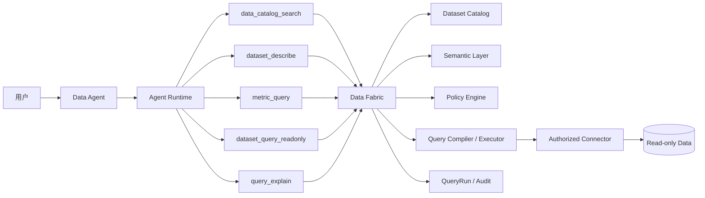
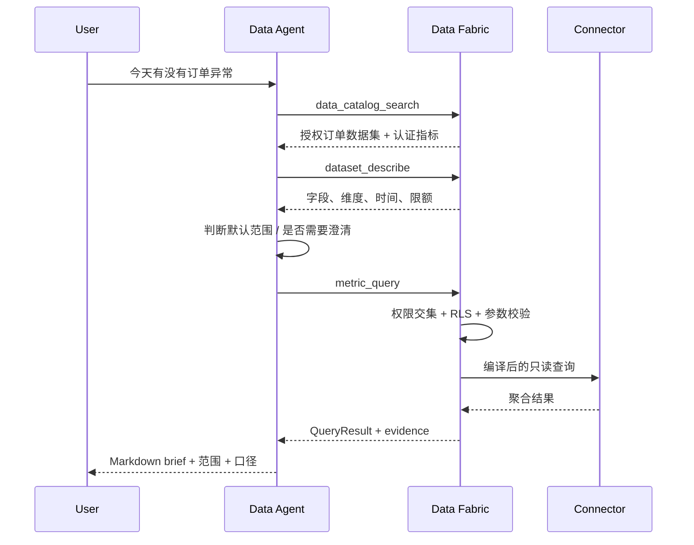

# Data Agent 通用数据问询技术设计

> 文档版本：v1.0  
> 状态：设计评审稿  
> 日期：2026-10-30  
> 产品口径：[data-agent-general-query-prd.md](./data-agent-general-query-prd.md)  
> 上级技术口径：[data-agent-context-assembly-design.md](./data-agent-context-assembly-design.md)  
> 目标：让 Data Agent 在无选区场景下发现、查询、验证和总结用户有权访问的数据

---

## 1. 决策摘要

1. 新增独立的受治理数据面 `dsh-collab-data-fabric`，不与 Data Agent 会话域混合。
2. Data Agent 通过工具访问数据，不直接连接数据库，不持有数据库凭据。
3. MVP 只支持认证指标和参数化聚合查询，不开放自由 SQL。
4. 数据目录只返回请求人有权知道的数据集、指标和维度。
5. 行级过滤、列级脱敏、查询限额由 data-fabric 服务端强制执行。
6. 无选区 ContextPack 不注入完整数据目录，只注入“存在可用数据能力”的范围摘要和工具入口。
7. Agent 先调用 `data_catalog_search`，再调用 `dataset_describe` / `metric_query`。
8. 宽泛低风险问题优先自动查询并返回 brief；口径冲突时才调用 `ask_user_question`。
9. 每次查询形成 QueryRun，查询结果形成可追溯 QueryResult。
10. 连接器、语义模型、认证指标和权限策略都有明确扩展契约。

## 2. 现状与缺口

### 2.1 现状

- Data Agent 只能通过 `entity_read` 读取显式分享的平台对象。
- `metric.query`、`dataset.query.readonly` 只存在于产品设计、模版工具白名单和 Prompt，没有真实 Provider。
- 工作台指标目前来自静态种子数据，不是可查询数据源。
- `DataAgentWorkspaceConfig.dataConnectionIds` 已存在，但没有数据目录、连接器解析或查询执行链路。
- 无选区时 ContextPack 中没有用户可访问数据范围摘要。

### 2.2 直接后果

用户提出“今天有没有订单异常”时，模型没有可调用工具可发现订单数据集，也没有指标语义和查询能力，只能说明缺少数据上下文。

### 2.3 设计判断

这是平台数据能力缺口，不是模型推理缺口。解决方案必须落在服务端数据目录、权限和查询执行层，而不仅是修改 SOUL 或 Prompt。

## 3. 总体架构



### 3.1 分层职责

| 层 | 职责 | 不负责 |
| --- | --- | --- |
| Data Agent | 理解问题、选择工具、澄清、总结和报告 | 数据库连接、权限判断、SQL 执行 |
| Agent Runtime | 提供模型、会话和工具执行通道 | 数据语义和业务口径 |
| Data Fabric | 目录、语义、权限、编译、执行和审计 | 聊天交互和报告表达 |
| Connector | 连接具体数据源并执行标准化查询 | 业务授权和 Prompt |

## 4. 插件与模块边界

### 4.1 新增插件：`dsh-collab-data-fabric`

建议新增独立插件，原因是：

- 数据目录和查询执行会被 Data Agent、工作台、未来 BI 助手复用；
- 数据连接凭据和权限引擎不应运行在聊天插件内；
- 需要独立升级和更严格的审计边界；
- 后续可拆为独立服务而不改变 Data Agent 契约。

领域名建议：`collab_data_fabric`。

核心服务：

- `DataConnectionService`
- `DatasetCatalogService`
- `SemanticMetricService`
- `DataPolicyService`
- `QueryPlanningService`
- `QueryExecutionService`
- `QueryRunService`

### 4.2 现有插件调整

- `dsh-collab-data-agent`：注册数据工具、编排澄清、展示 brief、关联报告。
- `dsh-collab-context`：增加无选区的 data scope 摘要与 QueryResult source refs。
- `dsh-collab-teammate`：模版声明工具需求，实例声明工作区数据配置。
- `dsh-collab-workbench`：真实指标从 Data Fabric 读取，静态种子只用于演示环境。
- `dsh-collab-resource-market`：可以展示数据连接器资源，但安装不自动授予数据访问权。

## 5. 数据模型

### 5.1 DataConnection

```ts
type DataConnection = {
  id: string;
  workspaceId: string;
  name: string;
  connectorType: "postgres" | "mysql" | "snowflake" | "bigquery" | "file" | string;
  credentialRef: string;
  status: "active" | "disabled" | "error";
  readOnly: true;
  maxRows: number;
  timeoutMs: number;
  networkPolicy?: Record<string, unknown>;
  createdAt: string;
  updatedAt: string;
};
```

约束：

- 凭据只保存 SecretRef，不写入 ContextPack、日志或前端；
- Connector 必须声明只读能力；
- 一个连接可以被多个数据集复用；
- 停用连接后不删除历史 QueryRun。

### 5.2 Dataset

```ts
type Dataset = {
  id: string;
  workspaceId: string;
  projectIds: string[];
  connectionId: string;
  name: string;
  description: string;
  physicalName: string;
  timeField: string;
  defaultGranularity: "hour" | "day" | "week" | "month";
  freshnessField?: string;
  fields: DatasetField[];
  dimensions: DatasetDimension[];
  semanticModelVersion: string;
  status: "draft" | "active" | "disabled";
};
```

字段至少包含：

```ts
type DatasetField = {
  id: string;
  physicalName: string;
  dataType: "string" | "number" | "boolean" | "datetime";
  role: "identifier" | "measure" | "dimension" | "time";
  sensitivity: "public" | "internal" | "sensitive" | "restricted";
  description?: string;
};
```

### 5.3 SemanticMetric

```ts
type SemanticMetric = {
  id: string;
  workspaceId: string;
  datasetId: string;
  name: string;
  synonyms: string[];
  definition: string;
  formulaVersion: string;
  aggregation: "count" | "sum" | "avg" | "rate" | "custom";
  expression: string;
  timeField: string;
  defaultDimensions: string[];
  requiredFilters?: Record<string, unknown>;
  certified: boolean;
  status: "draft" | "active" | "deprecated";
};
```

约束：

- `certified=true` 才能参与默认自动查询；
- `formulaVersion` 写入 QueryRun 和 ContextReceipt；
- Metric 更新不得覆盖历史 QueryRun；
- 非认证 Metric 可用于用户显式指定的探索，但必须标注。

### 5.4 DataPolicy

```ts
type DataPolicy = {
  id: string;
  workspaceId: string;
  datasetId: string;
  principalType: "user" | "workspace-role" | "project-role";
  principalId: string;
  rowFilter?: string;
  columnRules: Array<{
    fieldId: string;
    action: "allow" | "deny" | "mask";
    mask?: string;
  }>;
  maxRows: number;
  maxScannedBytes?: number;
  timeoutMs: number;
  version: string;
};
```

行过滤表达式不能由模型生成。它由数据管理员配置，并由 Query Compiler 安全注入。

### 5.5 QueryRun

```ts
type QueryRun = {
  id: string;
  workspaceId: string;
  actorUserId: string;
  agentProfileId: string;
  conversationId?: string;
  agentRunId?: string;
  intentSummary: string;
  connectionId: string;
  datasetId: string;
  metricIds: string[];
  metricVersionSnapshot: Record<string, string>;
  normalizedQuery: Record<string, unknown>;
  policyVersionSnapshot: string[];
  status: "planned" | "running" | "succeeded" | "failed" | "timeout" | "cancelled";
  rowCount?: number;
  truncated?: boolean;
  dataCutoffAt?: string;
  durationMs?: number;
  errorCode?: string;
  errorMessage?: string;
  createdAt: string;
  endedAt?: string;
};
```

原始 SQL 可选择保存 hash 和脱敏摘要，不默认保存完整 SQL；必要时由 Connector 提供受限 debug ref。

### 5.6 QueryResult

```ts
type QueryResult = {
  queryRunId: string;
  columns: Array<{ id: string; label: string; type: string }>;
  rows: Array<Record<string, string | number | boolean | null>>;
  aggregates: Record<string, number>;
  dimensions: Record<string, string | number>;
  samples?: Array<Record<string, unknown>>;
  rowCount: number;
  truncated: boolean;
  dataCutoffAt: string;
  freshness: string;
  evidence: string[];
  permissionSummary: string;
};
```

模型默认只消费聚合结果和有限 samples。大结果集必须转成摘要或 Artifact，不进入 Prompt。

## 6. 工具契约

产品级名称使用点号，Provider 注册时映射为下划线，例如 `data.catalog.search` → `data_catalog_search`。

### 6.1 `data.catalog.search`

输入：

```json
{
  "query": "订单异常",
  "workspaceId": "ws-1",
  "projectId": "project-1",
  "limit": 10
}
```

输出：

```json
{
  "datasets": [
    {
      "datasetId": "orders",
      "name": "订单事实表",
      "description": "交易订单、支付和履约状态",
      "metrics": ["order_exception_rate"],
      "dimensions": ["region", "category", "status"],
      "freshness": "10 分钟"
    }
  ],
  "permissionScope": "当前工作区 · 华东/华南",
  "hasMore": false
}
```

服务端只返回可发现且有读取可能的数据集；无权限对象不泄露名称。

### 6.2 `dataset.describe`

输入：`datasetId`。

输出：

- 字段；
- 时间字段；
- 维度；
- 数据新鲜度；
- 认证指标；
- 行级权限摘要；
- 可用聚合粒度；
- 查询限额。

### 6.3 `metric.query`

输入：

```json
{
  "metricIds": ["order_exception_count", "order_exception_rate"],
  "timeRange": { "from": "2026-10-30T00:00:00+08:00", "to": "2026-10-30T10:30:00+08:00" },
  "filters": { "region": ["east", "south"] },
  "groupBy": ["status", "region", "category"],
  "limit": 100
}
```

输出：QueryRun + QueryResult。

### 6.4 `dataset.query.readonly`

只允许语义层支持的 measure、dimension、filter 和 time range。

禁止：

- 原始 SQL 字符串；
- 任意函数；
- 跨数据集 join（首版）；
- 写入、DDL、存储过程和外部网络函数。

### 6.5 `query.explain`

返回：

- 将使用的连接、数据集和指标；
- 规范化时间与过滤；
- 预计行数和扫描量；
- 是否触发澄清；
- 是否需要审批。

`query.explain` 不执行真实数据查询。

## 7. 查询编排

### 7.1 标准流程



### 7.2 默认执行判定

自动执行必须同时满足：

1. 有且仅有一个高置信数据集或一个认证 Metric Group；
2. 默认时间可由用户问题和工作区时区确定；
3. 过滤和粒度可由已授权维度安全推断；
4. 查询成本低于工作区阈值；
5. 不需要跨数据集 join；
6. 不涉及对外报告或高风险决策。

任一条件不满足，进入澄清或拒绝路径。

### 7.3 澄清决策

服务端返回 `clarificationRequired`：

```ts
type ClarificationDecision = {
  required: boolean;
  reason:
    | "multiple-metric-definitions"
    | "scope-too-broad"
    | "permission-partial"
    | "cost-over-limit"
    | "dataset-ambiguous"
    | "time-range-ambiguous";
  question: {
    id: string;
    header: string;
    question: string;
    options: Array<{ label: string; description: string }>;
    multiSelect?: boolean;
  };
  defaultAssumption?: string;
};
```

Agent 通过原生 `ask_user_question` 展示，不在 Prompt 内自造第二套澄清 UI。

### 7.4 澄清后复用

会话中保存：

- 当前 dataset / metric；
- 规范化时间；
- 已确认过滤；
- 默认范围；
- QueryRun lineage。

后续“华东生鲜”只增加过滤，不要求用户重复完整范围。

## 8. 权限与安全

### 8.1 权限求交

```text
effectiveDatasetAccess =
  userWorkspaceMembership
  ∩ projectMembership
  ∩ datasetGrant
  ∩ rowPolicy
  ∩ columnPolicy
  ∩ profileResourceScopes
  ∩ connectionPolicy
```

### 8.2 强制执行点

1. Catalog Search：只索引用户可发现对象；
2. Dataset Describe：隐藏无权限字段；
3. Query Explain：展示脱敏后的范围和成本；
4. Query Compile：必须注入行过滤；
5. Result Normalize：列脱敏后再返回工具结果；
6. Report Render：只渲染模型已获准看到的数据；
7. Audit：记录策略版本，不记录敏感原值。

### 8.3 前端不是安全边界

前端传入的 workspaceId、projectId、datasetId、filter 只作为意图，服务端必须重新解析和校验。

## 9. ContextPack 设计

### 9.1 无选区场景

不注入数据集明细，只注入 `data-capability` section：

```text
[data-capability]
- workspace: <id>
- actor: <id>
- defaultTimezone: Asia/Shanghai
- dataQueryAvailable: true
- availableToolGroups: catalog, describe, query, explain
- requirement: 必须通过工具发现和查询，不在回答中编造数据
```

如果没有任何可用连接：

```text
- dataQueryAvailable: false
- reason: no-authorized-connection
```

### 9.2 QueryResult 回写

工具结果可形成：

- `query-run` SourceRef；
- `dataset` SourceRef；
- `metric` SourceRef；
- Report 的 evidence；
- ContextReceipt 的 tool result 摘要。

不把完整 QueryResult 写入永久 ContextPack；保存引用和摘要。

## 10. 可扩展性设计

### 10.1 Connector SPI

```ts
interface DataConnector {
  readonly type: string;
  readonly capabilities: {
    readonly describe: boolean;
    readonly query: boolean;
    readonly explain: boolean;
  };
  validateConfig(config: unknown): Promise<void>;
  testConnection(config: ConnectorConfig): Promise<ConnectionHealth>;
  compile(
    query: SemanticQuery,
    context: CompileContext,
  ): Promise<CompiledQuery>;
  execute(
    query: CompiledQuery,
    context: ExecutionContext,
  ): Promise<ConnectorResult>;
}
```

扩展方式：

- 新增 Connector 代码插件；
- 在资源市场注册连接器 manifest；
- 工作区管理员配置连接和凭据引用；
- 数据集与指标通过配置创建；
- Data Agent 不感知数据库类型。

### 10.2 Dataset / Metric Adapter

不同业务域通过语义模型扩展，不修改 Agent Prompt：

- 订单域：订单、支付、取消、履约；
- 供应链域：库存、供应商、采购；
- 项目域：任务、工时、交付；
- 会议域：会议、行动项、决策。

新增领域主要增加：

- Dataset 定义；
- Metric 定义；
- Dimension 与同义词；
- Access Policy；
- 可选领域 Skill。

### 10.3 工具能力发现

Runtime 只向 Agent 暴露当前 Workload 实际具备的工具：

- 没有连接器执行器时不暴露 query 工具；
- 没有 catalog 时不声称可发现数据；
- 外部 Runtime 不支持的工具不得由模版白名单强行伪造。

## 11. 配置与代码边界

### 11.1 配置实现

| 配置 | 归属层 | 说明 |
| --- | --- | --- |
| builtin / external | Runtime Profile | 执行通道 |
| model / reasoning | Runtime Profile | 不改变数据权限 |
| allowedTools | Runtime Profile + 模版约束 | 只能收窄，不能越权扩权 |
| resourceScopes | Runtime Profile | 工作区、项目、dataset authorized |
| SOUL / goals / scenarios | 智能体模版 | 分析与沟通行为 |
| output contract | 智能体模版 | brief / report / HTML |
| clarification policy | 智能体模版 | 默认自动与澄清条件 |
| 数据连接、默认范围、时区 | AI伙伴实例 / 工作区配置 | 使用偏好 |
| dataset / metric / dimension | Data Fabric 配置 | 领域语义 |
| RLS / column mask / quota | Data Fabric 配置 | 数据治理 |
| subscription / preferred metrics | AI伙伴实例 | 个人/工作区偏好 |

详细说明：

- [Runtime Profile 配置说明](./data-agent-runtime-configuration.md)
- [智能体模版配置说明](./data-agent-template-configuration.md)
- [AI伙伴实例配置说明](./data-agent-ai-partner-configuration.md)

### 11.2 代码实现

| 能力 | 原因 |
| --- | --- |
| Connector drivers | 需要协议、认证和数据库 SDK |
| Query compiler | 必须保证参数化和安全 |
| RLS injection | 安全边界不能交给配置文本 |
| Permission resolver | 需要服务端权威授权 |
| Result normalizer | 统一脱敏、截断和错误 |
| QueryRun persistence | 审计和可复现 |
| Tool registration | Runtime 能力边界 |
| Approval / Action Ticket | 写操作和敏感动作 |
| UI components | 澄清、scope chip、查询进度和证据面板 |
| Python extension adapter | 高级连接器和数据处理 |

### 11.3 禁止配置化

以下内容不得通过普通模版、Prompt 或实例设置覆盖：

- 关闭 RLS；
- 扩大用户数据权限；
- 开放自由 SQL；
- 忽略查询限额；
- 删除 QueryRun 审计；
- 修改系统 Agent 保护；
- 自动执行写操作。

## 12. API 草案

Data Fabric：

| 方法 | 路径 | 说明 |
| --- | --- | --- |
| GET | `/api/collab/data-fabric/connections` | 列出授权连接 |
| POST | `/api/collab/data-fabric/connections/test` | 测试连接 |
| GET | `/api/collab/data-fabric/catalog/search` | 权限感知搜索 |
| GET | `/api/collab/data-fabric/datasets/:id` | 数据集摘要 |
| POST | `/api/collab/data-fabric/metrics/query` | 执行认证指标 |
| POST | `/api/collab/data-fabric/datasets/query` | 参数化聚合 |
| POST | `/api/collab/data-fabric/query/explain` | 预检 |
| GET | `/api/collab/data-fabric/query-runs/:id` | 查询审计 |

Data Agent：

| 方法 | 路径 | 变更 |
| --- | --- | --- |
| POST | `/api/collab/data-agent/query` | 支持无选区 general query |
| GET | `/api/collab/data-agent/conversation` | 返回 queryRuns 与 scope 摘要 |
| POST | `/api/collab/data-agent/report` | 基于同一 QueryResult 生成报告 |

## 13. 错误模型

| 错误码 | 行为 |
| --- | --- |
| `no_authorized_dataset` | 说明没有可访问数据，并提供配置/治理入口 |
| `dataset_ambiguous` | 展示候选范围，要求选择 |
| `metric_definition_conflict` | 展示认证口径，要求确认 |
| `permission_partial` | 返回授权子范围，明确未覆盖范围 |
| `query_cost_exceeded` | 不执行，提供缩小范围建议 |
| `query_timeout` | 返回已完成阶段和可重试条件 |
| `connector_unavailable` | 说明连接状态，不暴露凭据 |
| `result_truncated` | 返回聚合摘要和截断说明 |
| `policy_denied` | 直接拒绝，不降级为无数据 |

## 14. 测试策略

### 14.1 单元测试

- 权限交集；
- 语义查询参数校验；
- RLS 注入；
- 列脱敏；
- 时间范围规范化；
- 自动查询与澄清判定；
- Connector compile / execute 契约；
- QueryRun 状态机。

### 14.2 契约测试

- Agent 工具 schema；
- Data Fabric API；
- Runtime 工具白名单映射；
- ContextPack `data-capability` 与 QueryResult SourceRef；
- 模版要求工具与 Runtime 实际工具的兼容性。

### 14.3 集成测试

- 订单域从 catalog 到 brief 的闭环；
- 多口径触发澄清；
- 部分权限范围；
- 无数据、超时、截断和连接失败；
- 报告复用 QueryResult。

### 14.4 GUI 测试

- 无选区输入“今天有没有订单异常”；
- 进度、scope chip、brief 和 Markdown；
- 澄清卡与默认范围继续；
- 按区域/品类下钻；
- 无权限和数据缺口；
- 生成报告；
- 移动端和错误状态。

## 15. 两步实施

实现严格分为：

1. 产品相关模块能力建设；
2. 订单 MVP。

### 15.1 第一步：产品模块能力建设

#### 15.1.1 数据面基础设施

- 创建 `dsh-collab-data-fabric`；
- 定义 DataConnection、Dataset、SemanticMetric、DataPolicy、QueryRun、QueryResult；
- 实现领域存储、状态机和审计；
- 实现 Connector SPI 和 Fixture Connector；
- 实现权限感知的 catalog search 和 dataset describe。

#### 15.1.2 查询执行链路

- 实现语义查询参数 schema；
- 实现 query explain；
- 实现 metric query 和 dataset query read-only；
- 实现 RLS 注入、列脱敏、时间规范化、限额、超时和结果截断；
- 实现 QueryRun 状态机和 QueryResult 正常化；
- 实现 Provider-safe 工具注册。

#### 15.1.3 Agent 与 Context

- 注册数据目录、describe、explain 和 query 工具；
- 无选区 ContextPack 增加 `data-capability`；
- 实现自动查询与结构化澄清判定；
- 实现 QueryResult SourceRef 和 ContextReceipt；
- 实现 scope chip、查询进度、证据和错误状态；
- 保证不分享卡片时可以完成通用数据问询。

#### 15.1.4 三层配置

- Runtime Profile 增加数据工具、resource scope 和查询预算；
- 智能体模版增加 capability refs、clarification policy 和 output policy；
- AI伙伴实例和工作区配置接入真实数据连接、默认范围、指标偏好和查询上限；
- 增加配置校验、revision、Reset 和兼容性检查。

#### 15.1.5 测试

- Fixture Dataset 覆盖 string/number/time/dimension/measure；
- 权限交集、RLS、列脱敏、超时、截断和冲突；
- 工具契约和外部 Runtime 能力发现；
- Agent 无选区问询 GUI；
- 澄清、下钻、无数据和无权限；
- 配置三层优先级与 Reset。

第一阶段退出条件：

- Fixture Dataset 完成 discovery → describe → explain → query → brief；
- Data Agent 核心链路中没有订单表和订单专用 Prompt；
- 权限和审计闭环完整；
- 订单域只需新增 Connector/配置/Skill 即可接入。

### 15.2 第二步：订单 MVP

#### 15.2.1 订单数据接入

- 实现订单 Connector 或接入内部只读订单服务；
- 配置订单物理表和字段映射；
- 配置行级区域/组织范围和列脱敏；
- 配置数据新鲜度和查询限额。

#### 15.2.2 订单语义层

配置：

- `order_count`；
- `paid_order_count`；
- `payment_failure_rate`；
- `cancel_rate`；
- `fulfillment_timeout_rate`；
- `order_exception_count`；
- `order_exception_rate`；
- 区域、品类、状态、支付方式、渠道、商家维度；
- 下单时间和履约时间口径。

#### 15.2.3 订单 Agent Skill

增加版本化订单 Skill：

- 用户问题到订单意图映射；
- 默认异常口径；
- 默认对比规则；
- 默认下钻顺序；
- 订单 brief 结构；
- 澄清选项文案。

Skill 不实现权限、SQL 或查询执行。

#### 15.2.4 工作台与报告

- 将工作台订单指标迁移到 Data Fabric；
- 标记并隔离演示种子；
- 报告复用 QueryResult；
- HTML 派生复用报告快照，不重新查询。

#### 15.2.5 订单 GUI E2E

- 无选区输入“今天有没有订单异常”；
- 默认 brief、范围、口径和截止时间；
- 按区域、品类下钻；
- 部分权限和口径冲突；
- 超时、截断和连接失败；
- 正式报告和移动端。

第二阶段退出条件：

- 真实权限范围内订单问询闭环；
- 全部结果带 QueryRun 和 evidence；
- 无数据和无权限不产生猜测；
- 工作台和 Data Agent 使用同一认证指标；
- 核心 Data Fabric、工具、ContextPack 和权限协议不需要结构性修改。

### 15.3 实施顺序

```text
Data Fabric 领域与存储
  → Fixture Connector / Catalog / Describe
  → Query Explain / Query Execution / QueryRun
  → Agent 工具与 ContextPack
  → 默认 brief / 澄清 / 证据 UI
  → Runtime / Template / Instance 配置
  → 产品模块自动化验收
  → 订单 Connector
  → 订单 Dataset / Metric / Policy / Skill
  → 订单 brief / 报告 / 工作台迁移
  → 订单 GUI E2E
```

### 15.4 阶段门禁

1. 第一阶段未完成查询工具真实实现前，不接订单真实数据。
2. 第二阶段不得为了订单特例修改通用工具 schema、ContextPack 核心结构或权限引擎。
3. 订单专用逻辑必须位于 Connector 配置、Dataset、Metric、Policy、Skill 和 UI 显示层。
4. 如果订单接入需要跨数据集自由 SQL、额外权限旁路或第二套审计，必须回到第一阶段重新设计。
5. 两阶段都以 fail closed 为默认：Runtime、权限、连接或指标不可用时拒绝给出数据结论。

## 16. 风险与缓解

| 风险 | 缓解 |
| --- | --- |
| 默认范围导致误读 | 所有 brief 明示范围、默认口径和截止时间 |
| 自由 SQL 绕过权限 | 不开放原始 SQL，服务端编译器注入 RLS |
| 语义指标版本漂移 | QueryRun 固化 metricVersion |
| 大结果进入上下文 | 聚合优先、samples 限量、Artifact 存储 |
| Connector 扩展失控 | 固定 SPI、manifest、能力和协议校验 |
| 管理员误以为有全量数据 | 平台角色与数据授权分层展示 |
| 静态演示数据混入真实结果 | 数据集状态和 `demo` 标记，禁止生产查询使用 |
| 多口径冲突 | 认证 Metric 分组，冲突时结构化澄清 |
| 外部 Runtime 工具不支持 | capability discovery，拒绝不可执行工具 |

## 17. PRD 对应关系

| PRD 章节 | 技术实现 |
| --- | --- |
| 通用问题直接 brief | catalog → describe → metric query → result normalize |
| 结构化澄清 | ClarificationDecision + ask_user_question |
| 权限范围 | Policy Engine + RLS + column mask |
| 订单 MVP | orders dataset + certified metrics |
| 证据与审计 | QueryRun + SourceRef + ContextReceipt |
| 配置/代码边界 | data-fabric、runtime、template、instance 四层 |
| 扩展性 | Connector SPI + Dataset/Metric 配置 |
