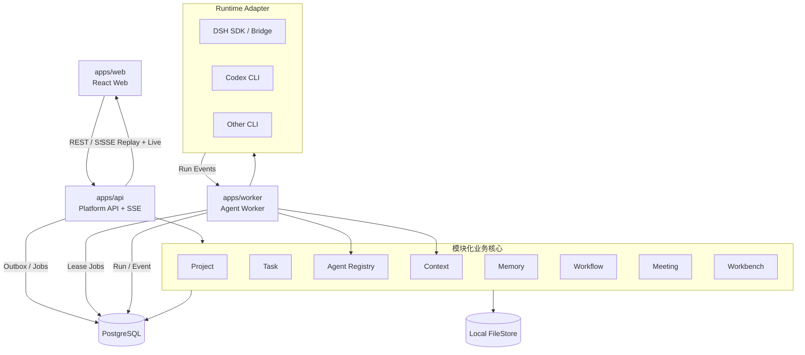
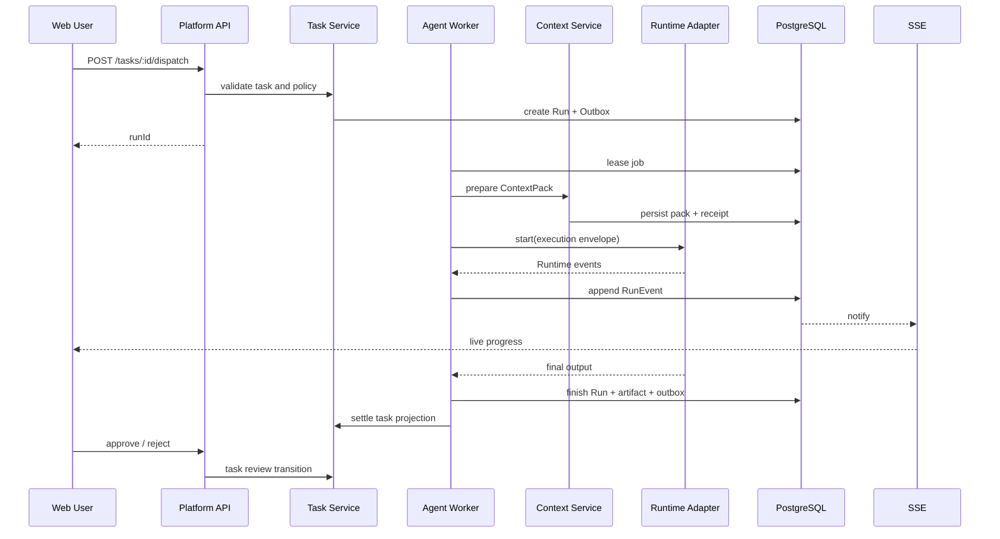

# 技术设计：Pluginmax 工程化平台 V1

> 版本：v1.1
>
> 日期：2026-10-25
>
> 状态：工程化改造基线，供实现、任务拆分和验收共同引用
>
> 适用范围：从当前 DSH 插件集合演进为可独立运行、可持续扩展的本地优先平台
>
> 本次更新：纳入新项目创建、源码复制、Git/依赖/运行数据隔离、验收与回滚方案
>
> 关联设计：
>
> - [Agent 任务控制与动态 AI 团队总体架构](./technical-design-agent-task-control-overall.md)
> - [阶段一 Runtime Agent Execution Plan 闭环](./technical-design-phase1-agent-execution-plan.md)
> - [外部 Agent Teammates 技术设计](./external-agent-teammates-technical-design.md)

## 0. 结论

V1 不重写业务能力，而是把当前“DSH 插件内运行的产品”重构为：

```text
独立 Web 应用
    → Platform API
    → 领域应用服务
    → PostgreSQL

Task / Chat / Workflow
    → Agent Gateway
    → Agent Worker
    → Runtime Adapter
    → DSH / Codex / 其他外部 CLI
```

目标形态是：

> **模块化单体业务核心 + 独立 Agent 执行 Worker + PostgreSQL 数据面 + 独立 Web 客户端。**

V1 的核心判断：

1. **先稳定平台 API 和领域模型，再迁移 UI。** 不能只把当前 DSH Client Bundle 换一个页面外壳。
2. **继续采用模块化单体。** V1 不拆微服务，不引入 Kafka、Redis、Temporal 或分布式事务。
3. **PostgreSQL 是平台结构化业务数据的唯一事实源。** 当前 JSON Storage Domain 只作为迁移来源，DSH Session 继续保存 Runtime 原始运行事实。
4. **文件先使用本地 FileStore Adapter。** 业务代码只依赖文件接口，后续可平滑切换 S3/MinIO。
5. **DSH 继续作为 Agent 执行引擎，而不是产品 UI 和业务后端。**
6. **Web 不直接调用 DSH。** 所有 Agent 调用统一经过 Agent Gateway 和 Runtime Adapter。
7. **执行过程可见性是 V1 核心能力。** 任务输入、上下文、状态、计划、工具、子 Agent、输出和交付物必须可追踪。
8. **V1 暂不做认证与多租户。** 但领域模型保留 `actorId`、`ownerId` 和 `createdBy`，避免后续重新改业务模型。

## 1. 目标与非目标

### 1.1 目标

- 提供完全独立的浏览器 Web 应用，不依赖 DSH Shell、Client Bundle、Slot 或页面路由。
- 将项目、任务、AI 伙伴、Run、上下文和记忆数据落入 PostgreSQL。
- 通过稳定 HTTP API 支持未来 Web、桌面端、SDK、自动化 Agent 和开放平台复用。
- 提供独立 Agent Gateway，统一管理任务派发、上下文装配、Runtime 选择、运行状态、取消、重试和事件。
- 在任务页、聊天框和 Run 详情中实时展示执行输入、当前进展、工具活动和输出。
- 保留 DSH 的内置 Agent、外部 CLI、Session 和事件能力，不修改 DSH 上游源码。
- 让项目、任务、Agent 和工作流按领域扩展，避免继续把业务逻辑堆在大型 `index.ts` 中。
- 支持当前单机部署，并为后续 PostgreSQL 托管、对象存储、多租户和独立 Worker 扩展留出边界。

### 1.2 V1 非目标

- 用户注册、SSO、OIDC、多租户和组织计费。
- 公网开放部署和跨主机 Agent 调度。
- 对象存储、分布式缓存和消息中间件。
- 高可用、读写分离、跨区域容灾。
- Task Team、Lead Agent 动态组队和 Task Delivery Plan。
- 完整重写所有工作流与会议功能。
- 展示模型原始思维链。平台只展示模型显式输出的计划摘要、工具调用和结果。
- 保证所有外部 Runtime 都提供同等粒度的执行事件。
- 修改 `vendor/deepseek-harness`。

## 2. 当前架构与主要改造点

### 2.1 当前架构

当前系统是可运行的插件化单体：

- DSH Web Shell 负责页面和导航。
- 每个 `dsh-collab-*` 插件负责 Host 服务、HTTP Route、Client Bundle 和 Storage Domain。
- 结构化数据存入 `$DSH_HOME/storages/*.json`。
- Agent Run 主要使用 DSH 内置 Session 或本地 CLI 子进程。
- 跨插件协作主要使用 `ctx.provide()`、`ctx.get()` 和进程内 `ctx.emit()`。

该结构适合快速验证，但不适合作为独立产品长期演进：

- 页面与 DSH Client Bundle 强绑定。
- JSON Storage Domain 缺少关系查询、事务、索引和高频写入能力。
- 业务服务、HTTP Route 和存储逻辑大量集中在单个入口文件。
- Agent 长任务依赖 Web 宿主进程生命周期。
- Run 事件、SSE 和恢复能力缺少统一平台契约。

### 2.2 不能直接照搬的部分

- 不迁移 DSH `__ModuleLoader__` 和 Shell Slot 机制。
- 不把 `/api/collab/*` 原样暴露为产品公共 API。
- 不把 DSH Session Event 直接暴露给 Web。
- 不允许新 Web 解析 DSH Runtime 私有对象或存储文件。
- 不继续使用“一个插件一个 JSON 文件”作为平台数据架构。

### 2.3 应保留的部分

- 项目、任务、工作流、会议、AI 伙伴、Context、Memory 的领域边界。
- `TaskExecutionPolicy`、`RuntimeCapabilityProfile`、`ExecutionEnvelope`、`RunEvent`、`ExecutionGate` 等已有契约。
- “Preflight → ContextPack → Run → Gate → Review → Memory”的执行思想。
- DSH Session 的会话隔离和事件持久化能力。
- 零上游修改原则。

## 3. 总体架构



### 3.1 部署单元

V1 推荐三个业务进程：

| 部署单元      | 职责                                   | 是否必须独立             |
| ------------- | -------------------------------------- | ------------------------ |
| `apps/web`    | 页面、交互、SSE 展示                   | 可以作为静态资源独立部署 |
| `apps/api`    | 认证接入层、REST、SSE、领域编排        | 独立进程                 |
| `apps/worker` | Agent Job、Runtime 生命周期、Run Event | 独立进程                 |

开发环境允许 `api` 和 `worker` 通过同一命令启动不同模式，但生产部署应分开，避免长任务占用 Web API 进程。

### 3.2 基础设施

V1 只引入：

- PostgreSQL。
- 本地文件目录。
- PostgreSQL Outbox 与数据库任务队列。
- DSH 或其他 Runtime 子进程。

不引入：

- Redis。
- Kafka / NATS。
- Temporal。
- 独立向量数据库。

高频任务量出现后，再将数据库队列替换为专用 Queue，但 Job 与 Run Event 契约不变。

## 4. 仓库结构

建议演进为：

```text
apps/
  web/                        独立 React Web
  api/                        HTTP API、SSE、BFF
  worker/                     Agent 调度与 Runtime 管理

packages/
  contracts/                  Zod DTO、事件、错误码、OpenAPI Schema
  database/                   Schema、Migration、Repository
  domain/                     领域模型、状态机、领域服务
  application/                用例、事务编排、Outbox
  agent-runtime/              Runtime Adapter、DSH、Codex、事件归一化
  files/                      FileStore 接口和 LocalFileStore
  ui/                         设计系统与通用组件
  config/                     环境配置、日志、Feature Flags

docs/
  engineering-platform-v1-technical-design.md
```

`packages/domain` 和 `packages/application` 内部继续按领域分目录：

```text
packages/domain/src/
  project/
  task/
  agent/
  context/
  memory/
  workflow/
  meeting/
  workbench/
```

每个模块只允许：

- import `@pluginmax/contracts`。
- import 本模块内部文件。
- 通过 `application` 中定义的 Port 调用其他模块。

禁止：

- 从另一个模块 import 数据库表或 Repository。
- API 直接写 SQL。
- UI 直接依赖数据库 DTO。
- Agent Runtime 直接修改 Task 状态。

## 5. 独立 Web 应用设计

### 5.1 技术选型

- React + Vite。
- TanStack Router。
- TanStack Query。
- 平台设计系统 `@pluginmax/ui`。
- 基于 OpenAPI/Schema 生成的 TypeScript API Client。
- SSE 使用 `fetch` 流或 `EventSource` 兼容封装。
- E2E 使用 Playwright。

不选择 Next.js 作为 V1 默认方案。当前产品是工作台型应用，没有明显 SEO 和服务端渲染需求，Vite SPA 更简单。

### 5.2 页面结构

```text
/
  workbench
  projects
    :projectId
  tasks
    :taskId
  chat
    :conversationId
  agents
    :agentId
  runs
    :runId
  workflows
  meetings
  settings
```

页面只负责：

- 数据查询和缓存。
- 用户交互。
- 表单校验。
- 展示 API 返回的领域状态。
- 订阅 Run Event。

页面不负责：

- 决定 Agent 是否可执行。
- 自行拼接 Prompt。
- 自行轮询 Runtime。
- 直接访问本地文件路径。
- 复制业务状态机。

### 5.3 UI 边界

Web 使用统一的 `PlatformApiClient`：

```ts
interface PlatformApiClient {
  projects: ProjectApiClient;
  tasks: TaskApiClient;
  agents: AgentApiClient;
  runs: RunApiClient;
  contexts: ContextApiClient;
}
```

所有请求使用 `/api/v1` 前缀。UI 不允许直接使用 `/api/collab/*`。

## 6. Platform API 设计

### 6.1 API 约定

- REST + SSE。
- 版本前缀 `/api/v1`。
- JSON 请求和响应。
- 所有写接口支持 `Idempotency-Key`。
- 所有查询支持显式分页。
- UTC ISO 时间。
- 错误使用稳定错误码，不依赖错误文案判断。
- OpenAPI 由 Zod Contract 生成。

统一错误：

```ts
interface ApiError {
  code: string;
  message: string;
  requestId: string;
  details?: Record<string, unknown>;
}
```

统一命令上下文：

```ts
interface RequestContext {
  requestId: string;
  actorId: string;
  workspaceId?: string;
}
```

V1 暂不实现登录。开发环境提供固定 Local Actor，但该 Actor 必须通过中间件注入，不能散落在业务服务中。

### 6.2 首批 API

```text
GET    /api/v1/projects
POST   /api/v1/projects
GET    /api/v1/projects/:projectId
PATCH  /api/v1/projects/:projectId

GET    /api/v1/tasks
POST   /api/v1/tasks
GET    /api/v1/tasks/:taskId
PATCH  /api/v1/tasks/:taskId
POST   /api/v1/tasks/:taskId/messages
POST   /api/v1/tasks/:taskId/dispatch
POST   /api/v1/tasks/:taskId/review

GET    /api/v1/agents
POST   /api/v1/agents
GET    /api/v1/agents/:agentId
PATCH  /api/v1/agents/:agentId

GET    /api/v1/runtimes
POST   /api/v1/runtimes
POST   /api/v1/runtimes/:runtimeId/probe

GET    /api/v1/runs
GET    /api/v1/runs/:runId
GET    /api/v1/runs/:runId/events
GET    /api/v1/runs/:runId/stream
POST   /api/v1/runs/:runId/cancel
POST   /api/v1/runs/:runId/retry

GET    /api/v1/runs/:runId/input
GET    /api/v1/runs/:runId/context
GET    /api/v1/runs/:runId/artifacts
```

### 6.3 API 分层

```text
HTTP Route
  → Request Validation
  → Application Use Case
  → Domain Service
  → Repository / Transaction
  → Outbox Event
```

HTTP Route 不直接调用 `AgentRuntimeAdapter`。任务派发通过 Application Service 写入 Run 和 Outbox，由 Worker 执行。

## 7. PostgreSQL 数据设计

### 7.1 基本原则

- 一个 PostgreSQL 数据库，一个初始 Schema。
- 表按领域所有权划分。
- 主键使用平台生成的可排序 ID 或 UUID。
- 所有业务表包含 `created_at`、`updated_at`。
- 可变聚合包含 `version`，写操作使用乐观锁。
- 跨领域不共享 Repository。
- JSONB 用于整体读取的策略、快照和扩展字段，不用于替代所有关系建模。
- 正式 Migration 文件进入版本控制，不允许启动时自动改表。

### 7.2 首批表

```text
workspace
project
project_member

agent
agent_version
runtime
runtime_capability_snapshot

task
task_message
task_acceptance
task_link

run
run_input_snapshot
run_event
run_plan
run_plan_step
execution_gate
run_artifact

context_pack
context_receipt
scene_session

project_memory
project_claim
project_truth
agent_episode
handoff_card
memory_review

domain_outbox
job
idempotency_key
```

### 7.3 表结构示例

```sql
CREATE TABLE run (
  id UUID PRIMARY KEY,
  project_id UUID NOT NULL REFERENCES project(id),
  task_id UUID REFERENCES task(id),
  agent_id UUID NOT NULL REFERENCES agent(id),
  runtime_id UUID NOT NULL REFERENCES runtime(id),
  status TEXT NOT NULL,
  trigger TEXT NOT NULL,
  input_snapshot_id UUID,
  context_pack_id UUID,
  plan_id UUID,
  idempotency_key TEXT NOT NULL,
  attempt INTEGER NOT NULL DEFAULT 1,
  version INTEGER NOT NULL DEFAULT 1,
  started_at TIMESTAMPTZ,
  ended_at TIMESTAMPTZ,
  error_code TEXT,
  created_by TEXT NOT NULL,
  created_at TIMESTAMPTZ NOT NULL,
  updated_at TIMESTAMPTZ NOT NULL,
  UNIQUE (idempotency_key)
);

CREATE TABLE run_event (
  id UUID PRIMARY KEY,
  run_id UUID NOT NULL REFERENCES run(id),
  seq BIGINT NOT NULL,
  type TEXT NOT NULL,
  visibility TEXT NOT NULL,
  summary TEXT NOT NULL,
  data JSONB,
  source TEXT NOT NULL,
  source_event_id TEXT,
  raw_ref TEXT,
  created_at TIMESTAMPTZ NOT NULL,
  UNIQUE (run_id, seq)
);

CREATE INDEX run_event_run_seq_idx ON run_event(run_id, seq);
```

### 7.4 数据所有权

| 领域      | 拥有的表                                               |
| --------- | ------------------------------------------------------ |
| Project   | workspace、project、project_member                     |
| Task      | task、task_message、task_acceptance、task_link         |
| Agent     | agent、agent_version、runtime、capability              |
| Execution | run、run_event、run_plan、gate、artifact               |
| Context   | context_pack、context_receipt、scene_session           |
| Memory    | project_memory、claim、truth、episode、handoff、review |

其他模块可以读取投影，但写操作必须调用所有者 Application Service。

### 7.5 事务与 Outbox

一致性采用：

```text
业务写事务
  + domain_outbox.insert
  → commit
  → Worker 读取 Outbox
  → Queue / 内部消费者
```

禁止：

- 先 emit 内存事件，再写数据库。
- 跨领域直接开一个超大事务。
- 把 Task 完成、Run 完成和 Memory 写入绑定成分布式事务。

## 8. 文件存储

V1 使用本地文件，但必须通过接口访问：

```ts
interface FileStore {
  put(input: PutFileInput): Promise<FileRef>;
  get(ref: FileRef): Promise<ReadableStream>;
  stat(ref: FileRef): Promise<FileStat>;
  delete(ref: FileRef): Promise<void>;
  createDownloadUrl(ref: FileRef): Promise<string>;
}
```

`LocalFileStore`：

```text
data/
  files/
    <workspaceId>/
      <artifactId>/
        metadata.json
        content
```

要求：

- 所有路径先规范化，禁止目录穿越。
- 文件名与存储键分离。
- 下载接口由 API 代理或签发短期本地 URL。
- 文件哈希、大小、MIME、创建者写入数据库。
- 后续切换 S3/MinIO 只新增 Adapter，不修改 Task 或 Agent。

## 9. Agent Gateway

### 9.1 职责

Agent Gateway 是业务领域与 Runtime 之间的唯一桥接层：

- 接收 Run 请求。
- 校验 Agent、Runtime、执行策略和上下文。
- 生成 Execution Envelope。
- 将 Job 写入队列。
- 管理 DSH/外部 CLI 生命周期。
- 归一化 Runtime 事件。
- 持久化 Run、Run Event、Plan、Gate、Artifact。
- 提供取消、超时、重试和恢复。
- 向 Web 推送实时状态。

Agent Gateway 不负责：

- Task 业务状态。
- Project 成员关系。
- ContextPack 内部选择算法。
- Memory 当前真相判定。

### 9.2 Runtime Adapter 接口

```ts
interface AgentRuntimeAdapter {
  readonly id: string;

  capability(input: RuntimeProbeInput): Promise<RuntimeCapabilityProfile>;

  preflight(input: RuntimePreflightInput): Promise<RuntimePreflightResult>;

  start(input: AgentExecutionInput): AsyncIterable<RuntimeEvent>;

  cancel(runId: string): Promise<void>;

  resume?(input: AgentResumeInput): AsyncIterable<RuntimeEvent>;
}
```

`RuntimeEvent` 只描述 Runtime 事实，不能包含 Task 状态转换：

```ts
type RuntimeEvent =
  | RuntimeStarted
  | AssistantDelta
  | AssistantMessage
  | PlanSnapshot
  | ToolStarted
  | ToolResult
  | SubagentStarted
  | SubagentFinished
  | UsageReported
  | RuntimeWarning
  | RuntimeFailed
  | RuntimeCompleted;
```

### 9.3 DSH Adapter

V1 支持两种 DSH Adapter：

#### `DshSdkAdapter`

首选基线，使用：

```text
dsh --profile sdk
```

通过 TypeScript SDK 的 stdio JSON-RPC 驱动 DSH Runtime。公开通知包括：

- `session.event`
- `session.status`
- `subagent.started`
- `subagent.finished`

优点：

- 与独立 Web 完全解耦。
- Runtime 在独立子进程中运行。
- 有 Session、事件、子 Agent 和状态。
- 不依赖 DSH Web。

限制：

- 当前 SDK 公开协议主要转发持久 Session 事件，不直接暴露内部临时 token 流。
- 当前协议没有单 Session Cancel/Close，取消需要由 Worker 终止或回收 Runtime。

#### `DshStreamBridgeAdapter`

可选增强，在 DSH Worker 中增加轻量 out-of-tree 插件，订阅 `agent/assistant-stream`，转换为平台 `message.delta`。

用途：

- 实现接近当前 DSH 聊天框的 token 级输出。
- 继续向平台提供 `session.event`、状态和子 Agent 事件。

该 Adapter 不改变 Web 或 Task API。V1 可以先使用 `DshSdkAdapter`，在需要时启用 Bridge。

### 9.4 外部 Runtime

V1 保留：

- Codex JSONL。
- 通用 stdin/stdout plain-text。
- 其他命令型 Agent。

外部 Runtime 必须声明：

- 协议。
- 默认模型和模型池。
- 最大上下文。
- 工具能力。
- 是否支持结构化计划。
- 是否支持工具事件。
- 是否支持取消。
- 超时和最大回合。

UI 根据能力显示 `structured / summary / opaque`，不能把普通 stdout 伪装成结构化进度。

### 9.5 Job 与 Worker

V1 使用 PostgreSQL 任务队列：

- `job` 表保存待执行任务。
- Worker 使用 `FOR UPDATE SKIP LOCKED` 领取任务。
- Job 包含 `run_id`、租约、心跳、超时和重试次数。
- 同一 `run_id` 只允许一个活跃 Worker。
- Worker 崩溃后，过期租约可被重新领取。
- Runtime 成功结束后，Run 和 Task 回写通过 Outbox 完成。

不引入 Redis，降低部署成本。

### 9.6 并发与成本

默认限制：

```text
全局并发 Agent：2
单 Agent 并发 Run：1
默认任务超时：30 分钟
Runtime 进程空闲回收：10 分钟
普通 Run Event 批量写入：100ms
Token Delta 推送合并：50-100ms
```

这些值通过配置控制，不硬编码到任务或 Runtime 模型中。

## 10. Run 执行过程与可见性

### 10.1 用户可见信息

任务页、聊天框和 Run 详情共用同一套 Run 视图：

| 区域     | 展示内容                                 |
| -------- | ---------------------------------------- |
| 输入     | 用户消息、任务目标、验收标准、附件、引用 |
| 上下文   | ContextPack 摘要、来源、排除项、Reason   |
| 运行状态 | 排队、运行、等待审批、完成、失败、取消   |
| 进度     | Plan 阶段、步骤、工具调用、子 Agent      |
| 输出     | Assistant 流式文本、最终消息、结构化结果 |
| 交付物   | 文件、链接、引用、Artifact               |
| 运行事实 | Runtime、模型、耗时、Token、错误、预算   |

默认不展示完整 System Prompt。可提供折叠的高级调试视图，并受后续权限控制。

### 10.2 两类事件

```text
RunEvent
  durable / ordered / replayable
  计划、步骤、工具、审批、子 Agent、最终消息、Artifact、错误

RunDelta
  transient / best-effort / non-replayable
  Assistant 文本增量、临时进度
```

RunEvent 是事实源。RunDelta 只用于改善实时体验，不能作为审计依据。

### 10.3 首个事件契约

```ts
type PlatformRunEventType =
  | "run.queued"
  | "run.started"
  | "input.snapshot"
  | "context.ready"
  | "plan.snapshot"
  | "step.started"
  | "step.completed"
  | "step.failed"
  | "tool.started"
  | "tool.result"
  | "subagent.started"
  | "subagent.completed"
  | "approval.requested"
  | "approval.decided"
  | "artifact.created"
  | "progress.summary"
  | "warning"
  | "error"
  | "run.completed"
  | "run.failed"
  | "run.cancelled";
```

现有 `RunEvent` 契约可以继续使用，新增事件应保持向后兼容。

### 10.4 实时传输

推荐 API：

```text
GET /api/v1/runs/:runId/events?afterSeq=123
  返回历史 RunEvent

GET /api/v1/runs/:runId/stream?afterSeq=123
  建立 SSE，先补发 afterSeq 后的事件，再推送实时事件
```

规则：

- `run_event.seq` 在单个 Run 内单调递增。
- 每个 SSE 消息携带 `id`、`event`、`data`。
- 浏览器断线重连时使用最后 Seq 或 `Last-Event-ID`。
- 先写数据库，再推送；数据库写入失败时不能发送成功事件。
- RunDelta 不写 RunEvent，可合并发送。

示例：

```text
id: 42
event: run.event
data: {"seq":42,"type":"tool.started","summary":"查询供应商产能"}
```

### 10.5 刷新与恢复

页面刷新后：

1. 查询 Run 当前状态。
2. 拉取 `seq > afterSeq` 的历史事件。
3. 订阅 SSE。
4. 重建运行时间线。
5. 用最终 Assistant Message 覆盖临时 Delta 文本。

不依赖浏览器 Store 保存完整运行历史。

### 10.6 能力降级

每个 Run 必须展示 `observability` 元数据：

```ts
interface RunObservability {
  planVisibility: "structured" | "summary" | "opaque";
  toolEventCompleteness: "complete" | "partial" | "none";
  textStreaming: "delta" | "message" | "final-only";
  subagentVisibility: "structured" | "summary" | "none";
}
```

如果 Runtime 只输出最终文本，UI 应显示“当前 Runtime 不提供详细进度”，不能展示伪造步骤。

## 11. 任务执行链路



### 11.1 Run 状态机

```text
queued
  → running
  → waiting_approval
  → running
  → completed | failed | cancelled | timeout | interrupted
```

Task 状态与 Run 状态分离：

- Run 完成不等于 Task 验收完成。
- Run 完成后，Task 可以进入待 Review。
- Review 退回后生成新 Run，不覆盖旧 Run。

## 12. Context 与 Memory

### 12.1 Context

执行前生成不可变 ContextPack：

- 场景事实。
- Agent 身份快照。
- 任务定义。
- 项目记忆。
- Agent 私有记忆。
- 显式引用。
- 执行与来源策略。
- Runtime 上下文预算。

输出：

- ContextPack。
- ContextReceipt。
- 可读 prompt 摘要。
- 使用和排除的来源。

V1 不引入向量数据库，优先使用 PostgreSQL 全文检索、结构化标签和作用域过滤。

### 12.2 Memory

写入时机：

- Task Review 通过后。
- 会议纪要确认后。
- 工作流节点 Review 通过后。
- 人工显式写入后。

Memory 写入通过 Outbox 异步执行，失败可重试。不能因为 Memory 写入失败而回滚已完成的 Task 或 Run。

## 13. 本地认证与操作边界

V1 不做正式认证，但必须遵守：

- 默认只绑定 `127.0.0.1`。
- Local Actor 由中间件注入。
- API 不接受客户端传来的任意 `actorId` 作为可信身份。
- Runtime 命令只允许管理员配置或内置白名单。
- 不允许通过普通任务字段执行任意 shell。
- 文件路径必须经过 FileStore 解析。
- 环境变量和模型密钥不写入数据库明文。

预留未来认证点：

```text
RequestContext.actorId
  ← V1 LocalActorProvider
  ← 未来 OIDC / Session Provider
```

## 14. 可观测性

V1 至少记录：

- `requestId`。
- `runId`。
- `runtimeId`。
- `agentId`。
- `taskId`。
- Run 持续时间。
- Runtime 启动时间。
- 输出 Token。
- 重试次数。
- 错误码。

日志使用结构化 JSON。敏感字段、密钥和完整 System Prompt 默认脱敏。

后续增加 OpenTelemetry Trace：

```text
API request
  → run dispatch
  → context prepare
  → worker start
  → runtime process
  → tool event
  → task settle
```

## 15. 从当前系统迁移

### 15.1 迁移原则

采用绞杀式迁移：

```text
当前 DSH 插件
  + 新 Platform API
  + 新 Web
  → 核心功能逐域切换
  → 旧 UI 只读或下线
```

不采用：

- 一次性重写全部模块。
- 长期双写 JSON 和 PostgreSQL。
- 新旧 UI 各自维护一套业务规则。

### 15.2 数据迁移

每个领域提供 Export / Import：

1. 从现有 Storage Domain 读取全部记录。
2. 用现有 Zod Schema 校验。
3. 转换为新 DTO。
4. 保留原 ID。
5. 写入 PostgreSQL。
6. 对账数量、ID、状态和关键引用。
7. 将旧 JSON 标记为只读备份。

首批迁移：

- Project。
- Task。
- Agent / Runtime。
- Run / Run Event。

第二批迁移：

- Context / Memory。
- Workbench。

第三批迁移：

- Workflow。
- Meeting。

### 15.3 切换策略

每个领域按以下步骤切换：

1. 新 API 可用。
2. 新 Web 页面达到功能对齐。
3. 数据完成迁移和抽查。
4. 旧插件页面停止写入。
5. 观察一个稳定周期。
6. 删除旧写入路径。

DSH Session 仍是 Agent 运行事实的一部分。平台 Run 保存 `dsh_session_id` 和 `raw_ref`，不复制 DSH 全部内部结构。

## 16. 测试策略

### 16.1 单元测试

- 领域状态机。
- Task 和 Run 权限规则。
- Context 预算。
- Runtime Event 归一化。
- 文件路径安全。

### 16.2 契约测试

- API DTO。
- RunEvent Schema。
- SSE 消息格式。
- Migration。
- DSH Adapter 与伪 Runtime Adapter 行为一致。

### 16.3 集成测试

- PostgreSQL 事务与 Outbox。
- Worker 租约、重试和恢复。
- API + DB + Worker 完整任务执行。
- SSE 断线续传。
- 文件上传和下载。

### 16.4 E2E 测试

Playwright 覆盖：

1. 创建项目。
2. 创建 AI 伙伴并绑定 Runtime。
3. 创建任务。
4. 派发 Run。
5. 实时看到状态、工具和输出。
6. 完成并提交 Review。
7. 退回后生成新 Run。
8. 刷新页面后恢复 Run 时间线。

### 16.5 Runtime 测试

使用 FakeRuntimeAdapter 作为稳定 CI 基础：

- 固定事件序列。
- 可模拟慢速输出。
- 可模拟工具调用。
- 可模拟超时、失败、取消和重启。

真实 DSH/Codex 测试作为集成测试，不要求每次单元测试启动外部模型。

## 17. 部署与开发

### 17.1 本地开发

```text
docker compose up -d postgres
pnpm dev
  ├─ web
  ├─ api
  └─ worker
```

Env 示例：

```text
DATABASE_URL=postgres://...
FILE_STORE_ROOT=./data/files
DSH_BIN=...
DSH_PROFILE=sdk
WORKER_CONCURRENCY=2
LOCAL_ACTOR_ID=local-admin
```

### 17.2 单机部署

V1 支持 Docker Compose 或 systemd：

```text
web static
api process
worker process
postgres
local file volume
dsh runtime
```

API 默认只监听本机。若未来需要远程访问，必须先完成认证与网络安全设计。

## 18. 新项目创建与工程隔离

### 18.1 强制约束

新项目采用完整物理副本，在独立目录中建立独立 Git 仓库、依赖、构建产物和运行环境。

```text
原项目：
/Users/oliviayang/Codex/一切皆插件/dsh-pluginmax

新项目：
/Users/oliviayang/Codex/pluginmax-platform
```

原项目在迁移期间保持只读。原项目最终会被丢弃，但在新项目完成验证前，不得对原项目执行构建、安装、迁移或写入。

新项目与原项目不得共享：

- Git 仓库和 Git 元数据。
- `node_modules`、lockfile 和构建产物。
- `DSH_HOME`、Profile、Storage 和 Session。
- Web 端口、测试工作区和外部 Runtime 数据。
- 软链接、硬链接或 `link:` 依赖。

### 18.2 隔离范围

| 对象         | 原项目                 | 新项目                          |
| ------------ | ---------------------- | ------------------------------- |
| 源码         | 原目录，只读           | 完整物理副本                    |
| Git          | 原项目仓库             | 新项目独立仓库                  |
| 依赖         | 原项目 `node_modules`  | 新项目独立依赖                  |
| Lockfile     | 原项目 lockfile        | 复制后由新项目管理              |
| 构建产物     | 原项目 `lib/`、`dist/` | 新项目独立生成                  |
| DSH 数据     | 原项目 `DSH_HOME`      | 新项目 `.tmp/dsh-home-platform` |
| Profile      | 原项目 Profile         | 新项目独立 Profile              |
| Session      | 原项目 `sessions/`     | 新项目独立 `sessions/`          |
| Storage      | 原项目 `storages/`     | 新项目独立 `storages/`          |
| Web 端口     | 原实例端口             | 新端口，例如 `33127`            |
| 工作区       | 原业务工作区           | `.tmp/isolation-workspace`      |
| 外部 Runtime | 原运行配置             | 新目录、Mock 或测试凭证         |

### 18.3 记录原项目基线

在原项目中记录当前状态，不执行提交、stash、reset 或 checkout：

```bash
export SOURCE_ROOT="/Users/oliviayang/Codex/一切皆插件/dsh-pluginmax"
export TARGET_ROOT="/Users/oliviayang/Codex/pluginmax-platform"

cd "$SOURCE_ROOT"
git status --short > /tmp/pluginmax-original-status.txt
git rev-parse HEAD > /tmp/pluginmax-original-head.txt
```

确认目标目录不存在：

```bash
test ! -e "$TARGET_ROOT"
```

### 18.4 创建完整物理副本

复制源码、文档、配置模板和 `vendor/deepseek-harness` 源码，排除 Git 元数据、依赖、运行数据和构建产物：

```bash
mkdir -p "$TARGET_ROOT"

rsync -a \
  --exclude=".git" \
  --exclude=".git/" \
  --exclude="node_modules/" \
  --exclude=".pnpm-store/" \
  --exclude=".tmp/" \
  --exclude=".DS_Store" \
  --exclude="lib/" \
  --exclude="dist/" \
  --exclude=".env" \
  --exclude=".env.*" \
  --exclude=".credentials.yaml" \
  "$SOURCE_ROOT/" \
  "$TARGET_ROOT/"
```

复制规则：

- `.git` 和 `vendor/deepseek-harness/.git` 不复制。
- `node_modules` 不复制，由新项目独立安装。
- `lib/`、`dist/` 不复制，由新项目独立构建。
- `.tmp`、日志、上传文件、凭证和本地环境变量不复制。
- `package.json` 和 `pnpm-lock.yaml` 复制，用于固定初始依赖版本。

复制后检查：

```bash
test -f "$TARGET_ROOT/package.json"
test -f "$TARGET_ROOT/pnpm-lock.yaml"
test ! -e "$TARGET_ROOT/.git"
test ! -e "$TARGET_ROOT/node_modules"
test ! -e "$TARGET_ROOT/.tmp"
```

### 18.5 初始化独立 Git 仓库

```bash
cd "$TARGET_ROOT"
git init
git add .
git commit -m "chore: initialize isolated Pluginmax project"
```

新项目不设置原项目为 remote，不自动 merge。`.gitignore` 至少包含：

```text
node_modules/
.tmp/
.env
.env.*
.credentials.yaml
lib/
dist/
coverage/
playwright-report/
test-results/
```

### 18.6 配置独立运行环境

每个终端会话先设置：

```bash
export TARGET_ROOT="/Users/oliviayang/Codex/pluginmax-platform"
export DSH_HOME="$TARGET_ROOT/.tmp/dsh-home-platform"
export PLUGINMAX_SMOKE_HOME="$DSH_HOME"
export PLUGINMAX_SMOKE_PORT=33127
export CODEX_HOME="$TARGET_ROOT/.tmp/codex-home-isolation"

cd "$TARGET_ROOT"
```

要求：

- `DSH_HOME` 不得指向原项目。
- Web 端口不得与原实例冲突。
- 外部 Runtime 使用独立目录、测试账号或 Mock。
- 不复制原项目的正式凭证。
- 不通过请求参数覆盖 Runtime 或命令配置。

### 18.7 安装与构建

```bash
pnpm install --frozen-lockfile
pnpm build
```

如果复制后的 `vendor/deepseek-harness` 需要独立构建：

```bash
CI=true pnpm --dir vendor/deepseek-harness install --frozen-lockfile
CI=true pnpm --dir vendor/deepseek-harness build
```

如果当前阶段仍需运行旧 Pluginmax Profile 做兼容验证：

```bash
DSH_HOME="$DSH_HOME" ./scripts/install-profile.sh
```

该命令只能在新项目目录执行，且 `DSH_HOME` 必须指向新项目隔离目录。新平台 V1 的主流程不依赖旧 Profile；生产实现应逐步改为固定版本的 DSH SDK 依赖。

### 18.8 验证隔离

启动新项目后检查端口：

```bash
lsof -nP -iTCP:33127 -sTCP:LISTEN
```

确认监听进程来自新项目目录。

如果安装了 Profile，检查所有 `link:` 路径：

```bash
if test -f "$DSH_HOME/profiles/pluginmax/package.json"; then
  rg -n "link:" "$DSH_HOME/profiles/pluginmax/package.json"
else
  echo "Pluginmax Profile 尚未安装"
fi
```

路径必须位于新项目：

```text
/Users/oliviayang/Codex/pluginmax-platform
```

不得出现原项目路径：

```text
/Users/oliviayang/Codex/一切皆插件/dsh-pluginmax
```

检查运行数据目录：

```bash
mkdir -p "$DSH_HOME"
test -d "$DSH_HOME"
printf '%s\n' "$DSH_HOME"
```

输出必须位于：

```text
/Users/oliviayang/Codex/pluginmax-platform/.tmp/dsh-home-platform
```

验证原项目未变化：

```bash
cd "/Users/oliviayang/Codex/一切皆插件/dsh-pluginmax"
git rev-parse HEAD | diff - /tmp/pluginmax-original-head.txt
git status --short | diff - /tmp/pluginmax-original-status.txt
```

两个命令均无输出表示原项目 Git 状态未变化。同时确认：

- 原 Web 实例仍可访问。
- 原 Profile 未被重装。
- 原 Storage 和 Session 未出现新记录。
- 原工作区未出现测试文件。

### 18.9 开发规则与数据迁移

开发期间必须执行：

1. 所有安装、构建、测试和启动命令都在 `pluginmax-platform` 中执行。
2. 不修改原项目源码、Git 状态和运行数据。
3. 不通过 `link:`、软链接或硬链接引用原项目。
4. 不共享 `node_modules`、`DSH_HOME`、Storage、Session 或工作区。
5. 不在原项目中执行 `pnpm install`、`pnpm build` 或 `install-profile.sh`。
6. 需要旧代码时从原项目复制到新项目，复制后独立维护。
7. 新项目出现问题时停止新进程，不回滚或删除原项目数据。

正式数据迁移使用只读副本：

1. 从原项目导出数据副本。
2. 复制到新项目独立目录。
3. 在副本上执行迁移。
4. 对账记录数量、ID、状态和关键引用。
5. 保存迁移日志。
6. 迁移失败时丢弃副本，不影响原项目。

迁移脚本必须显式接收源目录和目标目录，不得使用隐式的当前用户数据目录。

### 18.10 回滚与验收

新项目回滚只操作新项目目录。必要时停止占用 `33127` 的进程，不得删除或重置原项目。

环境验收：

- [ ] 新项目位于独立目录。
- [ ] 新项目有独立 `.git` 和首次提交。
- [ ] 新项目有独立 `node_modules` 和 lockfile。
- [ ] 新项目构建产物只写入新目录。
- [ ] `DSH_HOME` 指向新项目隔离目录。
- [ ] Profile 的 `link:` 只指向新项目。
- [ ] Storage、Session、工作区与原项目不共享。
- [ ] Web 端口与原实例不同。
- [ ] 外部 Runtime 使用 Mock、测试账号或独立目录。
- [ ] 原项目 Git HEAD 和 `git status` 未变化。
- [ ] 原 Web、Profile、Storage 和 Session 未受影响。
- [ ] 回滚只需停止或删除新项目目录。

## 19. 实施阶段

### 阶段 A：工程骨架

- 建立 `apps/web`、`apps/api`、`apps/worker`。
- 建立 Contracts、Database、Domain、Runtime Adapter 包。
- PostgreSQL Schema 和 Migration。
- FakeRuntimeAdapter。
- 基础日志和错误码。
- CI：typecheck、lint、unit、integration、build。

验收：

- 三个进程可本地启动。
- Web 能调用 API。
- API 能写入 PostgreSQL。
- Worker 能处理一个 Fake Run。

### 阶段 B：核心业务迁移

- Project。
- Task。
- Agent / Runtime。
- Run / Run Event。
- FileStore。
- Workbench 基础聚合。

验收：

- 不依赖 DSH Web UI 可以创建项目、任务和 AI 伙伴。
- 任务可以派发 Fake Run。
- Web 可以显示 Run 状态和事件。

### 阶段 C：DSH Agent Gateway

- DshSdkAdapter。
- Worker 进程池。
- ContextPack。
- Execution Envelope。
- Run Event 持久化和 SSE。
- 取消、重试、恢复。

验收：

- DSH 执行真实任务。
- 任务页能展示输入、状态、工具、最终输出和交付物。
- 页面刷新后可恢复执行时间线。

### 阶段 D：上下文、记忆和流式增强

- Context / Memory 迁移。
- DshStreamBridgeAdapter。
- Assistant Delta。
- 来源和 Artifact 展示。
- 成本、Token 和运行事实。

验收：

- 能展示上下文回执。
- 能流式展示 Assistant 输出。
- Review 通过后完成 Memory 写入。

### 阶段 E：工作流、会议和旧 UI 下线

- Workflow。
- Meeting。
- 旧 Pluginmax Client Bundle 只读。
- 数据对账。
- 删除旧 JSON 写入路径。

验收：

- 新 Web 覆盖主要使用流程。
- 旧 DSH Web 不再承担产品 UI。
- 旧插件仅保留必要的 Runtime 兼容适配。

## 20. 风险与控制

| 风险                  | 影响             | 控制措施                                       |
| --------------------- | ---------------- | ---------------------------------------------- |
| 一次性重写范围过大    | 功能中断         | 采用绞杀式迁移，按领域切换                     |
| DSH Alpha 协议变化    | Agent 执行不稳定 | 固定版本、Adapter 隔离、契约测试               |
| SDK 不提供 token 级流 | 实时体验下降     | 先提供状态/工具/最终消息，再增加 Stream Bridge |
| Worker 崩溃           | Run 丢失         | PostgreSQL 租约、心跳、恢复和幂等              |
| JSON 迁移丢数据       | 历史不可用       | 导出、校验、对账、保留只读备份                 |
| 事件写入过多          | 数据库压力       | RunEvent 与 RunDelta 分离、批量写入            |
| UI 直接依赖 Runtime   | 扩展困难         | Web 只依赖平台 API 和统一 RunEvent             |
| 未做认证但开放网络    | 安全风险         | 默认仅绑定 localhost，保留 Actor 中间件        |

## 21. V1 验收标准

工程结构：

- Web、API、Worker 可独立启动。
- 领域代码不集中在新的大型 `index.ts`。
- 所有表通过 Migration 创建。
- API 有 OpenAPI Contract。
- Worker 与 API 不通过直接函数调用共享 Runtime 进程。

数据：

- 项目、任务、AI 伙伴和 Run 不依赖 JSON Storage Domain。
- 文件通过 FileStore 访问。
- 数据迁移可重复执行且可对账。

Agent：

- 任务可以派发到 DSH 和 Fake Runtime。
- 失败、取消、超时和重启可恢复。
- 同一任务重试生成新 Run。

可见性：

- 用户可以看到 Run 输入摘要。
- 用户可以看到当前状态和可用进度。
- 用户可以看到工具调用、最终输出和交付物。
- 断开并刷新后，Run 时间线可恢复。
- Runtime 不支持详细事件时明确显示能力边界。

工程保障：

- 新项目满足第 18.10 节的工程隔离验收。
- 单元、契约、集成和 E2E 测试通过。
- 关键错误有稳定错误码。
- 日志包含 requestId 和 runId。
- 本地部署有备份和恢复说明。

## 22. 已冻结的技术决策

1. V1 采用模块化单体，不采用微服务。
2. V1 使用 PostgreSQL，不继续扩展 JSON Storage Domain。
3. 文件使用 FileStore 接口和本地 Adapter。
4. Web 使用独立 React SPA，不继续加载 DSH Client Bundle。
5. Agent 调用必须经过 Platform API、Outbox、Worker 和 Runtime Adapter。
6. Runtime Event 必须归一化为平台 RunEvent。
7. RunEvent 持久化并可回放，RunDelta 只用于实时体验。
8. V1 使用 SSE，取消和审批使用普通 POST。
9. V1 不做多租户和正式认证，但保留 Actor 抽象。
10. DSH 继续作为执行引擎，不承担产品业务数据所有权。
11. 新项目通过完整物理副本创建，使用独立 Git 仓库、依赖、构建产物和运行环境。
12. 原项目在新项目验证完成前保持只读，不与新项目共享 `DSH_HOME`、Storage、Session 或工作区。
13. 新旧项目之间禁止使用软链接、硬链接或 `link:` 依赖。
