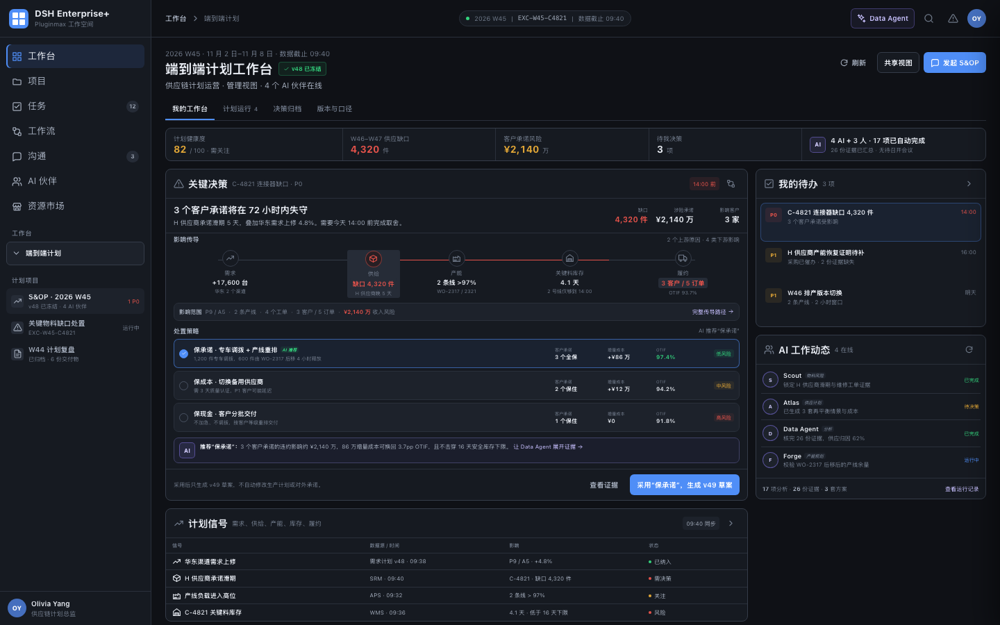
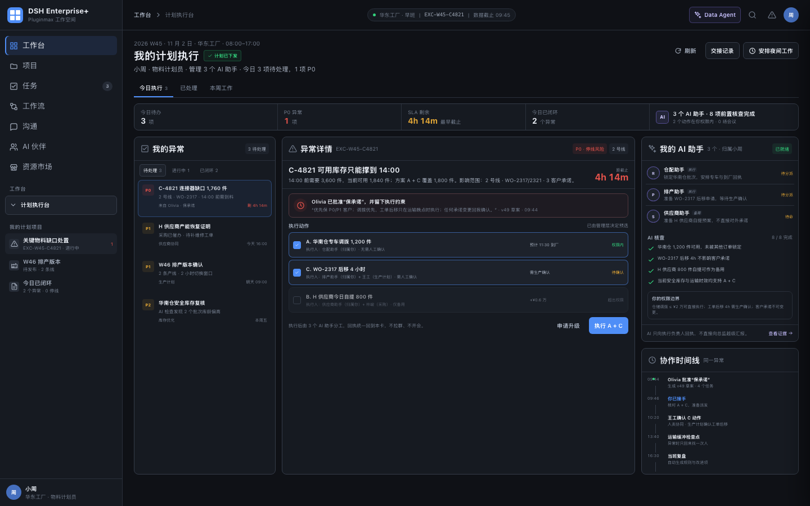

# 手机制造供应链 · 端到端计划工作台解决方案

> 文档版本：v1.0  
> 日期：2026-10-29  
> 目标读者：制造企业供应链一号位、S&OP 负责人、供应链数字化负责人、产品与研发团队  
> 平台基线：`dsh-pluginmax` 当前已具备的 AI 伙伴、任务、工作流、会议、Data Agent、项目/工作区、资源市场、身份权限与审计能力，以及正在落地的可插拔工作台 2.0  
> 关键页面 Demo：  
> [计划运营总监工作台](./demos/supply-chain-e2e-planning-workbench-demo.html) · [计划员执行工作台](./demos/supply-chain-plan-planner-workbench.html)

---



*计划运营总监工作台：关键决策、我的待办、AI 工作动态与计划信号在同一工作台内协同。*



*计划员执行工作台：异常队列、执行详情、AI 核查与协作时间线。*

## 0. 一页结论

这不是又一个供应链 BI 大屏，而是把**计划链、例外决策、人机团队和执行闭环**放进同一个工作面。

目标用户进入工作台后，应在 10 秒内回答五个问题：

1. 本周计划是否平衡？
2. 断点在哪一段，影响了哪些客户承诺？
3. AI 已经替我做完了哪些分析？
4. 现在只剩哪几个需要我判断的决策？
5. 我做完判断后，谁去执行、如何追踪、证据是否留痕？

产品主张可以概括为：

> **一条端到端计划链，一个例外决策队列，一支 Human + AI 计划团队。**

它带来的不是“多看几张报表”，而是三种可感知的变化：

| 过去 | 工作台中的新方式 | 对一号位的价值 |
| --- | --- | --- |
| 需求、供应、产能、库存、履约分散在多个系统与表格 | 同一条计划链展示上下游影响与数据时效 | 信息透明，不再靠人拼口径 |
| 异常发生后拉群、开会、找人、等分析 | AI 先归因、推演、准备证据和方案，人只看取舍 | 决策加快，减少非必要协同 |
| 决策停留在会议纪要或口头结论 | 决策一键变为任务、工作流、会议与交付物 | 执行可追踪，经验可沉淀 |

Demo 用一组模拟数据展示了这个工作方式：

- 4 个 AI 伙伴 + 3 个真人组成计划团队；
- AI 自动完成 17 项前置分析和推演；
- 管理者打开工作台时，只被推到眼前一个 P0 判断，其余事项收起；
- 每个决策都有影响、方案、成本、风险、置信度和证据链；
- 采用方案后自动派发 4 个任务并启动处置工作流；
- 一周减少约 11.5 小时非必要协同。

> 以上为演示口径，不代表客户基线或承诺值。正式项目需用客户数据重新测算。

---

## 1. 目标用户与业务问题

### 1.1 目标用户

**第一用户：供应链一号位 / 供应链副总裁 / 计划总监**

他们真正管理的不是标准流程，而是例外：

- 需求突变与渠道促销导致的计划外上修；
- 关键物料、连接器、芯片、结构件的供应断点；
- 多工厂产能冲突与产线切换；
- 库存错配与现金占用；
- 客户承诺、销售预测和实际供给不一致；
- 跨采购、计划、制造、物流、财务的协调成本。

**核心协同用户：**

| 角色 | 在工作台中的主要任务 |
| --- | --- |
| S&OP 负责人 | 冻结计划版本、组织决策评审、确认跨部门取舍 |
| 需求计划 | 审核预测偏差、渠道异常、促销与新品爬坡 |
| 供应计划 | 做供需平衡、分配库存、提出补料与替代方案 |
| 物料计划 | 跟踪关键料齐套、供应商交期与替代料认证 |
| 生产计划 | 评估产线、班次、换型和工单重排可行性 |
| 采购 | 确认供应商产能、交期、价格与加急窗口 |
| 物流 | 评估空运、陆运、仓配与关务约束 |
| 财务 | 测算增量成本、现金、毛利和承诺风险 |

### 1.2 当前典型问题

| 问题 | 典型表现 | 业务后果 |
| --- | --- | --- |
| 计划链不可见 | 需求、供给、产能、库存、履约各自一套表 | 看到结果时已错过最佳处置窗口 |
| 异常归因靠人 | 计划员逐个找采购、工厂、物流确认 | 小时级甚至天级响应 |
| 方案比较不完整 | 只比较成本，不比较交付、库存、质量和风险 | 局部最优，整体受损 |
| 协同没有边界 | 所有问题都拉群、开会、等回复 | 高价值人才被低价值协调占满 |
| AI 只做问答 | 对话结束即结束，不进入任务和流程 | 分析结果无法转化为执行 |
| 决策不可追溯 | 结论散落在会议纪要、邮件和聊天记录 | 复盘无依据，组织能力无法沉淀 |

### 1.3 产品机会

制造企业并不缺 ERP、APS、SRM、MES、WMS 或 BI。真正缺的是一层**跨系统的计划决策层**：

- 把数据变成可解释的计划链；
- 把偏差变成有边界的决策；
- 把决策变成可执行的任务和工作流；
- 把执行结果回流为下一次计划的上下文。

`dsh-pluginmax` 的差异不在于“再接一个聊天机器人”，而在于它已经具备把 AI 变成组织成员所需的基础设施：角色、任务、工作流、会议、权限、运行时、交付物验收、审计和插件市场。

---

## 2. Demo 说明：两个工作台，同一个异常

Demo 是两个独立工作台页面，不做角色切换器。演示人手工切换浏览器页签：

1. 先打开 [计划运营总监工作台](./demos/supply-chain-e2e-planning-workbench-demo.html)，展示“关键决策 + 我的待办 + AI 工作动态 + 计划信号”的真实工作台结构。
2. 在“关键决策”中查看 C-4821 的断点路径、三种取舍和 AI 推荐。
3. 点击“完整传导路径”，查看 6 层影响链、2 个上游原因、5 类影响范围与责任边界。
4. 点击“让 Data Agent 展开证据”，在现有 Data Agent 侧栏中查看供应、需求、库存归因和原始证据。
5. 点击“采用‘保承诺’”，只生成 v49 草案并派发 4 个任务，不自动提交生产计划或对外承诺。
6. 手工切换到 [计划员执行工作台](./demos/supply-chain-plan-planner-workbench.html)，展示同一异常编号下的“异常队列 + 执行详情 + 我的 AI 助手 + 协作时间线”。
7. 在计划员页执行 A + C；仓配助手和排产助手执行，C 动作同时拉起生产计划王工确认，供应商助手只保留备用预案。
8. 模拟 13:40 车辆晚到，AI 只回来找计划员做一次判断；确认后展示 14:00 产线未停，并由计划员“回报 Olivia”。
9. 点击“安排夜间工作”，把供应商证据校验、W46 切换影响、库存与替代料复核交给 3 个 AI 助手；确认后显示“已交班 · 明早 08:30 收作业”。

新增的业务组件只有两张卡：

- **管理层决策卡**：今天需要拍什么板；
- **计划员执行卡**：今天需要关掉什么异常。

其他区域均按平台已有工作台面板、任务列表、信号表格、AI 动态和 Data Agent 侧栏的组织方式呈现。

交互层级在 Demo 中的可见方式：

- **总监 → 计划员**：决策卡派发后显示执行负责人小周和 3 个 AI 助手，总监看到的是汇总状态。
- **计划员 → 自有 AI 助手**：执行卡将动作分派给“归属小周”的仓配、排产、供应商助手，AI 回执只回到计划员。
- **计划员 → 人类同事**：C 动作需要生产计划王工确认，B 动作保留采购林峻协同，均进入同一时间线。
- **AI 助手 → 总监**：不直接越级汇报；结果先由计划员验收，再汇总回报给总监。

---

## 3. 产品概念与设计原则

### 3.1 产品定位

**端到端计划工作台（Supply Chain Planning Workbench）**是供应链计划组织的 AI 原生操作界面。

它不是：

- 替代 ERP / APS / SRM / MES / WMS；
- 把所有指标堆在一起的驾驶舱；
- 让 AI 自动修改生产计划或承诺客户的系统；
- 一个只支持自然语言问答的聊天机器人。

它是：

- 计划数据、计划版本、计划约束和承诺的统一观察面；
- 异常归因、情景推演、决策建议和证据链的统一决策面；
- AI 伙伴、真人、任务、工作流、会议的统一协作面；
- 决策、执行、复盘和知识沉淀的统一闭环面。

### 3.2 四条设计原则

1. **One Plan, One Decision Queue**  
   工作台首页不做功能目录，而做“计划状态 + 需要判断的事项”。常规信息自动收敛，例外才占用人的注意力。

2. **Evidence before Recommendation**  
   AI 推荐必须带口径、时间范围、数据来源、假设、约束和置信度。没有证据链的结论不能进入决策队列。

3. **AI prepares, Human commits**  
   AI 可以读取、计算、归因、推演、起草、派发草稿；涉及订单承诺、生产计划发布、供应商合同和客户沟通的动作，必须由人确认。

4. **Collaboration only at decision boundaries**  
   数据对齐、事实核对、方案初稿由 AI 和系统完成。只有真正存在取舍、权限冲突或对外承诺时才拉起会议和多人协作。

### 3.3 用户价值的“三层砍掉”

| 砍掉什么 | 如何做到 | 结果 |
| --- | --- | --- |
| 砍掉找数和对口径 | 统一计划语义、时效标识、指标口径和证据链 | 从“先开会对数”变成“先看同一条链” |
| 砍掉重复分析 | AI 伙伴分工完成需求、供给、产能、物料分析 | 从“每次重新拉表”变成“AI 先交作业” |
| 砍掉无效会议 | 只有存在取舍或对外承诺时才升级会议 | 从“人人参会”变成“只在决策点协同” |

---

## 4. 端到端业务架构

### 4.1 计划链

```text
市场需求 / 客户订单
        ↓
需求计划：SKU × 渠道 × 客户 × 周
        ↓
供给计划：物料 × 工厂 × 供应商 × 周
        ↓
产能计划：产线 × 班次 × 工单 × 周
        ↓
库存计划：SKU × 仓库 × 批次 × 安全库存
        ↓
履约计划：订单 × 客户 × 承诺日期
        ↓
经营影响：收入 × 成本 × 现金 × 风险
```

计划工作台必须让用户看到“上下游影响”，而不只是每个域的单独指标。例如：

- 需求上修 4.8% 如何传导为连接器缺口；
- 连接器缺口如何影响产线负载；
- 产线重排如何影响库存和客户承诺；
- 加急补料如何影响成本和现金；
- 哪些客户承诺可以守住，哪些必须重新协商。

在工作台中的具体呈现：

- 决策卡首屏展示一条六节点传导链：H 供应商滑期 → C-4821 缺口 → 关键料库存 → 产能负载 → 客户承诺 → 经营风险；
- 链路下方固定显示影响范围：P9 / A5、2 条产线、4 个工单、3 客户 / 5 订单、¥2,140 万收入风险；
- 点击“完整传导路径”后，按层展开上游原因、物料与库存断点、产能约束、履约对象和经营结果，并标注每个节点的责任边界；
- 计划员工作台只展示与其班次相关的局部范围：2 号线、WO-2317 / 2321、3 个客户承诺。

### 4.2 计划对象模型

| 对象 | 定义 | 关键字段 | 平台承载 |
| --- | --- | --- | --- |
| Plan Cycle | 一个计划周期，如 2026 W45 | 周期、范围、冻结时间、状态 | 新业务域 `collab_supply_plan` |
| Plan Version | 一次可比较的计划快照 | 版本号、来源、冻结人、差异摘要 | 新业务域 + 工作流交付物 |
| Plan Item | 计划链上的最小计划对象 | SKU、物料、工厂、周、数量 | 新业务域 |
| Constraint | 供需平衡约束 | 产能、库存下限、供应商上限、预算 | 新业务域 + Skill 输入 |
| Signal | 计划偏差或风险信号 | 类型、严重度、影响对象、证据 | 新业务域 + 事件 |
| Scenario | 一套可比较的再平衡方案 | 假设、指标、成本、风险、置信度 | 新业务域 + Agent Run |
| Decision | 需要人判断的事项 | 优先级、截止时间、选项、责任人 | 新业务域 + 任务 |
| Evidence | 支撑判断的数据记录 | 来源、时间、快照、口径版本 | 新业务域 + Data Agent |
| Action | 决策后的执行动作 | 负责人、任务、工作流、SLA | 任务 + 工作流 |

### 4.3 跨域连接键

手机制造计划最容易失败的并不是算法，而是主数据映射。MVP 必须显式维护以下连接关系：

- `Customer Order → SKU → BOM → Material`；
- `Material → Supplier → Purchase Order → Delivery Window`；
- `SKU → Factory → Line → Shift → Work Order`；
- `Warehouse → SKU → Lot → Available Inventory`；
- `Commitment → Customer Priority → Penalty / Margin Exposure`。

没有这些连接键，端到端计划只能停留在视觉拼接。平台应以“计划语义层 + 连接质量检查”作为底座能力。

---

## 5. 新工作方式：S&OP 与日常异常的双循环

### 5.1 周度 S&OP 循环

| 时间 | 传统方式 | 新方式 | 平台能力 |
| --- | --- | --- | --- |
| 周一 06:00 | 计划员导出多套报表 | AI 自动拉取最新计划、供应商、产能和订单数据 | Data Agent、MCP、Skill |
| 周一 08:30 | 群内确认数据口径 | 工作台显示数据时效、版本和偏差来源 | 计划语义层、证据链 |
| 周一 10:00 | 各域分别分析 | Nova / Atlas / Forge / Scout 并行分析并交接 | AI 伙伴、Agent Run |
| 周一 14:00 | 逐个问题找人确认 | 决策队列只保留需要取舍的事项 | 决策域、任务 |
| 周一 15:30 | 大型 S&OP 会逐页过数据 | 会议只讨论 2–3 个取舍，默认材料是决策包 | 会议、交付物 |
| 周一 17:00 | 会后人工派发行动项 | 决策自动变成任务与工作流 | 任务、工作流 |
| 周二至周五 | 靠人追问执行 | AI 监控节点、交付物和异常，主动回流 | 工作流、Agent Run、简报 |

### 5.2 日常异常循环

```text
规则触发 / 事件监听
    → AI 判断影响范围并生成证据包
    → 形成方案与情景对比
    → 达到决策阈值则通知人类
    → 人类确认 / 选择 / 修改
    → 自动派发任务和工作流
    → AI 跟踪执行、客户沟通与闭环复盘
```

### 5.3 什么情况下才需要开会

不是所有异常都值得开会。建议显式定义升级条件：

- 客户承诺风险超过阈值；
- 两个以上部门给出冲突方案；
- 方案需要突破预算、库存下限或已冻结计划；
- 涉及对外承诺、合同、价格或客户沟通；
- AI 置信度低于阈值，且存在数据缺口。

其余情况默认走“异步决策 + 任务派发”，不拉群、不排会。

---

## 6. Human + AI 计划团队设计

### 6.1 团队构成

工作台不是“一个超级 Agent”，而是一支分工明确的计划小队。

| 成员 | 类型 | 职责 | 主要输出 | 写入边界 |
| --- | --- | --- | --- | --- |
| Olivia / 供应链计划总监 | Human | 目标、取舍、例外升级、对外承诺 | 决策与授权 | 可做最终决策与承诺 |
| 小周 / 华东工厂物料计划员 | Human | 承接决定、拆解动作、选择人类协同或 AI 助手、现场执行 | 执行结果、异常升级、夜间作业安排 | 仅在授权范围内执行，超出边界必须升级 |
| 林峻 / 采购负责人 | Human | 供应商交期、产能、报价与关系确认 | 供应商证据与承诺 | 可确认采购动作 |
| 周杰 / 制造计划经理 | Human | 产线、班次、工单与切换可行性 | 排产确认 | 可确认生产动作 |
| Nova / 需求计划 AI | AI | 需求预测、渠道偏差、促销与新品爬坡 | 需求结论与偏差清单 | 只读建议 |
| Atlas / 供应计划 AI | AI | 供需平衡、库存分配、补料与替代方案 | 供应方案与情景 | 只读建议 |
| Forge / 产能规划 AI | AI | 产线负载、班次、换型和工单重排模拟 | 可行性与影响评估 | 只读模拟 |
| Scout / 物料风险 AI | AI | 关键料监控、供应商交期、替代料与风险 | 风险信号与证据 | 只读监控 |
| 仓配助手 / 排产助手 / 供应商助手 | 计划员归属 AI | 执行计划员分派的调拨、排产申请、供应商证据与夜间分析 | 动作回执、证据包、次日作业 | 只向计划员回执，不直接对外承诺或越级汇报 |
| Data Agent | 平台内置 AI | 跨页面查数、归因、报告与数据治理 | 指标解释、图表、报告 | 只读查询 |

### 6.2 分工原则

**AI 负责“把事情准备好”：**

- 找齐数据；
- 发现偏差；
- 解释原因；
- 生成方案；
- 比较影响；
- 起草沟通；
- 跟踪执行；
- 生成复盘。

**人负责“做价值判断”：**

- 选择哪个目标优先；
- 接受多大成本或风险；
- 是否突破约束；
- 是否对外承诺；
- 是否升级组织。

### 6.3 人机接力协议

每条 AI 产出必须包含五要素，才能进入决策队列：

1. **结论**：发生了什么，影响是什么；
2. **证据**：来自哪个系统、哪个时间点、哪条记录；
3. **假设**：计算依赖哪些前提；
4. **边界**：哪些约束不能被突破；
5. **下一步**：等待谁做什么判断。

人的决策也必须包含四要素：

1. 选择哪个方案；
2. 是否修改约束；
3. 谁负责执行；
4. 何时复核。

### 6.4 三层交互与信息边界

Demo 把“人、Agent、组织”的交互拆成三层，避免 AI 绕过组织关系直接找人：

| 交互 | 发生什么 | 在 Demo 中的体现 |
| --- | --- | --- |
| 总监 ↔ 计划员 | 总监给目标、取舍和执行约束；计划员承接并反馈结果 | 总监派发“保承诺”并附“承诺不可变、调拨优先、C 仅在晚点时执行”；计划员执行后“回报 Olivia” |
| 计划员 ↔ 归属 AI 助手 | 计划员把动作拆给仓配、排产、供应商助手；AI 执行、回执、等待确认 | 执行卡标明执行人及归属；右侧“我的 AI 助手”显示待分派、执行中、已回执；13:40 由 AI 回到计划员面前 |
| 计划员 ↔ 人类同事 | 涉及生产确认、采购舱位等人类职责时，AI 只准备材料，不替人签字 | C 动作拉起生产计划王工确认，B 动作保留采购林峻协同 |
| 归属 AI 助手 ↔ 总监 | 不直接越级；先向计划员回执，再由计划员验收并汇总 | 总监工作台只看到“小周 + 3 个 AI 助手执行中”，不出现助手碎消息 |
| 计划员 ↔ 夜间 AI 作业 | 下班前把可异步完成的分析交给 AI，第二天早上收作业 | 17:10 交班 3 项分析；AI 夜间只读执行；明早 08:30 进入计划员待验收 |

这条边界的核心不是“限制 AI”，而是让每个人和 Agent 都知道：**谁负责判断、谁负责执行、谁负责验收、谁可以向谁汇报**。

### 6.5 组织效率的衡量

建议把“减少非必要协同”作为一等指标，而不是只测模型调用次数：

| 指标 | 定义 | Demo 中的表现 |
| --- | --- | --- |
| AI 前置完成率 | 进入决策前已由 AI 完成的分析比例 | 17 / 20 |
| 决策收敛率 | 不需要会议即可做出的决策比例 | 2 / 3 |
| 决策等待时长 | 从信号触发到形成决策的时间 | 小时级目标 |
| 跨角色往返次数 | 一个问题在各角色间来回确认的次数 | 从多次降到一次交接 |
| 会议替代率 | 被异步决策替代的会议比例 | 目标 ≥ 30% |
| 行动闭环率 | 决策后生成任务/工作流并完成验收的比例 | 100% 可追踪 |

---

## 7. 平台能力映射

### 7.1 直接复用

| `dsh-pluginmax` 能力 | 在本方案中的用途 | 用户感知 |
| --- | --- | --- |
| 工作台 2.0 面板插件 | 组织计划链、决策队列、人机团队和证据面板 | 一个面向计划角色的工作台 |
| AI 伙伴 / AI Teammate | 承载 Nova、Atlas、Forge、Scout 的岗位职责与运行 | AI 是有名字、有工作记录的队友 |
| Data Agent | 跨页面选择、指标解释、报告生成 | 看到异常即可追问“为什么” |
| 任务 | 承接决策后的行动项、验收与截止时间 | 每个决策都能追到人 |
| 工作流 | 端到端异常处置和 S&OP 节点运行 | 过程可控、节点可审 |
| 会议 | S&OP 决策评审、异常升级 | 只讨论需要取舍的内容 |
| 项目 / 工作区 | 承载计划中心与异常作战室 | 数据、角色、交付物有边界 |
| 资源市场 | 分发计划 Skill、MCP、面板和工作台方案 | 一次配置，多角色使用 |
| 身份 / RBAC / Action Ticket | 区分读、写、承诺与审批权限 | AI 不越权，人有最终控制 |
| 交付物验收 | 决策包、分析报告、客户沟通稿的确认 | AI 只起草，人签核 |
| 审计 / 运行记录 | 追踪 AI 做了什么、用了什么数据 | 可解释、可复盘、可审计 |
| 记忆 / 上下文 | 保留计划假设、历史决策和项目知识 | 新一期计划不用从零解释 |

### 7.2 需要扩展

| 扩展项 | 类型 | 建议命名 | 说明 |
| --- | --- | --- | --- |
| 供应链计划域 | 后端插件 | `dsh-supply-plan` | 计划周期、版本、信号、方案、决策、证据 |
| 计划工作台面板 | 客户端插件 | `dsh-supply-plan-panels` | 注册到 `workbench.canvas.panel` |
| 计划 Agent 模板 | AI 伙伴模板 | 需求 / 供应 / 产能 / 物料风险 | 由平台定义，工作区实例化 |
| 计划 Skill | 资源市场 Skill | 需求偏差解释、供需平衡、产能模拟等 | 可绑定 Agent，不携带密钥 |
| 计划 MCP | 资源市场 MCP | ERP、APS、SRM、MES、WMS、TMS 等 | 只读优先，写入走独立工具 |
| 计划工作流模板 | 工作流资产 | 关键物料缺口处置、W48 计划发布 | 人机混合节点、交付物门禁 |
| 工作台方案 | 市场资产 | 手机制造 · 端到端计划工作台 | 含布局、面板默认配置、角色说明 |

### 7.3 能力边界

首版不做：

- AI 直接提交生产计划或客户承诺；
- 用 AI 替代 APS/ERP 的计算引擎；
- 任意 SQL 或任意数据库写操作；
- 跨工作区拼接供应商和客户数据；
- 让用户自行编排任意 Agent 的无限自治；
- 用“自动执行”掩盖审批、合规和审计缺口。

---

## 8. 工作台信息架构与面板

### 8.1 页面结构

```text
端到端计划工作台
├── 顶部：计划周期 / 版本 / 数据时效 / 冻结倒计时
├── 计划信号条：健康度、需求、缺口、承诺风险、待判断
├── 左侧主区
│   ├── 端到端计划链
│   ├── AI 归因与未来 8 周平衡
│   └── 决策队列 + 处置台
└── 右侧辅区
    ├── 人机计划团队
    └── 决策依据 / 数据可信度
```

### 8.2 面板清单

| 面板 | 建议 slot key | 核心内容 | 主要动作 |
| --- | --- | --- | --- |
| 计划信号条 | `supply-plan.pulse` | 健康度、需求、缺口、承诺风险 | 下钻到对应阶段 |
| 端到端计划链 | `supply-plan.chain` | 需求、供给、产能、库存、履约 | 切换阶段看归因 |
| 计划平衡图 | `supply-plan.balance` | 未来周度缺口/富余 | 查看异常周 |
| 决策队列 | `supply-plan.decisions` | 待判断事项、影响范围、截止时间 | 选择、比较、采用 |
| 处置台 | `supply-plan.cockpit` | 方案、成本、风险、人机接力 | 决策、派发、打开证据 |
| 人机计划团队 | `supply-plan.team` | AI 工作状态、人工待办、协同节省 | 查看工作记录 |
| 证据链 | `supply-plan.evidence` | 来源、时间、口径、假设、置信度 | 生成纪要、转任务 |
| 情景对比 | `supply-plan.scenarios` | 保交付/保成本/保现金等情景 | 生成计划草案 |

### 8.3 角色工作台

同一套面板能力应支持不同角色布局：

| 角色 | 首页重点 | 默认布局 |
| --- | --- | --- |
| 供应链一号位 | 健康度、承诺风险、待决策、人机团队 | 决策优先型 |
| 计划总监 / S&OP 负责人 | 计划链、版本差异、会议决策包 | 计划治理型 |
| 需求计划 | 需求偏差、渠道异常、预测修正 | 需求分析型 |
| 供应 / 物料计划 | 缺口、供应商、替代料、库存 | 供应处置型 |
| 制造计划 | 产能、班次、工单、切换成本 | 产能执行型 |
| 数据分析 | 口径、数据质量、报告 | 分析型 |

### 8.4 工作台市场包

建议在资源市场发布一个完整方案包：

```yaml
displayName: 手机制造 · 端到端计划工作台
visibility: team
primaryDomainCode: plan
panels:
  - supply-plan.pulse
  - supply-plan.chain
  - supply-plan.balance
  - supply-plan.decisions
  - supply-plan.cockpit
  - supply-plan.team
skills:
  - 需求偏差解释
  - 供需平衡与缺口归因
  - 产能可行性与排产影响评估
  - 供应商交期风险评估
  - 计划情景生成与比较
  - 决策包与会议纪要生成
mcp:
  - ERP 订单与库存查询
  - APS 产能与排程查询
  - SRM 采购订单与供应商承诺
  - MES 产线与工单状态
  - WMS 可用库存与批次
  - TMS 运输与加急能力
agents:
  - 需求计划 AI
  - 供应计划 AI
  - 产能规划 AI
  - 物料风险 AI
workflows:
  - 关键物料缺口处置
  - 周度 S&OP 计划发布
```

---

## 9. Skill、MCP 与数据契约

### 9.1 计划 Skill

建议遵循现有资源治理规范：展示名用业务语言，机器 ID 由平台生成；Skill 只承载方法、判断标准和输出约定，不携带密钥。

| 展示名 | 能力形态 | 输入 | 输出 | 写入 |
| --- | --- | --- | --- | --- |
| 需求偏差解释 | analyze | 预测版本、订单、渠道、促销 | 偏差幅度、驱动、异常渠道 | 无 |
| 供需平衡与缺口归因 | compute / analyze | 需求、供给、BOM、库存、约束 | 缺口、影响对象、证据 | 无 |
| 产能可行性与排产影响评估 | compute | 工单、产线、班次、换型 | 可行方案、负载、交付影响 | 无 |
| 供应商交期风险评估 | analyze | PO、交期、在途、库存 | 风险等级、原因、建议 | 无 |
| 计划情景生成与比较 | analyze / generate | 约束、目标、权重 | 3–5 套情景与指标对比 | 无 |
| 决策包生成 | generate | 信号、证据、方案 | 决策摘要、议题、待确认项 | 只写草稿交付物 |
| 计划复盘生成 | generate | 执行记录、偏差、决策 | 复盘报告、改进项 | 只写草稿交付物 |

### 9.2 外部系统 MCP

| 连接器 | 主要数据 | 默认权限 | 备注 |
| --- | --- | --- | --- |
| ERP 订单与库存 | 销售订单、库存、承诺、成本 | 只读 | 可按公司/工厂/客户行级授权 |
| APS 排程 | 产线、班次、工单、换型、产能 | 只读 | 模拟结果不直接回写 |
| SRM 采购 | PO、供应商、交期、报价、承诺 | 只读 | 供应商承诺需留证据 |
| MES | 工单、报工、产线状态、良率 | 只读 | 生产异常事件来源 |
| WMS | 可用库存、批次、锁定、库龄 | 只读 | 安全库存与批次追溯 |
| TMS | 在途、运输时效、空运舱位、报价 | 只读 | 加急方案证据 |
| CRM | 客户订单、优先级、合同风险 | 只读 | 客户承诺影响 |
| PLM / QMS | BOM、替代料、认证状态 | 只读 | 替代方案的前置约束 |
| 财务 | 标准成本、毛利、现金影响 | 只读 | 按角色脱敏 |

写入类 Tool 必须独立发布、独立授权，并通过 Action Ticket 与人工审批；不得在只读分析 Tool 中夹带写入能力。

### 9.3 数据时效与可信度

工作台必须展示“数据是什么时候的”，而不是假设都是实时。

| 数据 | 建议时效 | 超时处理 |
| --- | --- | --- |
| 订单 / 承诺 | ≤ 15 分钟 | 标记过期，降低决策置信度 |
| 库存 | ≤ 30 分钟 | 提示批次和锁定差异 |
| 产线 / 工单 | ≤ 15 分钟 | 提示排产版本 |
| 供应商交期 | ≤ 4 小时 | 标记待确认证据 |
| 运输 / 舱位 | ≤ 2 小时 | 加急方案标注时点 |
| 财务成本 | 日级 | 显示成本版本 |

当数据不满足时效或完整度阈值时：

- 不允许把结论标记为“高置信”；
- 决策卡明确列出数据缺口；
- AI 自动生成数据治理任务；
- 人可以继续决策，但需显式承担不确定性。

### 9.4 关键指标口径

| 指标 | 定义 | 主要来源 |
| --- | --- | --- |
| 计划健康度 | 供应缺口、承诺风险、产能超载、库存越界和数据可信度的加权综合分 | 计划域计算 |
| 需求偏差 | `(预测 - 实际) / 实际`，按 SKU × 周 × 渠道 | 需求计划 / 订单 |
| 供应缺口 | `需求 - 可用供给`，按物料 × 周 | APS / ERP / SRM |
| 产能利用率 | `需求工时 / 可用工时`，按产线 × 班次 | APS / MES |
| 库存天数 | `平均库存 / 日均 COGS`，按 SKU × 仓库 | ERP / WMS |
| OTIF 预测 | 预计按时按量交付的承诺数 / 总承诺数 | CRM / ERP / APS |
| 承诺风险金额 | 风险订单的收入、毛利、违约金和加急成本综合暴露 | CRM / 财务 |
| 计划达成率 | 实际产出 / 计划产出，按周和工厂 | MES / APS |

计划健康度的权重属于业务配置，不应由 AI 自行修改；版本变更需留痕。

---

## 10. 核心流程：关键物料缺口处置

### 10.1 触发

示例规则：

- 关键物料缺口 > 2,000 件；
- 影响 P0 客户或未来 72 小时内的产线开工；
- 供应商承诺滑期 ≥ 3 天；
- 承诺风险金额 > ¥500 万。

触发后自动创建异常工作区和处置工作流，拉入计划、采购、制造、物流、财务角色。

### 10.2 工作流节点

| 节点 | 执行者 | 类型 | 交付物 | 门禁 |
| --- | --- | --- | --- | --- |
| 1. 异常事实确认 | Scout + 采购 | 人机 | 异常摘要、证据包 | 供应商证据必须可追溯 |
| 2. 订单与客户影响 | Nova + Data Agent | AI | 受影响订单、客户、风险金额 | 数据完整度达标 |
| 3. 产线与库存影响 | Forge + 供应计划 | AI | 产线、库存、缺口传导 | 约束版本锁定 |
| 4. 情景推演 | Atlas + Forge | AI | 3 套方案与对比 | 至少覆盖保交付/保成本 |
| 5. 决策评审 | 计划总监 + 采购/制造 | Human | 决策纪要、选择方案 | 人确认 |
| 6. 预算/承诺审批 | 财务/授权人 | Human approval | 审批记录 | 按金额阈值 |
| 7. 任务派发 | Atlas / 工作流 | 系统 | 补料、排产、物流、客户沟通任务 | 使用已批准方案 |
| 8. 对外沟通 | AI 起草 + 人签发 | Human | 客户通知、供应商邮件 | 人工签字 |
| 9. 执行跟踪 | AI + 责任人 | 人机 | 到货、工单、承诺状态 | 节点 SLA |
| 10. 复盘归档 | AI + 计划总监 | 人机 | 复盘报告、改进项 | 人类验收 |

### 10.3 状态机

```text
detected → evidence_pending → assessing
        → decision_required → approved
        → executing → verifying → closed
                    ↘ blocked → escalated
```

每个状态都要有：

- 当前责任人；
- 证据与版本；
- 下一步 SLA；
- 是否可以由 AI 推进；
- 是否需要人类确认。

### 10.4 会议作为决策节点，而不是信息同步节点

只有满足升级条件时，系统自动生成会议议题包：

- 3 个待决策事项；
- 每个事项的方案、影响、成本、风险和证据；
- 需要哪个部门做取舍；
- 会议前必须完成的材料；
- 会议输出模板：决策、责任人、截止时间、后续流程。

这样，会议不再是“大家来听数据”，而是“有权限的人来做决定”。

---

## 11. 决策设计与 AI 可信度

### 11.1 决策优先级

建议采用“规则优先、AI 辅助排序”：

| 优先级 | 触发条件 | 典型场景 |
| --- | --- | --- |
| P0 | 影响 P0 客户、产线停线、承诺风险超过阈值 | 关键料 72 小时内断供 |
| P1 | 影响多个订单或单一工厂，存在可替代方案 | 供应滑期、排产冲突 |
| P2 | 单一客户或局部影响，有缓冲 | 渠道预测偏差 |
| P3 | 仅需关注，不影响本周承诺 | 数据质量、长期趋势 |

AI 只能建议优先级，不能自行修改优先级规则版本。规则变更必须由计划治理角色确认。

### 11.2 决策卡结构

每个决策必须回答：

1. **发生了什么**：异常、影响对象、当前状态；
2. **为什么发生**：归因、证据、置信度；
3. **有哪些选择**：至少 2 个可执行方案；
4. **每个选择的代价**：OTIF、成本、库存、产能、客户影响；
5. **AI 推荐什么**：推荐方案、原因、边界；
6. **谁来决定**：决策人、截止时间、升级路径；
7. **决定后做什么**：任务、工作流、会议、交付物。

### 11.3 置信度与拒答

| 置信度 | 行为 |
| --- | --- |
| ≥ 85% | 可进入正常决策队列，标注证据和数据时点 |
| 70%–84% | 可推荐，但必须显式展示不确定性和待补证据 |
| 50%–69% | 只提供分析，不给出“建议采用” |
| < 50% | 拒答确定性结论，生成数据补齐任务或升级人类 |

置信度不是模型自报即可，应由规则计算：

- 数据完整度；
- 数据时效；
- 证据一致性；
- 推演稳定性；
- 历史同类决策的偏差；
- 约束冲突数量。

### 11.4 决策可追溯

每次决策保存：

- 使用的计划版本与数据快照；
- 证据链接与数据时点；
- AI 模型 / Skill / MCP 版本；
- 方案假设和约束；
- 人类修改意见；
- 最终选择与审批人；
- 后续任务与结果。

复盘时回答“当时为什么这样决定”，而不是只看最终结果。

---

## 12. 技术架构与平台落地

### 12.1 总体架构

```text
┌─────────────────────────────────────────────────────────────┐
│                  体验层 / Workbench 2.0                     │
│  计划信号条 · 计划链 · 决策队列 · 处置台 · 人机团队 · 证据链  │
└──────────────────────┬──────────────────────────────────────┘
                       │ panel slot / API
┌──────────────────────▼──────────────────────────────────────┐
│              dsh-supply-plan（计划业务域插件）               │
│  计划周期 / 版本 / 约束 / 信号 / 方案 / 决策 / 证据 / 快照    │
└──────────┬──────────────────────┬───────────────────────────┘
           │                      │
┌──────────▼────────────┐  ┌──────▼───────────────────────────┐
│ AI 协作与执行层        │  │ 数据与连接层                      │
│ AI 伙伴 / Data Agent   │  │ Skill · MCP · 语义层 · 数据质量    │
│ 任务 / 工作流 / 会议    │  │ ERP / APS / SRM / MES / WMS / TMS │
└──────────┬────────────┘  └──────┬───────────────────────────┘
           │                      │
┌──────────▼──────────────────────▼───────────────────────────┐
│ 平台治理层                                                   │
│ 身份 / RBAC / Principal / Action Ticket / 审批 / 预算 / 审计  │
└─────────────────────────────────────────────────────────────┘
```

### 12.2 插件拆分

**后端：`dsh-supply-plan`**

- 存储域：`collab_supply_plan`；
- 计划周期、版本、信号、方案、决策、证据；
- 同源 Bearer 保护的 API；
- 计划健康度与数据时效计算；
- 决策状态机与审计；
- 对外集成只通过受控 Skill / MCP / 事件。

**前端：`dsh-supply-plan-panels`**

- 通过 `dsh.client` 提供客户端 bundle；
- 向 `workbench.canvas.panel` 注册计划面板；
- 只消费计划域 API 和平台上下文；
- 不直接访问外部 ERP / APS 凭据。

**AI 模板与流程资产**

- AI 伙伴模板：需求、供应、产能、物料风险；
- 工作流模板：关键物料缺口处置、周度 S&OP 计划发布；
- 会议模板：W45 S&OP 决策评审；
- 工作台市场包：手机制造 · 端到端计划工作台。

### 12.3 建议存储表

| 表 | 用途 |
| --- | --- |
| `plan_cycle` | 计划周期、范围、冻结状态 |
| `plan_version` | 版本、来源、快照指针、冻结人 |
| `plan_item` | 需求 / 供给 / 产能 / 库存 / 履约明细 |
| `plan_constraint` | 产能、库存、预算、供应商上限 |
| `plan_signal` | 偏差、风险、优先级、影响对象 |
| `plan_scenario` | 情景、假设、指标、成本、风险 |
| `plan_decision` | 决策、状态、责任人、截止时间、选择 |
| `plan_evidence` | 证据、来源、时点、口径版本、快照 |
| `plan_action` | 任务、工作流、会议、交付物引用 |
| `plan_audit` | 追加式审计与决策日志 |

### 12.4 建议 API

```text
GET  /api/collab/supply-plan/summary?cycleId=...
GET  /api/collab/supply-plan/chain?cycleId=...&version=...
GET  /api/collab/supply-plan/balance?cycleId=...&weeks=8
GET  /api/collab/supply-plan/decisions?cycleId=...
GET  /api/collab/supply-plan/decisions/detail?id=...
POST /api/collab/supply-plan/scenarios/run
POST /api/collab/supply-plan/scenarios/apply-draft
POST /api/collab/supply-plan/decisions/adopt
GET  /api/collab/supply-plan/evidence?id=...
POST /api/collab/supply-plan/decisions/dispatch
```

要求：

- `adopt` 与 `dispatch` 需要当前人的有效权限和明确的操作确认；
- `apply-draft` 只生成计划草案，不直接写入生产计划；
- 所有写操作带幂等键、`planVersion` 和 `evidenceSnapshotId`；
- 冲突时返回版本差异，不静默覆盖；
- 所有读取按工作区、项目、工厂、供应商、客户和数据行级权限裁剪。

### 12.5 事件

建议定义领域事件，供简报、工作流、会议和通知复用：

```text
plan.signal.detected
plan.signal.cleared
plan.scenario.generated
plan.decision.requested
plan.decision.made
plan.version.drafted
plan.version.frozen
plan.action.dispatched
plan.action.blocked
plan.variance.observed
```

事件只描述“发生了什么”，不直接承载业务写入。写操作仍走明确 API / 工作流 / 审批。

### 12.6 Agent 运行与权限

每个 AI 伙伴实例必须有：

- AI Teammate / Agent Profile；
- Runtime Profile；
- 工作区 / 项目授权；
- 工具白名单与数据范围；
- 预算、超时、重试策略；
- 每次运行的上下文、工具、证据、输出与审计；
- 人工验收节点。

AI 的执行结果先进入交付物门禁，不能跳过人类验收直接改变计划。

---

## 13. 指标、价值与 ROI

### 13.1 试点目标

以下为建议目标，需在项目启动时用客户基线确认：

| 指标 | 现状假设 | 试点目标 |
| --- | --- | --- |
| 计划链追溯率 | 多表人工拼接 | ≥ 95% 关键指标可追溯 |
| 异常响应时间 | 4–8 小时 | ≤ 1 小时 |
| 决策准备时间 | 1–2 天 | ≤ 4 小时 |
| 非必要协同 | 大量群聊和同步会 | 降低 30%–40% |
| 计划评审会时长 | 2–3 小时 | 降低 30% |
| OTIF 预测准确度 | 依赖人工经验 | 提升 3–5pp |
| 紧急加急成本 | 经常事后发现 | 降低 10%–15% |
| 同一异常重复发生 | 复盘不足 | 下降 20% |

### 13.2 价值公式

```text
价值 =
  减少缺料停线损失
  + 降低紧急采购 / 空运 / 加班成本
  + 库存与现金释放
  + 减少非必要协同工时
  + 降低承诺违约与客户流失风险
  - 平台、数据、集成与运营成本
```

### 13.3 示例测算

仅作为测算方法示例，不作为商业承诺：

- 假设 20 名计划相关人员，每人每周减少 11.5 小时低价值协同；
- `20 × 11.5 × 48 ≈ 11,040 人时/年`，约等于 5.5 个全职人力当量的时间释放；
- 假设年 COGS 为 ¥210 亿，日均约 ¥5,750 万；
- 若计划优化带来 1 天库存改善，对应约 ¥5,750 万现金占用下降；
- 若紧急加急成本年化 ¥5,000 万，降低 10% 即 ¥500 万；
- 承诺风险、停线损失和客户体验改善另行测算。

真正应写进经营汇报的不是“用了多少 AI”，而是：

- 异常处置时长；
- 承诺达成率；
- 库存周转；
- 加急成本；
- 计划人员时间结构；
- 组织可复制性。

---

## 14. MVP 范围与路线图

### 14.1 P0 范围

建议选择一个事业部、一个主产品族、两个工厂、12 周滚动计划作为首个闭环：

- 1 个端到端计划工作台；
- 5 个计划链阶段；
- 3 个关键物料 / 连接器；
- 4 个 AI 计划伙伴 + 1 个 Data Agent；
- 6 个只读 MCP；
- 2 个 Skill 组合包；
- 2 个工作流模板；
- 1 个 S&OP 决策会议模板；
- 决策与审计闭环。

### 14.2 分阶段

| 阶段 | 周期 | 交付 |
| --- | --- | --- |
| P0-0 业务对齐 | 1 周 | 场景、KPI、数据源、决策边界、成功标准 |
| P0-1 数据与口径 | 2 周 | 计划语义层、数据时效、指标口径、Mock 闭环 |
| P0-2 工作台与面板 | 2 周 | 计划链、决策队列、人机团队、证据链 |
| P0-3 AI 团队与 Skill | 2 周 | 4 个 AI 伙伴、只读 MCP、推演和推荐 |
| P0-4 流程与治理 | 1 周 | 决策审批、任务派发、工作流、交付物验收 |
| P0-5 试点与复盘 | 1 周 | 真实/准真实数据试运行、指标复盘、扩展建议 |

### 14.3 验收标准

1. 5 个计划链节点均能追溯到数据源与时间点；
2. 每个决策卡包含至少 2 个方案、成本、交付影响、风险和证据；
3. 没有证据或置信度不足时，系统显式拒答或要求补数据；
4. 采用方案后自动生成任务 / 工作流，且每个动作有责任人和截止时间；
5. 任一 AI 运行可回放上下文、工具、证据、输出和人工验收；
6. 普通用户无法看到无权访问的工厂、供应商、客户和成本数据；
7. 工作台在 1440 / 1280 / 760 宽度下无横向溢出，关键决策区可用；
8. 以真实计划周期跑通至少 1 次 S&OP 和 2 次异常处置。

### 14.4 P1 / P2

**P1：跨工厂与多角色扩展**

- ATP / CTP 承诺模拟；
- 多工厂产能协同；
- 供应商协同门户；
- 计划变更影响传播；
- 角色化工作台模板；
- 供应商风险与替代料认证联动。

**P2：网络级优化与自主监控**

- 多事业部、多区域网络优化；
- 需求感知与外部市场信号；
- 更丰富的财务和碳排放约束；
- 自主监控、主动预警和低风险自动闭环；
- 组织记忆与计划策略自动优化。

---

## 15. 风险与治理

| 风险 | 表现 | 应对 |
| --- | --- | --- |
| 主数据不可靠 | BOM、物料、工厂映射不一致 | 先做连接质量检查；缺口进入治理任务 |
| 数据延迟 | 工作台显示旧数据 | 强制展示时点；超时降低置信度 |
| AI 幻觉 | 给出没有证据的结论 | 结论必须引用证据；无证据不进入决策 |
| AI 越权 | 建议被误认为执行 | 读、写、审批分层；Action Ticket 与人工门禁 |
| 组织抵触 | 计划员担心被替代 | 先定位为“AI 做准备工作”，保留人工判断与岗位成长 |
| 会议文化惯性 | 仍然要求所有人参会 | 用决策包和异步决策替代同步会；只对取舍开会 |
| 供应商数据敏感 | 价格、交期、客户信息泄露 | 行级/字段级权限、工作区隔离、脱敏与审计 |
| 口径漂移 | 不同版本指标不同 | 指标版本化、语义层、数据 Agent 统一口径 |
| 过度自动化 | 小异常也触发流程 | 设置阈值和分级；低风险默认监控不升级 |

治理原则：

- 平台管理员维护资源定义；
- 工作区管理员维护数据连接与角色；
- 计划负责人维护口径与决策阈值；
- AI 伙伴的定义不能绕开平台权限；
- 所有关键动作可审计、可回放、可追责。

---

## 16. 交付物与下一步

本次产出：

1. 解决方案设计文档：本文件；
2. 计划运营总监工作台：[supply-chain-e2e-planning-workbench-demo.html](./demos/supply-chain-e2e-planning-workbench-demo.html)；
3. 计划员执行工作台：[supply-chain-plan-planner-workbench.html](./demos/supply-chain-plan-planner-workbench.html)；
4. 共用页面样式：[supply-chain-plan-workbench.css](./demos/supply-chain-plan-workbench.css)。

Demo 已验证：

- 1440 / 1280 桌面宽度布局；
- 760 宽度响应式布局；
- 两个工作台页面，无角色切换器；
- 同一异常编号、证据链与时间线贯穿；
- 三套取舍切换与决策 CTA 联动；
- 六节点影响传导、影响范围条与完整传导路径抽屉；
- Data Agent 证据侧栏；
- 采用“保承诺”后生成 v49 草案，显示小周 + 3 个 AI 助手的交接状态；
- 计划员执行 A + C，归属 AI 助手状态从待分派变为回执；
- 计划员与王工（生产确认）、林峻（采购备用）的人类协同；
- 13:40 异常回找、14:00 闭环与 14:05 回报 Olivia；
- 16:30 复盘规则回流；
- 17:10 夜间交班 3 项 AI 作业，明早 08:30 收作业状态；
- v49 草案不自动提交计划。

建议下一步：

1. 与供应链一号位确认“决策阈值”和“人工承诺边界”；
2. 选定一个 12 周计划周期和一个关键物料异常作为试点；
3. 盘点 ERP / APS / SRM / MES / WMS / TMS 的数据时效与接口；
4. 确认计划健康度、OTIF、供应缺口、库存天数、承诺风险的统一口径；
5. 将本 Demo 的面板拆成 `dsh-supply-plan-panels` 的可注册组件；
6. 先用 Mock / 只读数据跑通“发现—解释—决策—派发—验收”闭环，再接真实写入。

---

## 17. 开放问题

在进入详细产品设计前，需要业务方确认：

1. 试点事业部、产品族、工厂和客户范围；
2. 计划周期是 8 周、12 周还是 26 周；
3. 哪些 KPI 进入一号位首页，哪些只进入计划员视图；
4. 承诺风险的金额阈值、客户等级和审批权限；
5. AI 可以自动派发哪些任务，哪些必须人工点击；
6. 供应商协同是否包含外部账号与外部 Agent；
7. 数据延迟的可接受范围；
8. 现有 APS 是否支持 API 情景模拟，还是需要在平台侧做轻量模拟；
9. 是否需要支持多币种、多工厂、多法人；
10. 试点成功指标和基线数据的获取方式。

