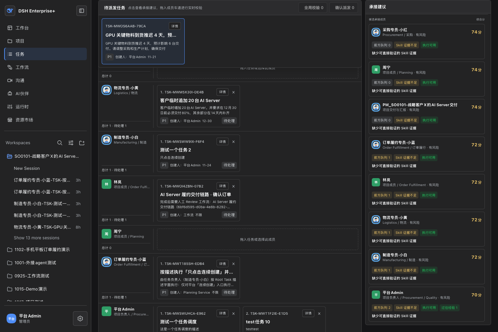

# 资源队列视图技术设计

> 状态：P0 实现稿  
> 范围：`dsh-collab-task`、`dsh-collab-task-dispatch`、AI伙伴只读能力

## 1. 产品边界

资源队列是任务管理中的管理员视图，不替代任务看板、任务详情、AI伙伴管理或现有自动派发链路。

- 默认入口仍是任务看板。
- 只有插件成功加载且当前用户为平台管理员时，任务页才显示「资源队列」。
- 资源队列必须指定单个项目，不提供「全部项目」聚合视图。
- 草案和校验只存在于当前页面内存，不写任务。
- 确认入队仅调用任务服务已有的 `assign`，不调用 Agent 派发，不创建 Run。

## 2. 用户动线

1. 点击待派任务，读取承接建议。
2. 候选按项目参与、Skill 证据、执行可用性和队列负载排序；承接成员默认筛选「AI伙伴」，可切换「全部 / AI伙伴 / 人类员工」。
3. 选择伙伴或拖入伙伴车道后，进入本次派发的实时校验。
4. 加入派发方案，不立即修改任务。
5. 使用「全局校验」汇总所有草案。
6. 每个阻断或风险项提供一条可勾选建议。
7. 只应用选中建议，并重新校验。
8. 无阻断时允许批量入队，并逐项返回结果。

顶部「待派发任务」只展示尚未指派负责人的任务。已经指派、但尚未完成、取消或归档的任务，会按 `queueSeq` 和队列兜底顺序排列在对应承接成员的车道内，用于派发时判断真实执行负载。

已指派任务卡在同一甬道内横向排列并支持横向滚动，可以直接拖到其他承接成员甬道完成改派；点击卡片右上角 `×` 会取消负责人并恢复为「待指派」。两类操作均复用任务服务现有 `assign` 接口。

改派只更新负责人并把业务状态收敛到「待处理」，不会直接触发 AI 执行。用户需在「确认派发」列表中全选或部分勾选本次改派任务；确认后 AI 负责的任务进入「进行中」并启动执行，人类负责的任务保持人工处理。

页面向上滚动时，任务标题、视图切换和操作栏会先滚出视口；「待派发任务」区域吸附在顶部。其下「承接成员」和「承接建议」各自拥有独立滚动容器，滚动一侧不会带动另一侧。

对于「运行中」或「异常」任务，拖拽改派和 `×` 移出都会先展示二次确认弹窗，说明当前负责人、目标负责人以及执行上下文风险；用户确认前不会调用任务接口。

## 3. 数据与判定

候选只使用当前系统可验证的信号：

- 项目参与：项目绑定、工作区绑定或项目角色分配。
- Skill 证据：AI伙伴有效 Skill 的名称、触发词、场景和岗位说明与任务文本的确定性匹配。
- 执行可用性：现有 Teammate Runtime availability。
- 队列负载：当前项目内该伙伴的待启动、运行中、阻塞和待补充数量。
- 成功率：该伙伴历史已完成与已取消任务的比例。

不伪造固定 capacity、精确 ETA 或 Skill 强制匹配。缺少 Skill 证据是风险，不是硬阻断；项目或执行身份不满足才是阻断。

## 4. 接口

`POST /api/collab/tasks/dispatch/candidates`

- 输入：`workspaceId`、`taskId`
- 输出：任务摘要、当前任务的推荐候选和当前项目承接成员
- 推荐候选只包含项目参与成员，以及已经在该项目队列中有任务的承接人

`POST /api/collab/tasks/dispatch/assignees`

- 输入：`workspaceId`
- 输出：当前项目承接成员，不依赖某一项待派发任务
- 包含项目人类成员和业务 AI伙伴；排除会议 Facilitator、任务规划与 Router 等服务型 Agent

`POST /api/collab/tasks/dispatch/reassign`

- 输入：项目、任务和目标负责人
- 仅变更负责人并把任务置为「待处理」，不触发 Agent Run

`POST /api/collab/tasks/dispatch/execute`

- 输入：待处理 AI 任务
- 仅在用户确认派发后启动现有任务执行链路

`POST /api/collab/tasks/dispatch/validate`

- 输入：`workspaceId`、`items[{ taskId, teammateId }]`
- 输出：逐项候选校验与可改派备选
- 只读，不修改任务

`POST /api/collab/tasks/dispatch/commit`

- 输入：`workspaceId`、`items[{ taskId, teammateId }]`
- 服务端重新校验全部项目、Skill、可用性和队列信号
- 逐项调用任务服务 `assign`
- 返回每项成功或失败，不提供伪事务语义

## 5. 插件与扩展点

- `dsh-collab-task` 只增加 `pluginmax.task.dispatch-view` 插槽、管理员视图切换和任务刷新回调。
- `dsh-collab-task-dispatch` 拥有推荐、草案、校验、建议和批量提交流程。
- 任务服务仍是唯一任务写入方。
- AI伙伴与资源市场服务只读。

## 6. 回归保护

- 非管理员不显示新入口。
- 插件未加载时不显示新入口。
- 任务看板默认视图和现有筛选、详情、派发行为不变。
- 批量入队不调用 `collabTaskDispatch`，因此不会因新功能而自动唤起 Agent。
