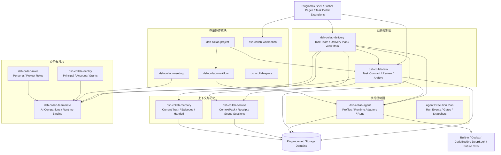
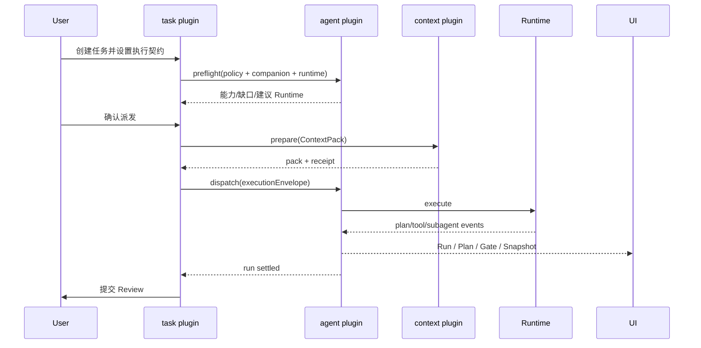
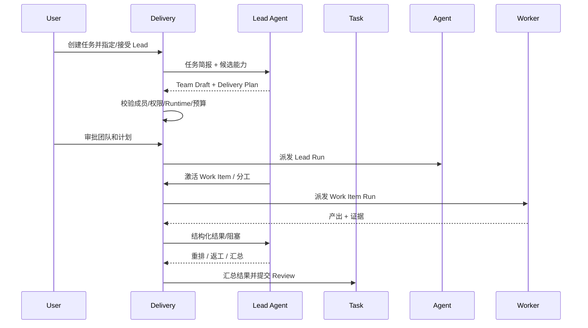

# 技术设计：Agent 任务控制与动态 AI 团队总体架构

> 版本：v1.0  
> 日期：2026-10-25  
> 状态：顶层架构基线，供阶段一、阶段二详细设计共同引用  
> 产品依据：[产品设计：任务管理作为 Agent Runtime 的超级遥控器](../../产品设计-任务管理作为Agent运行时超级遥控器.md)  
> 分阶段设计：
>
> - [阶段一：Runtime Agent Execution Plan 闭环](./technical-design-phase1-agent-execution-plan.md)
> - [阶段二：Task Delivery Plan 与动态 AI 团队](./technical-design-phase2-task-delivery-plan.md)

## 0. 结论

本方案将“任务管理作为 Agent 超级遥控器”拆成两条明确的产品与技术路线：

```text
阶段一
Task
  → Runtime / Agent
  → Agent Execution Plan
  → Run / Evidence / Review

阶段二
Task
  → Task Team
  → Task Delivery Plan
  → Work Item
  → Agent Run
  → Agent Execution Plan
```

核心技术判断：

1. **任务控制面不执行 Agent 工具，只定义契约、组织责任、分发权限和验收结果。**
2. **Runtime 执行计划属于 Runtime / Agent 域，平台只标准化、持久化和展示。**
3. **Task Team、Task Delivery Plan、Work Item 属于阶段二的独立交付编排域，不塞进 `dsh-collab-task`。**
4. **Lead Agent 是显式 AI Principal，不是平台隐藏 Agent；平台保留计划、授权、状态和审计的最终治理权。**
5. **存量插件只通过公开 `ctx` 服务、版本化 DTO 和领域事件协作，不直接 import 其他插件内部实现。**
6. **每个插件独立拥有 UI、服务、存储、路由和降级行为；跨插件功能通过能力就绪检查组合启用。**
7. **命令走同步服务接口，通知走版本化事件；正确性依赖持久状态与对账，不依赖 `ctx.emit` 是否送达。**
8. **阶段一不得依赖任何阶段二对象；阶段二只增量增加编排域，不重写阶段一执行链。**

## 1. 设计目标与边界

### 1.1 目标

- 同时支持平台内置 Runtime、Codex、CodeBuddy、DeepSeek 及未来 Runtime。
- 支持任务、工作流、会议和聊天共用同一 Agent Run 执行底座。
- 支持阶段一单 Agent 闭环和阶段二多 Agent 动态团队。
- 支持 Runtime 能力和工具持续增长，不因新增工具反复修改任务模型。
- 支持任务控制、Agent 执行、上下文、记忆、身份和 UI 插件独立安装。
- 支持插件卸载、缺失依赖、版本落后和 Runtime 不可用时的可解释降级。
- 支持可恢复、可重试、可审计的跨插件协作。

### 1.2 非目标

- 本阶段不实现任意 Agent 无限自主组织。
- 不把 Runtime 内部每个工具步骤变成平台 Work Item。
- 不允许插件直接修改其他插件 storage domain。
- 不依赖修改 `vendor/deepseek-harness`。
- 不引入中心化微服务、消息队列或分布式事务；继续在现有 DSH 宿主进程与插件体系中落地。
- 不承诺所有外部 CLI 都支持阻断式工具门禁。

## 2. 架构原则

### 2.1 领域优先，不按页面拆服务

服务边界按领域责任划分，而不是按页面区块划分：

- Task 拥有任务契约与生命周期。
- Agent 拥有 Run、Runtime 适配和 Agent Execution Plan。
- Context 拥有上下文装配与回执。
- Memory 拥有当前真相、Agent 私有记忆和交接卡。
- Delivery 拥有 Task Team、Task Delivery Plan、Work Item 和 Lead 编排。

页面可以聚合多个领域，但不得成为跨域状态的所有者。

### 2.2 插件自闭环

每个插件必须满足：

1. 有自己的 `package.json`、`cordis.patch.yml`、Host 半侧、Client 半侧和测试。
2. 只打开自己的 storage domain。
3. 只通过 `ctx.provide()` 暴露公开服务。
4. 对其他业务插件使用 `ctx.get()` / `ctx.inject()` 做能力探测。
5. 缺失软依赖时，不崩溃、不返回伪造结果，而是显示明确降级态。
6. 卸载本插件后，不破坏其他插件已拥有的数据。
7. UI 功能由本插件贡献，不 patch 其他插件构建产物。

### 2.3 能力契约优先

跨插件不直接依赖具体实现类，而依赖以下契约：

- 领域服务接口；
- 版本化 DTO；
- 版本化领域事件；
- HTTP DTO；
- UI Slot / 面板贡献；
- Runtime Adapter；
- Context Scene Adapter。

跨域契约放入轻量 `@pluginmax/contracts`，只包含 Zod schema、纯类型和版本常量，不包含存储或业务实现。

### 2.4 事实快照不可变

以下事实写入后不可原地覆盖：

- Run 的 Execution Envelope；
- Agent Execution Plan 版本；
- Task Delivery Plan 版本；
- Team Roster 版本；
- Execution Gate 决策；
- Work Item 状态事件；
- 工具事件和证据引用。

可变对象只保存“当前指针”和状态；历史通过版本表 / 事件表读取。

### 2.5 命令同步，通知异步

- 创建 Run、批准 Gate、变更 Work Item 等命令走同步服务调用。
- “Run 已结束”“任务已变更”等通知走领域事件。
- 领域事件不承担唯一事实来源。消费者必须能通过 ID 回源和对账。
- 所有跨域写操作使用稳定 `dispatchKey`、`commandId` 或 `eventId` 实现幂等。

### 2.6 平台治理与 Agent 自主分层

```text
平台治理
  权限 / 预算 / Team 合法性 / Plan 校验 / Gate / 状态 / 审计
      ↓ 授权与契约
Lead Agent
  拆解 / 组队 / 分工 / 上下文协调 / 交互 / 重排 / 汇总
      ↓ Work Item 契约
Runtime Agent
  内部步骤 / 工具 / 子 Agent / 局部重试
```

Lead Agent 的组织权来自任务授权和平台规则，不来自 SOUL。

## 3. 总体逻辑架构



## 4. 插件边界与变更分类

### 4.1 存量插件职责

| 插件                   | 当前职责                              | 本方案职责                                                           |
| ---------------------- | ------------------------------------- | -------------------------------------------------------------------- |
| `dsh-collab-shell`     | 全局导航、页面容器、路由与 UI Slot    | 增加任务详情扩展 Slot 和插件能力就绪视图；不拥有业务数据             |
| `dsh-collab-identity`  | Principal、账号、Grant、审计          | 保持授权主体；为团队/Work Item 提供权限判定输入                      |
| `dsh-collab-roles`     | Persona、角色库、席位                 | 为 AI伙伴能力描述提供人设引用；不参与 Team 生命周期                  |
| `dsh-collab-teammate`  | AI伙伴定义、实例、Runtime 绑定        | 增加 Team 候选投影和 Runtime Pool 查询；保持既有 assignable 契约     |
| `dsh-collab-agent`     | Profiles、外部 Runtime、Agent Run     | 阶段一核心扩展：能力解析、Execution Envelope、Plan、事件、Gate、快照 |
| `dsh-collab-context`   | ContextPack、Receipt、Scene Session   | 阶段二增加 Team / Work Item Scene Adapter 支持；不放团队业务规则     |
| `dsh-collab-memory`    | 项目当前真相、Agent 私有记忆、Handoff | 为 Team / Work Item 提供交接卡、当前真相和记忆写入                   |
| `dsh-collab-task`      | Task 聚合、Review、归档               | 增加执行契约、运行聚合视图和阶段一控制 UI；不承载 Task Team          |
| `dsh-collab-workflow`  | 工作流状态机与审批                    | 继续作为独立流程权威；Agent Run 增强对其透明                         |
| `dsh-collab-meeting`   | 会议和参与者                          | 继续通过 Teammate / Agent / Context 使用 AI伙伴                      |
| `dsh-collab-project`   | 项目扩展信息、成员和角色              | 提供 Team 的 Workspace / Project 边界，不保存 Team                   |
| `dsh-collab-space`     | 共享文件、锁、摘要                    | 为 Work Item 提供文件证据；不参与计划编排                            |
| `dsh-collab-workbench` | 工作台聚合                            | 可聚合待授权 Gate、待确认 Team/Plan、Work Item 异常                  |
| `dsh-collab-employee`  | Legacy 兼容层                         | 不新增能力；只保留历史 Run、Ticket、Delegation 读取                  |
### 4.2 新增插件

#### `dsh-collab-delivery`

阶段二新增，独立承载：

- Task Team；
- Team Draft 和版本；
- Task Delivery Plan 和版本；
- Work Item；
- Lead Orchestration Cycle；
- 跨 Agent 协作事件；
- Work Item 到 Agent Run 的绑定与对账；
- Team 与 Delivery Plan UI。

它不负责：

- Agent 进程启动和 Runtime 协议；
- ContextPack 渲染；
- 记忆抽取；
- Principal / Grant 定义；
- Task 主状态与 Review 权威；
- Workflow 节点状态。

### 4.3 依赖方向

```text
contracts / shared
        ↑
identity → teammate → agent → task
                         ↘ context → memory
                              ↑
                           delivery
                              ↓
                       task / teammate / agent
```

约束：

- 箭头表示调用方向，不表示直接 import 内部模块。
- `delivery` 可以要求 `task + agent + teammate`；`context` 是完整上下文闭环的必需能力，`memory` 为可选增强。
- `task` 不依赖 `delivery`。
- `agent` 不依赖 `task`；通过通用 Run Source Handler 向上通知。
- `context` 不依赖 `delivery`；通过 Scene Adapter 扩展。
- 依赖缺少时，插件进入自身声明的降级模式。

## 5. 插件自闭环与安装组合

### 5.1 单插件模式

每个插件至少提供一个独立可感知入口：

| 插件     | 独立可用能力                                     |
| -------- | ------------------------------------------------ |
| Task     | 人工任务管理、验收、退回、归档                   |
| Agent    | Runtime 管理、受控 Run、Run 观察                 |
| Teammate | AI伙伴定义和运行态                               |
| Context  | 上下文回执查询                                   |
| Memory   | 记忆 Review 和当前真相                           |
| Workflow | 无 Task / Agent 也能完成人工工作流               |
| Meeting  | 会议与人工参与者                                 |
| Project  | 项目空间与角色                                   |
| Delivery | Team/Plan 草稿和依赖就绪检查；完整编排需依赖插件 |

`dsh-collab-delivery` 的业务价值天然建立在 Task、Agent 和 Teammate 之上。它在依赖缺失时必须显示“能力未就绪”，而不是留下半运行的团队记录。

插件独立安装验收：

1. 空数据库首次启动可正常打开自己的入口；
2. 自己拥有的核心对象可创建、读取、更新和归档；
3. 软依赖缺失时不显示不可用按钮，也不抛出未处理异常；
4. 必需依赖缺失时显示安装/授权 checklist；
5. 卸载后再次安装，不会因僵尸 Session、旧 Slot 或残留内存状态崩溃；
6. 插件不能通过“页面能打开”冒充业务闭环，必须有可验证的完成态。

### 5.2 能力描述

每个插件可在 `package.json` 中声明非执行型元数据，供安装与诊断使用：

```json
{
  "pluginmax": {
    "contractVersion": "1",
    "provides": ["task.contract.v1", "task.review.v1"],
    "requires": ["identity.principal.v1"],
    "optional": ["agent.execution-plan.v1", "context.pack.v1"]
  }
}
```

该元数据不替代运行时探测；插件加载后仍需通过 `ctx.get()` 检查真实能力。

### 5.3 Readiness 契约

每个插件暴露或上报：

```ts
interface PluginReadiness {
  pluginId: string;
  version: string;
  status: "ready" | "degraded" | "blocked";
  provides: string[];
  missingRequired: string[];
  missingOptional: string[];
  availableActions: string[];
  degradedActions: string[];
}
```

宿主 UI 在“插件能力”设置页展示，不把异常只写终端日志。

### 5.4 推荐安装组合

| 组合           | 插件                                                                      |
| -------------- | ------------------------------------------------------------------------- |
| 基础任务       | shell + identity + task                                                   |
| 阶段一任务控制 | shell + identity + roles + teammate + agent + context + task；memory 推荐 |
| 工作流 Agent   | shell + identity + workflow + agent；roles / memory 可选                  |
| 阶段二 AI 团队 | 阶段一组合 + delivery + memory                                            |

仓库提供 profile/manifest 安装脚本。单插件仍可 `dsh plugin add`，组合安装只负责依赖完整度和开机顺序，不改变插件边界。

建议启动顺序：

```text
storage/web/agent host
  → shell
  → identity
  → roles
  → teammate
  → context
  → memory
  → agent
  → task
  → delivery
  → workflow / meeting / project / workbench
```

除授权和宿主能力外，业务依赖仍通过 `ctx.get()` / `ctx.inject()` 动态解析；不能依赖配置文件中“碰巧排对顺序”来保证语义正确。

## 6. 跨插件契约

### 6.1 `@pluginmax/contracts`

建议从现有 `@pluginmax/shared` 中拆出纯契约包：

```text
packages/contracts/
  runtime-capability.ts
  task-execution-policy.ts
  execution-envelope.ts
  agent-execution-plan.ts
  run-event.ts
  execution-gate.ts
  task-team.ts
  delivery-plan.ts
  work-item.ts
  collaboration-event.ts
  domain-event.ts
```

规则：

- 只依赖 Zod，不依赖 Cordis、Storage、React。
- 每个 schema 带 `schemaVersion`。
- 破坏性变更创建新文件与版本，不直接改旧 schema 语义。
- 插件内部模型可以扩展更多字段，但对外投影只返回契约字段。

### 6.2 服务端口

阶段一核心端口：

```ts
interface AgentExecutionControlPort {
  preflight(input: ExecutionPreflightInput): Promise<ExecutionPreflightResult>;
  dispatch(input: ExecutionDispatchInput): Promise<AgentRunProjection>;
  execution(runId: string): ExecutionProjection | undefined;
  events(runId: string, afterSeq?: number): readonly RunEvent[];
  decideGate(input: GateDecisionInput): Promise<ExecutionGate>;
  cancel(runId: string): Promise<AgentRunProjection>;
}
```

阶段二核心端口：

```ts
interface DeliveryControlPort {
  proposeTeam(input: ProposeTeamInput): Promise<TeamDraftProjection>;
  validateTeamDraft(
    input: ValidateTeamDraftInput,
  ): Promise<TeamValidationResult>;
  approveTeam(input: ApproveTeamInput): Promise<TaskTeamProjection>;
  requestPlan(input: RequestPlanInput): Promise<DeliveryPlanProjection>;
  approvePlan(input: ApprovePlanInput): Promise<DeliveryPlanProjection>;
  dispatchReadyWorkItems(
    input: DispatchReadyWorkItemsInput,
  ): Promise<DispatchCycleResult>;
  updateTeam(input: TeamChangeInput): Promise<TaskTeamProjection>;
  requestReplan(input: RequestReplanInput): Promise<void>;
  listWorkItems(input: { teamId: string }): readonly WorkItemProjection[];
  events(teamId: string, afterSeq?: number): readonly CollaborationEvent[];
}
```

### 6.3 领域事件

统一事件信封：

```ts
interface CollabDomainEvent<T> {
  id: string;
  type: string;
  version: 1;
  occurredAt: string;
  workspaceId: string;
  aggregateType: string;
  aggregateId: string;
  actorPrincipalId?: string;
  correlationId?: string;
  causationId?: string;
  payload: T;
}
```

建议事件：

- `task.execution-policy.updated.v1`
- `agent.run.started.v1`
- `agent.run.event.v1`
- `agent.plan.changed.v1`
- `agent.gate.requested.v1`
- `agent.gate.decided.v1`
- `agent.run.settled.v1`
- `delivery.team.proposed.v1`
- `delivery.team.activated.v1`
- `delivery.plan.activated.v1`
- `delivery.work-item.changed.v1`
- `delivery.work-item.handoff.v1`
- `delivery.team.replan-requested.v1`

事件只用于降低延迟；查询和恢复必须回源到 owner service。

## 7. 数据架构

### 7.1 Domain 所有权

| Domain                             | Owner    | 数据                                                                               |
| ---------------------------------- | -------- | ---------------------------------------------------------------------------------- |
| `collab_task`                      | task     | Task 聚合、验收、Review、运行引用                                                  |
| `collab_agent`                     | agent    | Profile、Run、外部 Runtime 定义                                                    |
| `collab_agent_execution`           | agent    | Capability Snapshot、Execution Envelope、Plan、Run Event、Gate、Execution Snapshot |
| `collab_context`                   | context  | Scene Session、ContextPack、Receipt                                                |
| `collab_memory`                    | memory   | Truth、Claim、Episode、Handoff、Review                                             |
| `collab_delivery`                  | delivery | Team、Plan、Work Item、Lead Cycle、协作事件                                        |
| `collab_teammate`                  | teammate | AI伙伴定义、实例、Runtime 绑定                                                     |
| `collab_team` / `collab_principal` | identity | Principal、Account、Grant、审计                                                    |

### 7.2 跨域引用

只保存稳定 ID 和必要快照：

- Task 保存 `executionPolicy` 和 `agentRunIds`；
- Run 保存 `contextPackId`、`ticketId`、`principalId`；
- Delivery 保存 `taskId`、`teamId`、`workItemId`、`runId`；
- Context 保存 `objectId` 和 SourceRef；
- Memory 保存来源引用；
- 不复制其他域的可变整对象。

UI 聚合通过 service / HTTP projection 完成。

### 7.3 存量 Domain 迁移约束

DSH 现有 storage domain 默认是 `single` 布局：

- 已存在 domain 的 unit version 不能在插件启动前自动迁移；版本不匹配会导致 `open()` 直接失败。
- 存量记录必须保持 schema 向后兼容。
- 新字段先 optional，新表可以同域增量声明。
- 数据回填在 `open()` 之后执行，必须幂等。
- 不能使用 `invalidRecords: backup-and-skip` 掩盖权威数据错误。

因此：

- 阶段一新增的 Execution Plan / Gate / Event 使用新 `collab_agent_execution` domain，避免抬升 `collab_agent` 版本。
- Task 只增加 optional 执行契约字段；先读写兼容，再在后续版本收紧。
- 阶段二使用全新 `collab_delivery` domain，不修改任务主域结构。
- 每个 domain 变更附旧格式 fixture、升级测试和整文件回滚方案。

## 8. 可靠性与一致性

### 8.1 本地事务 + Saga

跨插件不能共享事务。采用：

1. owner domain 先写入带 `pending` 状态的本地记录；
2. 调用下游服务并传稳定幂等键；
3. owner 记录下游 ID，状态转 `bound`；
4. 失败后由协调器按幂等键重试或补偿；
5. 对账器扫描超时 `pending` 记录。

示例：

```text
Task 记录 pendingDispatchKey
  → Agent.dispatch(dispatchKey)
  → Agent 返回 runId
  → Task 绑定 runId
```

若最后一步失败，Task 可通过 `dispatchKey` 搜索现有 Run 并补绑定。

### 8.2 Outbox

需要异步通知的插件增加本地 `outbox` 表：

```ts
interface DomainOutboxRecord {
  id: string;
  eventType: string;
  eventVersion: number;
  aggregateId: string;
  payload: unknown;
  status: "pending" | "published" | "failed";
  attempts: number;
  nextAttemptAt?: string;
}
```

`ctx.emit()` 只用于已写入 outbox 事件的快速发布。消费者按事件 ID 去重。

### 8.3 对账优先

以下链路必须有 reconciler：

- Task pending run binding；
- Agent Run 终态未回写 Task；
- Delivery Work Item 处于 `dispatching` 或 `running` 但 Run 已结束；
- Lead Cycle 未关闭；
- Team/Plan 状态与成员状态不一致。

### 8.4 重启恢复

- Agent Run 继续沿用 queued 重放、running → interrupted 规则。
- Delivery Orchestrator 在启动后恢复 `dispatching`、`waiting_lead` 和 `waiting_human` 状态。
- Lead Session 可通过 Context Plugin 的稳定 Session Binding 恢复。
- Gate pending 状态持久化，不因进程重启丢失。

## 9. 权限与安全

### 9.1 有效权限

```text
有效执行权限 =
  Principal / Grant
  ∩ AI Companion 状态
  ∩ Runtime Profile
  ∩ Task / Work Item Policy
  ∩ Runtime Capability
  ∩ 用户本轮授权
```

### 9.2 Runtime 与业务授权分离

- Runtime Profile 只限制执行方式与工具。
- Role Grant 决定业务资源访问。
- Task Policy 进一步缩小本轮范围。
- Action Ticket 绑定 Principal、Context 和有效期。
- Runtime 能力声明不能自动获得 Grant。

### 9.3 Gate 执行强度

Runtime Capability 增加：

```ts
type GateEnforcement =
  | "blocking" // 动作执行前可暂停并等待决策
  | "cooperative" // Runtime 主动上报并暂停
  | "observe-only"; // 平台只能观察后终止/审计
```

高风险动作只允许在 `blocking` 或满足外部沙箱控制的情况下自动运行。`observe-only` 不得被 UI 描述为“已阻止”。

## 10. UI 扩展架构

### 10.1 阶段一

- `dsh-collab-task` 在自己拥有的任务详情中聚合 Agent Execution Plan。
- `dsh-collab-agent` 提供自己的 Runtime 管理面和 Run 详情面。
- 如果 Agent 插件未安装，任务详情不显示空计划区域。
- 如果 Plan 不可见，显示 `opaque` / `derived-summary` 状态，而不是伪造步骤。

### 10.2 阶段二

`dsh-collab-shell` 增加版本化任务详情扩展 Slot：

```text
pluginmax.task.detail.tabs
  props: { taskId, workspaceId, refreshToken, canManage }
```

`dsh-collab-delivery` 注册：

- `团队`
- `交付计划`

`dsh-collab-task` 继续拥有：

- 任务头部、状态、当前负责人
- 执行
- 交付物
- Discussion
- 历史

扩展 Slot 的注册必须可释放；卸载 Delivery 后两个页签消失，任务详情仍正常使用。

若当前 SlotRegistry 不适合动态 props，使用 `pluginmax.task-selection` 轻量 store 作为临时桥接，但只能由 Shell 定义版本化合同，禁止各插件自行挂全局 DOM。

## 11. Runtime 与工具扩展模型

### 11.1 Adapter 注册表

```ts
interface RuntimeAdapter {
  readonly id: string;
  describe(input: RuntimeDescriptorInput): Promise<RuntimeCapabilityProfile>;
  resolve(input: RuntimeResolveInput): Promise<ExecutionEnvelope>;
  execute(input: RuntimeExecuteInput): Promise<RuntimeExecutionResult>;
  parseEvent?(raw: unknown): RuntimeEventDraft | undefined;
}
```

内置 Session、Codex JSONL、plain-text CLI 和未来协议都实现同一端口，但可声明不同的可见性和 Gate 能力。

### 11.2 工具类别

工具策略按稳定类别表达：

- `fs.read`
- `fs.write`
- `shell.execute`
- `web.search`
- `web.fetch`
- `browser.control`
- `mcp.<connector>`
- `notify.send`
- `data.delete`
- `external.publish`

新增具体工具优先映射到现有类别；只有出现新风险语义时才增加类别，不直接修改 Task schema。

### 11.3 Plan 可见性

```ts
type PlanVisibility = "structured" | "summary" | "opaque";
```

- `structured`：有步骤、工具、子 Agent、Gate 和产出事件。
- `summary`：有阶段、主要动作、等待原因和结果。
- `opaque`：只有 Run 生命周期、最终输出和错误。

UI 必须显示 `source: explicit | derived | unavailable`。

## 12. 阶段一路径



阶段一完整设计见 [technical-design-phase1-agent-execution-plan.md](./technical-design-phase1-agent-execution-plan.md)。

## 13. 阶段二路径



阶段二完整设计见 [technical-design-phase2-task-delivery-plan.md](./technical-design-phase2-task-delivery-plan.md)。

## 14. 非功能要求

### 14.1 性能

- Run 事件写入按 Run 串行，跨 Run 可并行。
- 每 200-500ms 批量推送或由客户端增量拉取，不逐 token 持久化。
- 计划快照限制步骤数量，工具事件按摘要 + 引用存储。
- 任务详情首屏不加载全部事件，先加载最新 Run、计划摘要和待处理 Gate。

### 14.2 可观测性

- 终端 trace 保留 PID、Runtime、Run、命令摘要、退出码。
- 页面显示 Run 元数据、Plan 可见性、Gate 状态和 Context Receipt。
- 关键跨插件命令写 `correlationId`，可串联 Task → Delivery → Work Item → Run。

### 14.3 安全

- 所有浏览器路由 same-origin + Bearer。
- 指令和 payload 由服务端 schema 校验。
- 工具参数按白名单和类别检查。
- 不将原始环境变量、凭据、完整私有文件写入事件。
- 任何越权请求写安全审计。

### 14.4 兼容性

- Node.js >= 24。
- 不修改 upstream。
- 旧 AgentRun、Task、ContextPack 记录可继续读取。
- 任何新表 / 新字段先以 optional 或独立 domain 引入。

## 15. 测试架构

### 15.1 单插件闭环

每个插件验证：

- 无其他业务插件时可启动；
- 自有页面 / API 可用；
- 缺失软依赖时 readiness 为 degraded；
- 缺失必需依赖时 blocked，不产生半状态。

### 15.2 契约测试

- `@pluginmax/contracts` schema 前后兼容；
- Task ↔ Agent 执行契约；
- Delivery ↔ Agent run source handler；
- Context Scene Adapter；
- Runtime Adapter fixtures；
- Gateway readiness 投影。

### 15.3 集成测试

- 阶段一：Task → Agent → Plan/Event → Review；
- 阶段二：Task → Team/Plan → Work Item → Run → Lead → Review；
- 插件缺失和重装；
- 服务重启恢复；
- 事件丢失后的对账恢复。

### 15.4 GUI 测试

- 阶段一任务详情无空 Team/Plan 页；
- 运行元数据、计划可见性和授权等待可读；
- 阶段二团队、计划、Work Item 和多 Run 切换；
- 插件卸载后扩展页签消失且任务不损坏；
- 窄屏和长文本不重叠。

## 16. 实施顺序

1. 建立 `@pluginmax/contracts` 和 capability readiness 基础。
2. 完成阶段一 Agent Execution 新 domain 与 Adapter。
3. Task 增加执行契约和阶段一 UI，保持 delivery 无依赖。
4. Context 接入 Execution Policy / Source Policy，修正通用禁止外部来源的策略。
5. 阶段一灰度与对账、历史回填。
6. 新增 `dsh-collab-delivery` domain 和服务。
7. Teammate 增加候选投影，Agent 增加通用 Run Source Handler。
8. Context / Memory 增加 Team / Work Item Scene 与 Handoff。
9. Delivery UI、Lead tools、动态重排。
10. 阶段二灰度、插件组合安装和回滚验证。

## 17. 风险与控制

| 风险                          | 控制                                                       |
| ----------------------------- | ---------------------------------------------------------- |
| Task 插件因聚合多个域而过肥   | Task 只聚合投影；Plan/Team/Work Item 数据在他域            |
| Delivery 变成第二个工作流引擎 | Delivery 只做任务级 AI 团队编排；正式流程仍归 Workflow     |
| Runtime 能力声明失真          | Probe + Adapter + Run 快照分层，unknown 不升级为 supported |
| 外部 CLI 无法阻断高风险动作   | Capability 标明 blocking / cooperative / observe-only      |
| 事件丢失导致状态停滞          | Outbox + 回源 + reconciler                                 |
| 插件卸载后 UI 崩溃            | 扩展注册可释放，能力探测与 readiness                       |
| Lead Agent 越权               | Action Ticket、团队范围、工具白名单、人工审批              |
| 计划版本把已完成工作覆盖      | 不可变版本 + Work Item 状态和产出保留                      |
| 大量 Agent 事件压垮存储       | 摘要化、批量、限额、引用原文                               |
| 上下文串台                    | Context Adapter、场景隔离、Receipt                         |

## 18. 待冻结决策

1. `@pluginmax/contracts` 作为新包，还是先并入 `@pluginmax/shared`。
2. `collab_agent_execution` 与 `collab_delivery` domain 名称是否按本文冻结。
3. Agent Execution Plan 的最低结构化协议和 plain-text Runtime 的 summary 投影规则。
4. Task Detail 扩展 Slot 使用 SlotRegistry 还是临时 selection store。
5. Delivery 的必需依赖是否包含 Memory，还是首期可选。
6. Team Draft 自动批准阈值和 Lead 团队变更预算。
7. Work Item 是否允许成为正式子 Task；本文建议只在跨队列或独立验收时物化。

## 19. 分阶段文档

- [阶段一详细设计](./technical-design-phase1-agent-execution-plan.md)
- [阶段二详细设计](./technical-design-phase2-task-delivery-plan.md)
