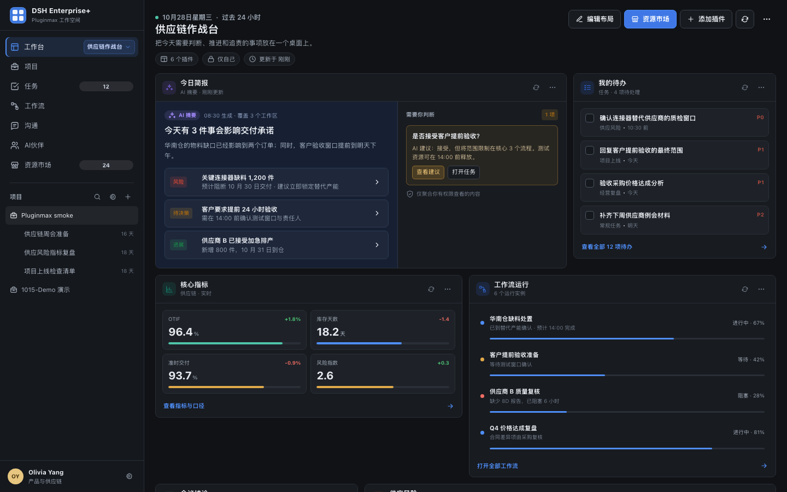
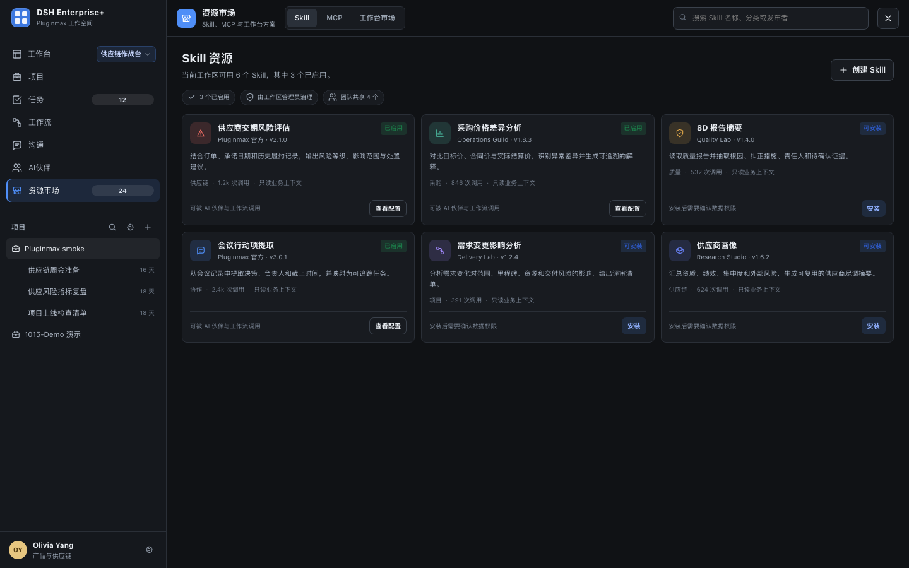

# dsh-pluginmax 工作台 2.0：可插拔工作台与资源市场 PRD

> 文档版本：v1.0  
> 日期：2026-10-28  
> 状态：产品方案评审稿  
> 目标读者：产品、设计、前端、后端、测试、插件开发者  
> 关联实现：[工作台插件](../plugins/dsh-collab-workbench/README.md)、[平台交互与视觉设计规范](./platform-interaction-design-guideline.md)  
> 交互 Demo：[workbench-plugin-market-demo.html](./demos/workbench-plugin-market-demo.html)

---

## 0. 一页结论

工作台从“系统预先编排的一张固定看板”升级为“用户拥有、可安装、可组合、可切换的个人操作界面”。

用户不再只拥有一个工作台，而是可以拥有多个工作台实例，例如“供应链作战台”“本周复盘”“项目上线”“个人专注台”。每个工作台由一组独立的功能面板插件组成，用户可以在不写代码的情况下增删、排序、调整尺寸和配置面板。

资源市场统一承载 Skill、MCP 与工作台市场；其中工作台市场承担两类资产的发现与安装：

1. **工作台方案**：一套可立即使用的布局与面板组合，安装时复制为用户自己的可编辑工作台；
2. **功能面板插件**：可被任意工作台引用的独立能力，例如任务、工作流、会议、指标、供应链风险、行业雷达。

三个关键产品判断：

- **工作台实例属于用户，不依附于某一次会话**。会话可以记住偏好，但工作台不会因会话结束而消失。
- **市场方案采用复制制，不采用全局覆盖制**。市场更新不会直接改变用户已经保存的工作台。
- **工作台只是 UI 组合层，不授予任何业务权限**。插件能看到什么，仍由用户、工作区、项目和资源权限共同决定。

---

## 1. 背景与问题

### 1.1 当前状态

现有工作台已具备核心指标、每日简报、待办、关注、会议纪要、供给例外和供应商风险七个固定模块，并支持拖拽排序、宽度与高度调整、布局保存。

这解决了“信息聚合”问题，但没有解决“工作方式差异”问题：

- 一线运营需要处理今日异常和待办；
- 产品经理需要同时看任务、会议、项目里程碑；
- 管理者需要看团队负载、流程阻塞和风险；
- 分析人员需要看指标趋势、外部情报和数据源状态。

这些用户打开系统时面对的是同一张工作台，只能通过调整同一套模块来勉强适配。

### 1.2 用户问题

| 问题 | 当前表现 | 结果 |
| --- | --- | --- |
| 工作场景切换成本高 | 不同任务共用一套布局，模块互相干扰 | 用户频繁收起和重排模块 |
| 无法同时保留多套工作方式 | “布局”只改变顺序和尺寸，不改变能力组合 | 计划、执行、复盘场景互相侵占 |
| 新能力接入依赖研发 | 新面板必须修改工作台代码 | 插件生态无法快速增长 |
| 市场资产与个人配置混淆 | 模板、已安装能力、当前布局没有统一模型 | 更新和覆盖行为不可预期 |
| 权限边界不清晰 | 用户容易把“看见面板”误解为“获得数据权限” | 存在越权认知与审计风险 |

### 1.3 设计依据

DeepSeek Harness 的插件市场与客户端插件机制提供了三个可复用原则：

1. 能力通过可发现、可安装、带版本的插件资产扩展；
2. 主界面通过槽位和客户端 bundle 组合，不要求修改上游内核；
3. 市场负责发现与分发，运行时负责加载与隔离，二者不能混为一个对象。

本方案沿用这些原则，并把“工作台方案”和“功能面板插件”明确拆开。仓库现有调研结论也表明：行业内已有会话级布局、面板注册和模板切换的积木，但尚未形成“多工作台实例 + 插件市场 + 用户自行组合”的完整闭环。

---

## 2. 产品定义

### 2.1 工作台实例 Workbench

用户拥有的一份命名界面配置，包含：

- 名称、图标、颜色和描述；
- 可见范围；
- 布局栅格与面板顺序；
- 每个面板的实例配置；
- 草稿版本与已发布版本。

工作台实例是用户主入口，不等同于工作区、会话或项目。

### 2.2 功能面板插件 Panel Plugin

一个独立交付、可被工作台引用的功能单元。插件声明名称、版本、发布者、图标、默认尺寸、数据权限、配置项和兼容范围。

示例：今日简报、任务焦点、工作流运行、会议结论、供应风险、团队负载、外部情报。

### 2.3 工作台方案 Workbench Template

市场中的一份组合快照，包含布局、面板清单、默认配置、封面和使用说明。安装时复制为一个新的工作台实例，并建立“来源方案 + 版本”的弱关联。

后续可选能力：

- 订阅来源方案更新；
- 查看新旧版本差异；
- 选择性合并，不自动覆盖。

### 2.4 工作台市场 Workbench Market

工作台方案与面板插件的统一发现页面，支持分类、搜索、详情、权限说明、安装、复制、更新和版本兼容提示。

### 2.5 资源市场 Resource Market

平台级右侧资源面板，统一承载 `Skill / MCP / 工作台市场` 三类资产。资源市场是入口和治理外壳，不改变 Skill、MCP 与工作台方案的原有对象定义。

### 2.6 概念关系

```text
工作台市场
├── 工作台方案 ──复制──> 工作台实例
└── 功能面板插件 ──安装/引用──> 工作台实例 ──加载──> 面板实例

资源市场
├── Skill
├── MCP
└── 工作台市场

工作区：数据与协作容器
会话：人与 Agent 的对话
工作台：用户操作这些数据和能力的界面组合
```

---

## 3. 目标与非目标

### 3.1 产品目标

1. 用户可以在 10 秒内切换到另一套完整工作台，并保留各自的面板和布局状态。
2. 用户可以在 3 分钟内从市场复制一套方案并开始使用。
3. 用户可以在编辑模式中完成面板添加、移除、排序、调整宽度和配置。
4. 第三方面板插件可以独立接入，不需要修改工作台主代码。
5. 工作台、方案和插件的更新与权限边界可解释、可回滚、可审计。

### 3.2 成功指标

以下为 MVP 上线后的观测目标，基线值在灰度前补齐：

| 指标 | 目标 |
| --- | --- |
| 新建第二个工作台的用户占比 | ≥ 25% |
| 周内发生工作台切换的用户占比 | ≥ 35% |
| 市场方案复制成功率 | ≥ 90% |
| 复制方案后 7 日仍保留至少 1 个面板的用户占比 | ≥ 60% |
| 编辑模式保存成功率 | ≥ 98% |
| 插件加载失败导致整页不可用的比例 | < 0.1% |
| 工作台切换后布局或状态丢失率 | < 0.5% |
| 面板安装前权限说明查看率 | ≥ 80% |

### 3.3 非目标

首版不做：

- 用户编写任意 JavaScript 后直接运行；
- 工作台内自由浮动的无限画布；
- 多人实时协同编辑同一画布；
- 绕过平台权限的插件数据访问；
- 以工作台替代项目、任务、会议或工作流详情页；
- 自动接受市场方案更新并覆盖用户配置；
- 公开第三方付费交易与分成体系。

---

## 4. 用户与核心场景

| 用户 | 典型工作台 | 核心任务 |
| --- | --- | --- |
| 一线运营 | 今日执行台 | 看异常、处理待办、追踪供应商和交付 |
| 项目负责人 | 项目作战台 | 看里程碑、风险、会议结论、成员负载 |
| 产品经理 | 产品发现台 | 看反馈、任务、路线图、外部情报 |
| 管理者 | 经营驾驶舱 | 看组织负载、流程阻塞、跨项目风险 |
| 平台管理员 | 插件治理台 | 管控插件来源、版本、权限和审计 |
| 插件开发者 | 开发者控制台 | 发布、验证、灰度、下架插件与方案 |

### 4.1 核心用户旅程

1. 用户第一次进入工作台，看到系统默认工作台；
2. 用户打开“资源市场 > 工作台市场”，搜索“供应链”并查看方案详情；
3. 用户复制方案，得到自己的“供应链作战台”；
4. 用户进入编辑模式，移除不需要的面板，添加“团队负载”；
5. 用户保存并设为常用；
6. 用户在“供应链作战台”和“本周复盘”之间切换；
7. 每次返回时，面板顺序、配置和最近查看状态保持。

---

## 5. 信息架构

### 5.1 全局入口

左侧导航沿用现有 dsh-pluginmax PC 壳层，不另外创造一套信息架构：

```text
DSH Enterprise+
├── 工作台            [当前工作台名称 ▾]
├── 项目
├── 任务
├── 工作流
├── 沟通
├── AI伙伴
└── 资源市场
```

- “工作台”行右侧展示当前使用的工作台名称，并把名称与下拉按钮合并为行内切换器；
- 点击行内切换器打开工作台列表，不再在侧栏长期铺开全部工作台；
- “资源市场”固定放在“AI伙伴”下方；
- 资源市场与项目、任务等模块同级，点击后把右侧主内容区整体切换为资源市场；
- 只有进入“工作台市场”页签后，才展示工作台方案与功能面板插件；
- 页面右上角保留“编辑布局 / 资源市场 / 添加插件 / 刷新 / 更多”操作；
- 移动端将左侧栏收为抽屉，当前工作台切换器仍保持在“工作台”行内。

### 5.2 工作台使用态

```text
┌──────────────────────────────────────────────────────────┐
│ 当前工作台名称 / 说明 / 日期        编辑布局   资源市场   │
├──────────────────────────────────────────────────────────┤
│ 工作台名称 / 说明 / 日期 / 数据状态                       │
│                                                          │
│ ┌────────────────────────────┐ ┌───────────────────────┐ │
│ │ 功能面板插件 A              │ │ 功能面板插件 B         │ │
│ └────────────────────────────┘ └───────────────────────┘ │
│ ┌───────────────┐ ┌───────────────┐ ┌───────────────────┐ │
│ │ 功能面板插件 C │ │ 功能面板插件 D │ │ 功能面板插件 E     │ │
│ └───────────────┘ └───────────────┘ └───────────────────┘ │
└──────────────────────────────────────────────────────────┘
```

### 5.3 编辑态

- 主区进入“编辑中”状态；
- 面板显示拖拽把手、宽度设置、配置和移除入口；
- 右侧打开“插件库 / 面板设置”；
- 顶部提供撤销、重做、取消、保存；
- 离开前若有未保存修改，必须确认。

### 5.4 资源市场态

- 入口固定在左侧“AI伙伴”下方，点击后右侧主内容区整体切换为资源市场；
- 左侧导航保持可见，“工作台”取消选中，“资源市场”进入选中态；
- 不使用遮罩、抽屉或浮层，不叠压工作台内容；
- 点击返回、再次点击“工作台”或切换工作台后回到工作台页面；
- 顶部：资源市场标题、`Skill / MCP / 工作台市场` 三页签、搜索、关闭；
- `Skill`：展示可安装或已启用的技能资产；
- `MCP`：展示业务系统连接、协议、工具数量、授权范围和健康状态；
- `工作台市场`：展示本 PRD 定义的工作台方案与功能面板插件；
- 工作台市场内部继续使用左侧分类与主区列表；
- 方案或插件详情在当前右侧资源面板内继续向右展开，不跳回独立全屏页面。

### 5.5 管理态

工作台管理页展示：

- 我创建的；
- 团队共享给我的；
- 最近使用；
- 已隐藏；
- 草稿与已发布状态。

支持重命名、复制、设为常用、调整可见范围、导出和删除。

---

## 6. 核心流程

### 6.1 切换工作台

1. 用户点击左侧“工作台”行右侧的当前工作台名称；
2. 在当前行右侧弹出切换器，显示常用、最近、全部；
3. 当前工作台有明确选中态；
4. 点击其他工作台立即切换，不刷新整页；
5. 恢复该工作台自己的面板顺序、尺寸、配置、滚动位置和草稿；
6. 若当前工作台存在未保存编辑，先确认放弃或保存；
7. 记住每个用户的最后选择，下次进入直接恢复。

### 6.2 新建工作台

用户可选择三种起点：

- **空白工作台**：从插件库添加面板；
- **市场方案**：复制市场中的工作台方案；
- **复制现有**：完整复制当前工作台配置。

最低需要填写名称；图标、描述和可见范围可后补。创建成功后自动切换。

### 6.3 编辑工作台

1. 点击“编辑布局”；
2. 从右侧插件库添加面板；
3. 拖拽面板标题区调整顺序；
4. 在面板设置中调整宽度、标题、配置和可见条件；
5. 支持撤销、重做；
6. 点击保存后更新草稿；
7. 私有工作台立刻生效；共享工作台需要“发布更新”才对其他用户生效。

### 6.4 从市场复制工作台方案

1. 打开左侧“资源市场”，进入“工作台市场”页签，再打开方案详情；
2. 查看完整预览、包含面板、所需插件、权限和更新时间；
3. 点击“复制到我的工作台”；
4. 系统检查插件可用性和权限；
5. 名称冲突时自动追加序号；
6. 复制成功后切换到新工作台，并提供“继续调整”入口。

### 6.5 安装功能面板插件

1. 在“资源市场 > 工作台市场”中打开功能插件详情；
2. 展示发布者、版本、兼容性、数据访问和已安装状态；
3. 用户点击“添加到当前工作台”；
4. 若插件未安装，先进入安装确认；
5. 安装完成后面板出现在当前工作台下方；
6. 用户可继续排序和配置。

---

## 7. 功能需求

### 7.1 多工作台管理

| 编号 | 优先级 | 需求 | 验收标准 |
| --- | --- | --- | --- |
| WB-001 | P0 | 用户可以创建多个工作台 | 至少可创建 20 个；名称 1～40 字符 |
| WB-002 | P0 | 顶部切换器可切换工作台 | 切换后 300ms 内进入加载态，1s 内完成常用工作台首屏 |
| WB-003 | P0 | 每个工作台独立保存布局 | 切换、刷新、重新登录后顺序与尺寸不串台 |
| WB-004 | P0 | 支持重命名、复制、删除 | 删除二次确认；删除当前工作台后切换到默认/最近工作台 |
| WB-005 | P0 | 支持设为常用 | 常用工作台固定在切换器顶部，最多 5 个 |
| WB-006 | P1 | 支持拖拽调整工作台顺序 | 顺序仅影响当前用户，不影响协作者 |
| WB-007 | P1 | 支持导出/导入配置 | 导出不包含业务数据与用户凭证 |

### 7.2 使用态

| 编号 | 优先级 | 需求 | 验收标准 |
| --- | --- | --- | --- |
| WB-101 | P0 | 工作台按配置加载面板 | 未知或已卸载插件显示降级卡，不阻塞其他面板 |
| WB-102 | P0 | 面板独立加载、刷新和失败 | 单面板异常不导致整页白屏 |
| WB-103 | P0 | 面板数据展示来源和更新时间 | 数据过期时显示明确提示 |
| WB-104 | P0 | 支持键盘浏览 | Tab 顺序与视觉顺序一致；Esc 关闭浮层 |
| WB-105 | P1 | 支持工作台快捷切换 | `Cmd/Ctrl + 1..9` 可绑定常用工作台 |
| WB-106 | P1 | 支持临时专注模式 | 隐藏指定面板，不改动已保存布局 |

### 7.3 编辑态

| 编号 | 优先级 | 需求 | 验收标准 |
| --- | --- | --- | --- |
| WB-201 | P0 | 添加已安装面板 | 添加后面板出现在画布底部，并自动滚动到可见位置 |
| WB-202 | P0 | 移除面板 | 二次确认；同一插件可创建多个独立实例 |
| WB-203 | P0 | 拖拽排序 | 拖动标题区生效；按钮与表单不触发拖动 |
| WB-204 | P0 | 调整宽度 | 沿用现有工作台 6 列栅格，支持 1/6～1/1 宽度；移动端按断点降为 2 列或单列 |
| WB-205 | P0 | 撤销与重做 | 至少保留最近 20 次编辑 |
| WB-206 | P0 | 未保存离开确认 | 保存、放弃、取消三个明确选择 |
| WB-207 | P1 | 面板复制 | 复制面板实例及其配置，不复用同一实例 ID |
| WB-208 | P1 | 条件显示 | 可按工作区、项目、角色隐藏面板，不授予权限 |

### 7.4 插件与面板

| 编号 | 优先级 | 需求 | 验收标准 |
| --- | --- | --- | --- |
| PLG-001 | P0 | 插件拥有稳定 ID 和语义化版本 | 安装、更新、卸载均可追踪 |
| PLG-002 | P0 | 插件声明最小数据权限 | 安装前展示；运行时不获得未声明权限 |
| PLG-003 | P0 | 插件声明兼容范围 | 不兼容版本禁止添加并给出升级建议 |
| PLG-004 | P0 | 插件可独立崩溃隔离 | 插件错误边界展示标题、错误码和重试 |
| PLG-005 | P0 | 插件卸载不删除用户布局意图 | 面板转为“能力不可用”占位，可恢复 |
| PLG-006 | P1 | 支持插件更新与回滚 | 更新前检查布局兼容；可回退上一版本 |
| PLG-007 | P1 | 支持多实例和实例级配置 | 各实例配置相互隔离 |

### 7.5 资源市场与工作台市场

| 编号 | 优先级 | 需求 | 验收标准 |
| --- | --- | --- | --- |
| RES-001 | P0 | 资源市场固定在“AI伙伴”下方 | 侧栏顺序与现有 dsh-pluginmax 壳层一致 |
| RES-002 | P0 | 资源市场占用右侧完整主内容区 | 与项目、任务等模块同级切换；左侧导航保持可用；关闭后保持当前工作台 |
| RES-003 | P0 | 资源市场包含 Skill、MCP、工作台市场三页签 | 切换页签不关闭资源面板，当前页签有明确选中态 |
| RES-004 | P0 | 工作台市场仅在第三个页签展示 | 未进入该页签时不发起工作台市场数据请求 |
| RES-005 | P0 | Skill 与 MCP 复用统一资源卡片规范 | 名称、发布者、版本、权限、状态和操作可扫描 |
| RES-006 | P1 | 资源市场搜索作用于当前页签 | 切换页签后搜索词清空或按页签独立保存，行为必须一致 |

| 编号 | 优先级 | 需求 | 验收标准 |
| --- | --- | --- | --- |
| MKT-001 | P0 | 市场包含方案和插件两类资产 | 分类、详情和操作不能混淆 |
| MKT-002 | P0 | 支持关键词、分类、发布者和兼容性筛选 | 搜索结果 500ms 内展示 |
| MKT-003 | P0 | 方案详情展示真实布局预览 | 预览至少体现面板数量、宽度和主要标题 |
| MKT-004 | P0 | 方案复制为独立工作台 | 不建立会破坏用户配置的强绑定 |
| MKT-005 | P0 | 安装前展示权限与依赖 | 缺少必需插件时阻止方案复制或明确降级 |
| MKT-006 | P1 | 支持团队私有市场 | 仅工作区成员可见，需管理员审核 |
| MKT-007 | P1 | 支持订阅方案更新 | 更新必须展示差异并由用户确认 |
| MKT-008 | P1 | 支持评分、收藏和使用量 | 不展示无法解释的单一热度排名 |

### 7.6 可见范围与共享

| 编号 | 优先级 | 需求 | 验收标准 |
| --- | --- | --- | --- |
| SHR-001 | P0 | 工作台支持私有和团队只读分享 | 私有仅创建者可见；团队可见不自动获得编辑权 |
| SHR-002 | P0 | 被分享者可复制为个人工作台 | 复制不继承原主人的私有面板配置 |
| SHR-003 | P1 | 支持工作台编辑者和管理员 | 角色包括 Owner、Editor、Viewer |
| SHR-004 | P1 | 共享工作台支持草稿/发布 | Viewer 在发布前看不到未发布改动 |
| SHR-005 | P1 | 所有共享与权限变化写审计 | 记录操作者、对象、前后值和时间 |

### 7.7 治理与安全

- 市场资产必须有发布者、版本、校验和来源；
- 官方、认证团队与社区插件使用不同标识；
- 插件安装和权限提升必须二次确认；
- 工作台配置不得包含访问令牌、密码或业务明文导出；
- 插件调用的服务端接口必须再次鉴权；
- 管理员可禁用插件、隐藏资产和强制下架；
- 被禁用插件显示只读占位，不自动删除用户配置。

---

## 8. 关键交互规则

### 8.1 工作台切换器

- 入口位于左侧“工作台”导航行右侧，展示当前工作台名称；
- 名称右侧使用下拉按钮，名称过长时省略但保留按钮；
- 点击入口后在侧栏右侧弹出，不挤压主画布；
- 展示顺序：常用 → 最近使用 → 其他；
- 当前项使用选中底色和勾选图标；
- 每项展示图标、名称、可见范围和最近更新时间；
- 超过 8 个时提供搜索；
- 底部固定“新建工作台”和“管理工作台”；
- 移动端在触发按钮附近展开，宽度不超过视口减 24px，最大高度 80vh。

### 8.2 面板卡片

- 静态态不显示拖拽把手和尺寸控件；
- 编辑态标题区成为拖拽热区；
- 面板标题左侧展示插件图标，右侧是刷新与更多；
- 面板加载失败时保留标题和尺寸，正文显示错误与重试；
- 任何面板不得通过全屏遮罩阻止切换到其他工作台。

### 8.3 保存与发布

- 私有工作台：编辑内容先进入草稿，点击“保存”后生效；
- 团队共享工作台：保存草稿；Owner/Editor 点击“发布更新”后才更新共享版本；
- 草稿保存失败时阻止离开，并保留本地恢复副本；
- 可见范围从私有改为团队时，必须再次检查权限与敏感配置。

### 8.4 添加到当前工作台

- 工作台为空时，首次添加后面板占满 6 列；
- 工作台非空时，新面板默认 2、3 或 4 列，按插件建议尺寸；
- 添加成功只提示一次，不自动进入配置弹窗；
- 若当前在只读共享工作台，操作改为“复制后可编辑”。

### 8.5 空状态

工作台为空时展示：

- “从插件库添加面板”主按钮；
- “打开资源市场”次按钮，默认进入 Skill 页签，可继续切换到工作台市场；
- “复制已有工作台”文字入口；
- 不展示无意义的示例业务数据。

### 8.6 响应式

本版以 PC 为主，直接沿用现有 dsh-pluginmax 应用壳层：

- 左侧导航展开宽度 `264px`，收起宽度 `72px`；
- 主内容区使用 `18px 20px 28px` 页面内边距；
- 工作台画布为 6 等分栅格，列间距 `14px`；
- 编辑面板作为右侧详情轨道出现，不与主画布重叠；
- `> 900px`：保持 6 列画布；
- `640～900px`：降为 2 列，单个面板最多占满 2 列；
- `< 640px`：单列，侧栏工作台切换器保留，编辑栏改为全屏抽屉；
- 所有面板控件在 320px 宽度下不得横向溢出。

---

## 9. 状态与异常

| 场景 | 展示 | 可用操作 |
| --- | --- | --- |
| 工作台加载中 | 骨架屏 + 当前工作台名称 | 取消、切换其他工作台 |
| 工作台不存在 | 明确空态 | 返回默认工作台、管理工作台 |
| 无权限 | 说明缺少的权限来源 | 请求访问、复制公开方案 |
| 插件未安装 | 面板占位“能力未安装” | 查看插件、安装 |
| 插件被禁用 | 只读占位与管理员说明 | 移除面板、查看替代插件 |
| 插件版本不兼容 | 面板占位与版本要求 | 更新工作台、回退版本 |
| 面板数据失败 | 错误码、时间、重试 | 重试、查看详情 |
| 草稿冲突 | 显示冲突时间和来源 | 对比、保留我的、使用远端 |
| 市场复制失败 | 指出失败资产与依赖 | 重试、复制可用部分 |

---

## 10. 数据模型

以下为产品级模型，服务端字段还需补充 revision、createdBy、updatedBy 等审计字段。

```ts
type Workbench = {
  id: string;
  ownerId: string;
  name: string;
  description?: string;
  icon: string;
  color?: string;
  visibility: "private" | "team";
  layout: { columns: 6; density: "comfortable" | "compact" };
  panels: PanelInstance[];
  sourceTemplate?: { id: string; version: string };
  revision: number;
  publishedRevision: number;
  createdAt: string;
  updatedAt: string;
};

type PanelInstance = {
  id: string;
  pluginId: string;
  pluginVersion: string;
  title?: string;
  span: 1 | 2 | 3 | 4 | 5 | 6;
  order: number;
  config: Record<string, unknown>;
  visibilityCondition?: {
    workspaceIds?: string[];
    projectIds?: string[];
    roles?: string[];
  };
};

type PanelPluginManifest = {
  id: string;
  name: string;
  version: string;
  publisher: { id: string; name: string; verified: boolean };
  category: string;
  icon: string;
  description: string;
  defaultSpan: PanelInstance["span"];
  minSpan: PanelInstance["span"];
  capabilities: string[];
  dataScopes: string[];
  configSchema?: Record<string, unknown>;
  compatibleHost: string;
};

type WorkbenchTemplate = {
  id: string;
  version: string;
  name: string;
  description: string;
  preview: string;
  requiredPlugins: { id: string; versionRange: string }[];
  panelPlan: Omit<PanelInstance, "id">[];
  publisher: { id: string; name: string; verified: boolean };
  visibility: "official" | "team" | "public";
  updatedAt: string;
};
```

### 10.1 状态归属

- 布局、面板实例、标题与配置属于工作台；
- 业务数据属于原业务域，不复制进工作台；
- 插件资产属于插件域；
- 市场方案是不可变版本快照；
- 当前选中工作台属于用户偏好；
- 最近查看状态属于用户偏好，不写入业务数据。

### 10.2 解析顺序

```text
用户最后主动选择的工作台
→ 当前工作区建议工作台（P1）
→ 会话偏好工作台（P1）
→ 用户默认工作台
→ 系统默认工作台
```

任何层级解析失败都必须回退，不显示空白主界面。

---

## 11. 接口建议

| 方法 | 路径 | 用途 |
| --- | --- | --- |
| GET | `/api/collab/workbenches` | 我的与共享工作台列表 |
| POST | `/api/collab/workbenches` | 新建工作台 |
| GET | `/api/collab/workbenches/:id` | 工作台及其面板 |
| PATCH | `/api/collab/workbenches/:id` | 名称、图标、可见范围 |
| PUT | `/api/collab/workbenches/:id/draft` | 保存布局草稿 |
| POST | `/api/collab/workbenches/:id/publish` | 发布共享版本 |
| POST | `/api/collab/workbenches/:id/duplicate` | 复制工作台 |
| DELETE | `/api/collab/workbenches/:id` | 删除工作台 |
| GET | `/api/collab/resources/skills` | 资源市场 Skill 页签 |
| GET | `/api/collab/resources/mcps` | 资源市场 MCP 页签 |
| GET | `/api/collab/workbench-market/templates` | 市场方案列表 |
| GET | `/api/collab/workbench-market/templates/:id` | 方案详情 |
| POST | `/api/collab/workbench-market/templates/:id/install` | 复制为工作台 |
| GET | `/api/collab/workbench-market/plugins` | 插件目录 |
| POST | `/api/collab/workbench-market/plugins/:id/install` | 安装插件 |
| PUT | `/api/collab/workbenches/:id/preference` | 设为常用/默认 |

写接口要求：

- 携带 `revision` 做乐观并发控制；
- 安装与复制接口支持幂等键；
- 返回降级结果，例如 `installedWithMissingPlugins`；
- 不返回用户无权访问的工作区名称或统计；
- 所有操作写入审计，正文不记录敏感配置。

---

## 12. 权限模型

### 12.1 三层权限

1. **工作台权限**：是否可查看、编辑、发布或删除工作台；
2. **插件权限**：是否可用插件以及插件声明的数据范围；
3. **业务数据权限**：用户在当前工作区、项目和资源上的实际权限。

三者取交集。任何一层不满足，面板都不能展示对应数据。

### 12.2 可见范围

| 范围 | 可查看 | 可使用 | 可编辑 | 可复制 |
| --- | --- | --- | --- | --- |
| 私有 | Owner | Owner | Owner | Owner |
| 团队只读 | 团队成员 | 成员 | Owner/Editor | 有数据权限的成员 |
| 官方市场 | 所有人 | 复制后使用 | 平台维护者 | 所有人 |

### 12.3 安全规则

- 插件清单中的权限只是申请，服务端仍需逐请求鉴权；
- 工作台可见性不改变任何业务对象 ACL；
- 复制共享工作台时，不复制原主人专属的筛选值和敏感配置；
- 管理员的治理权限不等于业务数据查看权限；
- 插件不得在客户端读取未下发数据后自行拼接；
- 发布团队方案前执行敏感字段扫描。

---

## 13. 埋点与可观测性

### 13.1 关键事件

- `workbench_created`：来源为 blank/template/duplicate，耗时；
- `workbench_switched`：前后工作台、入口、耗时；
- `workbench_edit_started`；
- `workbench_panel_added` / `removed` / `reordered`；
- `workbench_saved`：面板数、撤销次数、失败码；
- `market_opened`：来源和默认标签；
- `market_asset_viewed`：资产类型、ID、版本；
- `market_template_installed`：成功、部分失败、失败原因；
- `market_plugin_installed`：权限确认、失败原因；
- `panel_render_failed`：插件、版本、错误码、宿主版本。

### 13.2 健康指标

- 各插件首屏加载时长 P50/P95；
- 面板错误率；
- 市场方案复制耗时；
- 草稿保存冲突率；
- 工作台切换失败率；
- 因插件版本引起的工作台打不开比例。

---

## 14. MVP 验收

### 14.1 功能验收

1. 用户拥有至少 3 个工作台，可以切换且互不污染布局。
2. 用户可以从空白、市场方案和复制现有三种方式新建工作台。
3. 用户可以在编辑态添加、移除、排序和调整面板宽度。
4. 用户可以从市场搜索方案和插件，查看详情与权限说明。
5. 复制方案会生成独立工作台，市场更新不会直接覆盖。
6. 单个面板失败时，其他面板仍可正常使用。
7. 刷新或重新登录后，当前工作台、布局和最近状态正确恢复。
8. 无权限工作台、插件和业务数据均给出明确降级，不泄露名称或数据。

### 14.2 质量验收

- 桌面 1440×900、1280×800、移动 390×844 无重叠或横向溢出；
- 键盘可完成打开切换器、切换、打开市场、返回和关闭；
- 切换工作台不触发整页刷新；
- 面板异常有错误边界；
- 编辑失败不丢本地未保存配置；
- 核心流程有自动化测试和至少一轮人工 GUI 验收。

---

## 15. 迭代计划

| 阶段 | 范围 | 退出条件 |
| --- | --- | --- |
| M0 方案冻结 | 术语、模型、Demo、接口草案 | 产品/设计/技术评审通过 |
| M1 多工作台 | 实例 CRUD、切换、独立布局、默认回退 | 不再依赖单一 layout 结构 |
| M2 编辑与插件底座 | 插件清单、面板注册、编辑模式、错误边界 | 3 个内置面板可被独立组合 |
| M3 市场 | 方案/插件列表、详情、复制与安装 | 从市场复制方案可完整走通 |
| M4 共享与治理 | 团队分享、草稿发布、审计、禁用与兼容 | 权限测试与审计测试通过 |
| M5 生态增强 | 订阅更新、团队市场、评分、AI 生成工作台 | 有真实外部插件接入验证 |

建议先以现有 7 个模块作为“内置面板插件”完成底座改造，再开放第三方资产；不要同时改造业务能力和发布市场，避免风险叠加。

---

## 16. 风险与对策

| 风险 | 影响 | 对策 |
| --- | --- | --- |
| 用户把“工作台可见”误解为“业务数据可见” | 权限误判 | 详情页和共享确认中明确写“可见范围不改变数据权限” |
| 插件质量参差导致白屏 | 主入口不可用 | 插件错误边界、版本兼容、管理员下架与占位恢复 |
| 市场方案更新覆盖用户修改 | 用户资产受损 | 复制制、差异确认、可回滚 |
| 多实例状态混乱 | 数据串台 | instanceId、pluginId、workbenchId 三者分离 |
| 6 列布局在窄屏失真 | 可用性下降 | 900px 以下降为 2 列，640px 以下单列 |
| 团队共享进入实时协同复杂度 | 延期 | MVP 只做只读共享和复制，不做多人实时编辑 |
| 插件权限过宽 | 数据泄露 | 最小权限、安装确认、服务端二次鉴权、审计 |

---

## 17. 待确认问题

1. 工作台是否需要在 P1 支持“工作区级默认工作台”，还是仅做用户级偏好？
2. 市场首版是否允许团队自行发布方案，还是只开放官方认证来源？
3. 共享工作台的 Viewer 是否允许临时隐藏面板但不影响他人？
4. 面板配置中哪些字段允许被复制到团队共享版本？
5. AI 生成工作台是否进入 P0，还是等插件清单和布局约束稳定后再做？

建议首版答案：用户级工作台 + 官方市场 + 私有/团队只读分享 + 不作 AI 自动生成核心入口。

---

## 18. Demo 使用说明

Demo 文件：[workbench-plugin-market-demo.html](./demos/workbench-plugin-market-demo.html)





本版 Demo 以 PC 为主，设计基准为 `1440×900` 与 `1280×800`，沿用现有 dsh-pluginmax 的 `264px` 左侧导航、深色主题、紧凑页头和 6 列工作台画布。移动端只保证基本可读与不破版，不作为本轮主验收视图。

可直接用浏览器打开，无需安装依赖。建议按以下路径体验：

1. 点击左侧“工作台”行右侧的“供应链作战台”，切换“本周经营复盘”；
2. 在切换器中点击“新建”，选择空白或市场方案；
3. 回到工作台，点击“编辑布局”，在右侧插件库添加“团队负载”；
4. 拖动面板标题调整顺序，点击面板查看宽度设置；
5. 点击左侧“AI伙伴”下方的“资源市场”，体验 `Skill / MCP / 工作台市场` 三页签；
6. 在“工作台市场”页签切换“工作台方案 / 功能插件”；
7. 打开任意方案详情，点击“复制到我的工作台”；
8. 在切换器中打开“管理工作台”，体验重命名、设为常用和复制。

Demo 使用浏览器 localStorage 保存名称、面板和当前选择，刷新后仍保留。清空站点数据可恢复初始演示状态。

### 18.1 当前 Demo 覆盖范围

本轮已把 PRD 与 Demo 中会直接影响原型理解的差异对齐：

- 左侧导航、工作台行内切换、资源市场位置与选中态一致；
- 资源市场使用右侧完整主内容区，不使用抽屉、遮罩或浮层；
- `Skill / MCP / 工作台市场` 三页签及默认 Skill 顺序一致；
- 工作台画布为 6 列，面板设置显示 `1/6～6/6`；
- 编辑态包含撤销与重做；
- 空工作台提供“添加插件 / 浏览资源市场 / 复制已有工作台”三个入口；
- 工作台切换器在移动端使用触发点附近弹层，不再写成独立底部抽屉；
- 工作台方案详情在当前资源市场页内展开，方案复制后回到工作台。

| 能力 | Demo 状态 | 与正式 PRD 的关系 |
| --- | --- | --- |
| 工作台 CRUD、切换、独立布局 | 已交互模拟，localStorage 保存 | 正式版需接服务端多用户存储与 revision |
| 6 列布局、排序、宽度、撤销、重做 | 已实现 | 可直接进入前端实现 |
| 资源市场三页签 | 已实现 | 页面壳层与交互可作为基线 |
| Skill 安装与 MCP 连接 | 前端演示状态 | 正式版需接资源治理、权限和审批 |
| 工作台市场方案复制 | 已实现 | Demo 使用内置资产，正式版需接市场 API |
| 功能插件安装 | 演示添加面板 | 正式版需插件清单、安装、版本和错误隔离 |
| 团队共享与发布 | 仅显示可见范围标签 | 需要账号、角色、发布版本和审计服务 |
| 搜索、分页和大于 8 个工作台 | 仅覆盖小数据量 | Demo 只有 4 个工作台，未触发搜索阈值 |
| 移动端 | 基本可用 | 本轮只作为降级验证，不替代 PC 验收 |

因此，后续阅读 PRD 时应区分两类内容：

1. **已由 Demo 证明的交互基线**：布局、切换、资源市场、编辑、市场复制；
2. **仍属于正式产品范围的 P0/P1 能力**：服务端持久化、权限、共享、审计、插件生命周期。

---

## 附录 A：与现有固定工作台的关系

现有七个模块迁移为内置插件：

| 现有模块 | 新插件 ID 建议 |
| --- | --- |
| 核心指标 | `pluginmax.kpi-overview` |
| 每日简报 | `pluginmax.daily-brief` |
| 我的待办 | `pluginmax.task-focus` |
| 重点关注 | `pluginmax.following` |
| 会议纪要 | `pluginmax.meeting-insights` |
| 供给例外 | `pluginmax.supply-exceptions` |
| 供应商风险 | `pluginmax.supplier-risk` |

迁移原则：

- 现有业务 API 不重写；
- 现有布局保存逻辑升级为工作台实例存储；
- 原“恢复默认布局”改为“重置当前工作台布局”；
- 原“另存为布局”迁移为“复制工作台”；
- 原有模块顺序通过一次兼容映射迁移成默认工作台。
