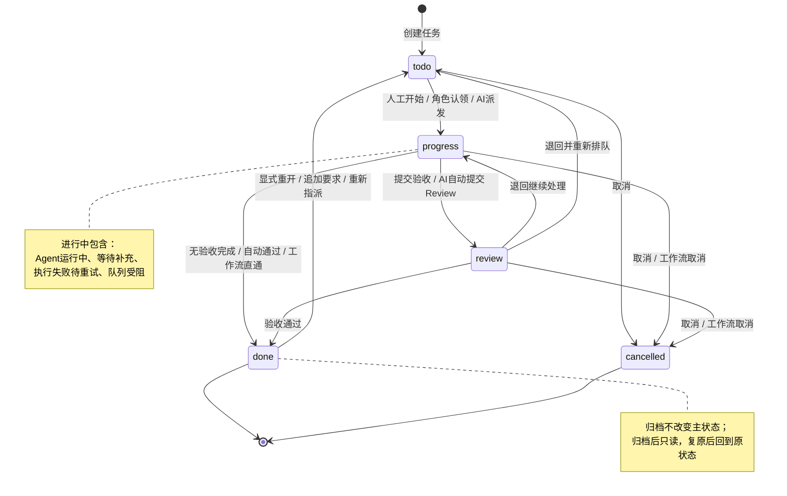
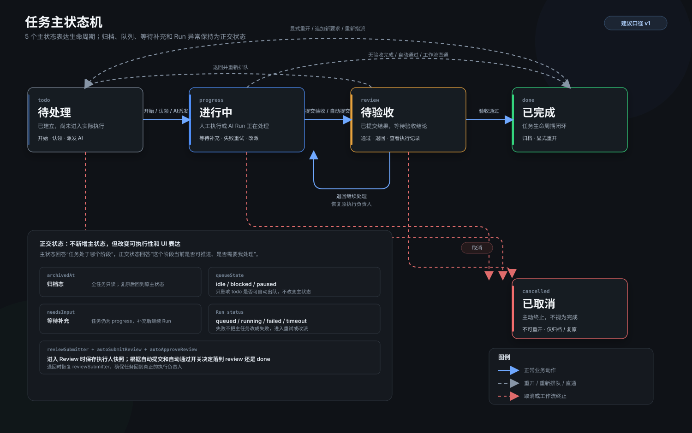

# 任务状态机定义与迁移设计

> 版本：v1  
> 日期：2026-10-31  
> 依据：当前 `dsh-collab-task` 工程实现  
> 图：[任务主状态机](demos/task-state-machine-v1.svg)

## 1. 结论先行

### 1.1 “开始”是什么

`开始`不是新建任务，也不是派发任务。

当前工程中，它表示：

- 任务处于 `todo / 待处理`；
- 当前用户是任务的执行责任人，或任务属于当前用户的 AI伙伴 / 角色；
- 任务不是角色待认领任务；
- 任务不是工作流投影任务；
- 当前用户点击后，服务端执行 `start`，把任务从 `todo` 推进到 `progress / 进行中`，并记录“开始处理”事件。

对应实现链路：

1. 详情页在 `todo + 非角色 + 属于当前用户` 时显示“开始”。
2. 客户端调用 `/api/collab/tasks/action`，`action = "start"`。
3. 服务端 `TaskService.start()` 调用 `setStatus(..., "progress", "开始处理")`。

**产品判断：**

| 负责人类型 | “开始”的必要性 | 建议 |
| --- | --- | --- |
| 人类负责人 | 有必要 | 保留。用于表达“已接单并进入执行”，让 `待处理` 和 `进行中` 有真实区别。 |
| AI伙伴负责人 | 大多数情况下不必要 | 不显示“开始”。任务派发给 AI 后，应由 Run 创建自动进入 `进行中`；无活跃 Run 时显示“重新派发”或“继续执行”。 |
| 角色待认领 | 不适用 | 只显示“认领”。认领成功后直接进入 `进行中`。 |
| 工作流任务 | 不适用 | 不显示“开始”。状态由工作流节点投影，任务详情只提供“打开工作流节点”。 |
| 待指派 | 不适用 | 不显示“开始”，先明确负责人。 |

因此，`开始`应保留为**人工负责人专用动作**，而不是所有 `todo` 任务的通用按钮。

### 1.2 状态模型原则

建议采用“5 个主状态 + 4 类正交标志”的模型：

- 主状态只表达任务生命周期阶段；
- 归档、队列暂停、等待补充信息、Run 异常不新增主状态；
- AI执行失败不等于任务失败，任务仍处于 `进行中`，由重试、改派或人工接管处理；
- 一个任务始终只有一个当前负责人；
- 所有主状态变化必须留下任务动态事件。

## 2. 状态枚举

### 2.1 主状态

| 状态码 | 展示名称 | 定义 | 进入条件 | 退出方式 |
| --- | --- | --- | --- | --- |
| `todo` | 待处理 | 任务已建立，但尚未进入实际执行 | 新建任务、退回待处理、已完成任务显式重开、负责人改为待指派 | 人工开始、角色认领、AI派发、取消 |
| `progress` | 进行中 | 已有人类执行者开始处理，或 AI Run 已接收并执行 | 人工点击开始、角色认领、AI Run 创建、退回继续处理、已完成任务被 Agent 追加要求 | 提交验收、无验收直接完成、取消 |
| `review` | 待验收 | 执行方已提交结果，等待具备权限的人确认 | 人工提交验收、AI成功且自动提交 Review、工作流推进到 Review | 通过、退回 |
| `done` | 已完成 | 任务生命周期闭环 | 验收通过、无 Review 条件直接完成、工作流节点给出最终闭环结论（通过/驳回由 outcome 区分） | 默认只读；通过显式重开回到 `todo` |
| `cancelled` | 已取消 | 任务被终止，不视为完成 | 人工取消（建议新增）、工作流节点取消 | 不可恢复为进行中；仅可归档/复原归档 |

### 2.2 正交状态

这些字段不会改变主状态码，但会改变可执行动作、UI 展示和自动出队逻辑。

| 字段 | 取值 | 含义 | 对状态机的影响 |
| --- | --- | --- | --- |
| `archivedAt` | 有值 / 无值 | 是否归档 | 有值时全任务只读；主状态保持不变，复原后回到原状态 |
| `queueState` | `idle / blocked / paused` | 队列可执行性 | 仅影响 `todo` 是否可自动出队，不改变主状态 |
| `needsInput` | `true / false` | Agent 等待人工补充信息 | 任务仍为 `progress`，补充输入后再继续 Run |
| `autoSubmitReview` | `true / false` | Agent完成后是否自动进入待验收 | 影响 `progress → review` 或留在 `progress` |
| `autoApproveReview` | `true / false` | 工作流提交后是否自动通过 | 影响工作流任务直接进入 `done` |
| `reviewSubmitter` | 负责人快照 | 本轮进入 `review` 前的执行人 | 退回时恢复原执行负责人 |
| Run 状态 | `queued / running / waiting_input / succeeded / failed / timeout / cancelled / interrupted` | AI 执行子状态 | 只有 `queued/running/waiting_input` 能说明 Agent 正在执行；失败/超时后任务通常仍在 `progress` |

## 3. 主状态机





## 4. 状态定义与操作矩阵

图例：

- `✓`：该状态下允许；
- `—`：该状态下不应展示；
- `条件`：仅满足责任人、权限或验收条件时允许；
- `建议`：当前工程尚未完整提供，但状态机需要补齐。

| 操作 | `todo` | `progress` | `review` | `done` | `cancelled` | 状态变化 |
| --- | --- | --- | --- | --- | --- | --- |
| 编辑标题、描述、验收项 | ✓ | ✓ | ✓ | 建议仅通过“重开”编辑 | — | `done` 编辑后建议显式转 `todo` |
| 更换负责人 | ✓ | ✓ | 建议先退回再改派 | 建议通过“重新开启” | — | 改为待指派时回到 `todo` |
| 开始 | 人类负责人 | — | — | — | — | `todo → progress` |
| 认领 | 角色成员 | — | — | — | — | `todo → progress` |
| AI派发 / 指令执行 | 条件 | ✓ | — | 建议禁止 | — | `todo → progress` |
| 勾选验收项 | ✓ | ✓ | ✓ | — | — | 主状态不变 |
| 提交验收 | — | 条件 | — | — | — | `progress → review` |
| 无验收直接完成 | — | 条件 | — | — | — | `progress → done` |
| 通过 | — | — | 验收权限 | — | — | `review → done` |
| 退回继续处理 | — | — | 验收权限 | — | — | `review → progress` |
| 退回并重新排队 | — | — | 验收权限 | — | — | `review → todo` |
| 催办 | 人类任务 | 人类任务 | 人类任务 | — | — | 主状态不变 |
| 发送执行消息 / 指令 | ✓ | ✓ | — | 建议重开后再发 | — | AI任务可触发 `todo → progress` |
| 评论 / 回复 | ✓ | ✓ | ✓ | 建议只读 | — | 主状态不变 |
| 打开 AI执行记录 | 条件 | ✓ | ✓ | ✓ | 只读 | 主状态不变 |
| 重置执行会话 | AI任务 | AI任务 | — | — | — | 主状态不变 |
| 取消任务 | 建议 | 建议 | 建议 | — | — | 任一非终态 → `cancelled` |
| 归档 | 建议仅终态 | 建议仅终态 | 建议仅终态 | ✓ | ✓ | 主状态不变 |
| 复原归档 | — | — | — | 归档时 | 归档时 | 主状态不变 |
| 打开工作流节点 | 工作流任务 | 工作流任务 | 工作流任务 | 工作流任务 | 工作流任务 | 由工作流驱动 |

## 5. 分状态定义

### 5.1 `todo / 待处理`

**业务定义**

任务已经存在，但尚未真正开始。这个状态同时覆盖“已指派但未开工”和“角色待认领”两种情况。

**进入方式**

- 新建普通任务；
- 新建角色任务；
- 已完成任务被显式重开；
- 已进行/待验收任务被改为待指派；
- 工作流把节点投影为 `todo`；
- 从待验收退回并重新排队。

**可用操作**

| 操作 | 发起者 | 结果 |
| --- | --- | --- |
| 开始 | 当前人工负责人 | `todo → progress` |
| 认领 | 当前角色成员 | `todo → progress`，负责人改为认领人 |
| AI派发 | 创建人、项目 owner/admin 或系统 | `todo → progress`，创建 Run |
| 改派 | 有权限的用户 | 负责人变化；改为待指派时保持 `todo` |
| 编辑内容 | 创建人/有权限的用户 | 状态不变 |
| 评论/回复 | 有项目访问权的人 | 状态不变 |
| 取消 | 创建人、项目 owner/admin（建议） | `todo → cancelled` |
| 归档 | 当前工程允许，建议仅终态 | 主状态不变，任务只读 |

**不应允许**

- 未认领的角色任务直接“开始”；
- 无负责人的任务发送执行指令；
- 工作流任务通过看板拖拽改变状态。

### 5.2 `progress / 进行中`

**业务定义**

任务已经进入执行。它可能是：

- 人类正在处理；
- AI Run 正在排队或执行；
- Agent 等待人工补充信息；
- Agent 执行失败或超时，等待重试/改派；
- 任务被人工暂停队列或依赖阻塞。

**进入方式**

- 人工点击“开始”；
- 角色成员认领；
- AI Run 创建；
- 待验收退回继续处理；
- 已完成的 Agent 任务收到新的执行指令；
- 工作流投影为进行中。

**可用操作**

- 提交验收；
- 勾选/取消验收项；
- 追加执行指令；
- 查看当前及历史 AI执行记录；
- 重置 Agent 执行会话；
- 改派负责人；
- 人类任务催办；
- 执行失败后重试或改派；
- 取消任务；
- 归档（建议仅终态）。

**离开条件**

| 条件 | 目标状态 |
| --- | --- |
| `autoSubmitReview = true` 且至少完成 1 个验收项，人工提交 | `review` |
| AI 成功且 `autoSubmitReview = true` | `review`，负责人交回实例 owner |
| `autoSubmitReview = false` 且全部验收项完成，人工提交 | `done` |
| 工作流无需 Review 或 `autoApproveReview = true` | `done` |
| 人工取消 / 工作流取消 | `cancelled` |

**关键规则**

- Run 失败、超时、取消、中断都不直接把任务改成“失败”。任务仍在 `progress`，故障体现在 AI执行记录和任务动态中。
- `needsInput = true` 时仍是 `progress`，不能新增“待补充”主状态。
- 只有当 AI Run 的终态为 `succeeded` 时，才可能自动提交验收。
- AI 协作者被 @ 触发时只回写讨论/执行反馈，不推进任务主状态。

### 5.3 `review / 待验收`

**业务定义**

执行方已经提交可验收结果，任务等待具备验收权限的人给出结论。

**进入方式**

- 人类执行者手动提交验收；
- Agent 成功且 `autoSubmitReview = true`；
- 工作流节点推进到 Review；
- 审批任务由工作流进入待审批。

**验收权限**

满足任一条件即可：

- 平台管理员；
- 任务创建人；
- 工作流指定审批人；
- 项目 owner；
- 具备项目 `approve` 权限的当前角色成员。

**可用操作**

| 操作 | 结果 |
| --- | --- |
| 通过 | `review → done`，进度 100%，验收项完成 |
| 退回继续处理 | `review → progress`，恢复原执行负责人，退回说明必填 |
| 退回并重新排队 | `review → todo`，恢复到队尾，等待重新派发 |
| 查看 AI执行记录 | 只读查看当前轮次 |
| 取消 | `review → cancelled`（建议新增） |
| 归档 | 当前工程允许，建议仅终态 |

**关键规则**

- 退回说明必填，并写入执行历史；
- 进入 `review` 时必须保存 `reviewSubmitter`；
- 通过后未完成验收项统一置为完成；
- 已取消任务不可验收；
- 工作流审批任务必须给出明确审批结论，不能被 Agent 成功结果代替。

### 5.4 `done / 已完成`

**定义**

任务生命周期结束，已形成可追溯的最终结论。

对于普通任务，`done` 表示验收通过或无 Review 完成。  
对于工作流任务，当前工程会把“节点最终通过”或“节点最终驳回”都收口到 `done`，再通过 `workflow.outcome` 区分 `approved / rejected`。

**可用操作**

- 查看内容、评论、执行历史和 AI执行记录；
- 归档；
- 显式追加要求并重开；
- 重新指派并重开；
- 向责任人追加执行消息时重开。

**重开规则**

| 触发 | 结果 |
| --- | --- |
| 编辑内容并追加要求 | `done → todo` |
| 重新指派 | `done → todo` |
| 人类向责任人追加执行消息 | `done → todo` |
| Agent 向任务写回新执行要求 | `done → progress` |
| 只向协作者发送协作评论 | 保持 `done` |

**建议**

窗口化 UI 应把“追加要求 / 重新指派”明确提示为“将重新开启任务”，避免用户误以为只是编辑元数据。

### 5.5 `cancelled / 已取消`

**定义**

任务被主动终止，不能视为成功交付。

**当前工程入口**

主要来自工作流节点取消后的状态投影。

**建议补齐**

- 增加明确的“取消任务”动作；
- 允许任务创建人、项目 owner、平台管理员在 `todo / progress / review` 取消；
- 必须填写取消原因；
- Agent 不能取消整项任务；
- 取消后内容、状态、验收项、指令均只读；
- 取消后只能归档/复原归档，不能重新开始。

## 6. 负责人类型对状态机的影响

### 6.1 人类负责人

```text
创建/指派 → todo
点击开始 → progress
提交验收 → review
验收通过 → done
退回 → progress
```

人类任务是“开始”操作最明确的适用场景。

### 6.2 AI伙伴负责人

```text
创建/指派给 AI → 自动派发 Run → progress
Run 执行中 → progress
需要补充信息 → progress + needsInput
Run 失败/超时 → progress + 异常执行记录
Run 成功 + autoSubmitReview → review
Run 成功 + 无 Review → done
```

AI伙伴任务不应要求用户再点一次“开始”。AI 的执行开始点应是 Run 创建时刻。

### 6.3 角色负责人

```text
创建角色任务 → todo
角色成员认领 → progress
非角色成员 → 不可认领
```

角色任务的第一操作是“认领”，不是“开始”。

### 6.4 工作流投影任务

```text
工作流节点状态 → Task 主状态投影
```

任务详情不能绕过工作流直接推进状态。允许的人工操作主要是：

- 打开工作流节点；
- 在审批节点提交通过/退回结论；
- 查看执行记录；
- 归档已终态任务。

## 7. 工程现状与建议差异

| 项目 | 当前工程现状 | 风险 | 建议 |
| --- | --- | --- | --- |
| `开始`入口 | 客户端按 `todo + 属于当前用户 + 非角色` 显示；服务端 `start` 只要求任务未结且非工作流 | 服务端未严格限制只能从 `todo` 开始 | 服务端增加 `status === todo` 校验；AI负责人不显示该按钮 |
| 通用状态更新 | `/tasks/status` 接受任意 `TaskStatus`；普通任务可被看板拖到任意列 | 可绕过验收、直接 `review → done`，造成语义不一致 | 限定合法迁移；跨阶段操作使用明确动作按钮 |
| 取消能力 | 工作流可产生 `cancelled`；普通任务没有明确取消按钮 | 任务无法正常终止，只能误用“完成”或“归档” | 新增显式取消动作和权限规则 |
| 通过动作 | 客户端只在 `review` 展示“通过” | 服务层 `approve` 未强制检查 `review` | 服务端增加状态守卫 |
| 归档 | 当前服务允许任意状态归档 | 进行中任务被隐藏后，状态理解成本高 | 建议仅允许 `done/cancelled` 归档；如必须支持活动任务归档，需在列表中显示“已归档但未结束” |
| 工作流驳回 | 最终收口为 `done + workflow.outcome=rejected` | “已完成”可能被误读为成功 | 文档明确 `done` 表示“任务闭环”，UI 同时显示审批结论；若业务强依赖成功/失败，再评估新增 `rejected` 终态 |
| 已完成重开 | 编辑、改派、发消息会自动重开 | 容易误改历史 | 保留能力，但操作前明确提示“将重新开启任务” |

## 8. 状态不变量

1. `done` 和 `cancelled` 是终态；普通操作不可修改。
2. `cancelled` 不可重开。
3. `done` 只能通过显式重开或明确的新执行要求进入下一轮。
4. 进入 `review` 时保存执行负责人快照。
5. `review` 退回时恢复 `reviewSubmitter`。
6. `done` 时进度必须为 100%。
7. `cancelled` 不计入完成率，也不满足其他任务的完成依赖。
8. 归档不改变主状态。
9. 当前负责人唯一；协作者和提及人不等于负责人。
10. 主状态每次变化都必须记录 actor、时间、前后状态和触发动作。

## 9. 实施顺序建议

### P0：先收紧状态正确性

1. 给 `start / submit / approve` 增加严格前置状态校验。
2. 限制普通任务的通用状态更新，禁止跳过验收直接完成。
3. 增加明确的任务取消动作、权限和原因字段。
4. 所有 API 校验必须与 UI 可用条件一致。

### P1：优化人机差异

1. 人工负责人保留“开始”。
2. AI负责人隐藏“开始”，改为“派发执行 / 重新派发 / 继续执行”。
3. 把需要补充信息、Run 失败、队列阻塞作为 `progress` 的可见子状态，不扩展主状态。
4. 对已完成任务的追加要求、改派和消息重开增加确认提示。

### P2：统一工作流终态语义

1. 明确 `done` 是“任务闭环”还是“成功完成”。
2. 如果业务必须区分，考虑新增独立 `rejected` 终态，而不是继续复用 `done`。
3. 所有工作流任务展示 `workflow.outcome`，避免只看到“已完成”。

## 10. 验收用例

| 场景 | 预期 |
| --- | --- |
| 人类任务点击开始 | `todo → progress`，任务动态记录“开始处理” |
| AI任务创建后自动派发 | `todo → progress`，不出现人工“开始”按钮 |
| 角色任务由角色成员认领 | `todo → progress`，负责人改为认领人 |
| 无 Review 的 AI 任务成功 | 完成后直接 `done` |
| 有 Review 的 AI 任务成功 | `progress → review`，负责人交回实例 owner |
| Agent 请求补充信息 | 保持 `progress + needsInput=true` |
| Agent 超时 | 保持 `progress`，AI执行记录显示超时 |
| 验收退回 | `review → progress`，恢复原执行负责人 |
| 验收通过 | `review → done`，进度 100%，验收项全部完成 |
| 已完成任务重新指派 | 先进入 `todo`，再按新负责人类型派发 |
| 已取消任务尝试开始/提交/验收 | 全部拒绝 |
| 归档任务复原 | 主状态保持归档前状态 |
| 工作流任务拖拽改状态 | 拒绝，提示由工作流节点控制 |

